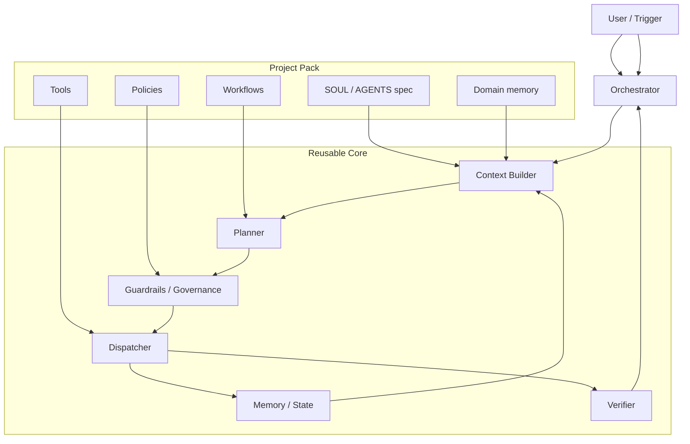

# Agent Template

Reusable template for automation agents.

This repository is designed to be copied onto different automation projects.
The reusable core stays generic. The project pack holds the domain-specific logic.

The structure is also inspired by Google ADK sample-agent repositories and CLI-driven
agent kits, where reusable agent packs, subagents, and workflow folders make the
system easier to extend.

## Where to start

- **Settings UI (for clients):** double-click `EINSTELLUNGEN.bat` (or run
  `python control_panel.py`) — opens a browser page to configure autonomy, models,
  and limits without editing any JSON. See [`control_panel.py`](control_panel.py).
- Architecture doc: [docs/architecture.md](docs/architecture.md)
- Onboarding doc: [docs/onboarding.md](docs/onboarding.md)
- Core runtime: [`core/`](core/)
- Project-specific configuration: [`project/`](project/)
- Current agent entrypoint: [`agent.py`](agent.py)
- CLI entrypoint: [`agent_cli.py`](agent_cli.py)
- Reserved subagents area: [`project/agents/`](project/agents/)

## Architecture



## What each layer does

### Project Pack

The project pack holds everything that is specific to one automation:

- `SOUL.md` for identity, goals, and quality standards
- `AGENTS.md` for operating instructions
- `manifest.json` for the structured agent blueprint
- `workflows/` for repeatable playbooks
- `tools/` for project-specific capabilities
- `policies/` for approval and safety rules
- `knowledge/` for business facts and conventions
- `memory/` for durable learnings

### Reusable Core

The core stays the same across projects:

- `Context Builder` loads project rules and knowledge
- `Planner` breaks tasks into steps
- `Governance` checks risk and approvals
- `Dispatcher` executes tools and subagents
- `Memory` stores task history and learnings
- `Verifier` checks whether the result is good enough
- `Orchestrator` coordinates the full run

### Runtime

Runtime data is operational, not domain-specific:

- task queue
- heartbeat
- logs
- crash recovery

## Execution flow

1. A trigger arrives.
2. The orchestrator loads the current context.
3. The planner drafts the work plan.
4. Governance checks whether the task is allowed.
5. The dispatcher runs the approved step.
6. The verifier checks the result.
7. Memory stores the outcome and the learning.
8. The orchestrator either finishes, retries, or escalates.

## Autonomy

The template ships in **full-autonomy mode** (`autonomy_level: "max"`). The agent
plans, executes, self-verifies, self-corrects, and loops without asking for
human approval — even for destructive or irreversible actions. Risky steps are
still flagged in the run metadata so there is an audit trail.

To re-enable the human approval gate, set `"require_human_approval": true` in
`project/config.json` and list gated terms under `approval_required_for` in
`project/manifest.json`.

## Current status

The new `core/` and `project/` folders are already in the repo as the target structure.
The existing `agent.py` still runs the current implementation.

## CLI

Use the template CLI for setup and status:

```bash
python agent_cli.py setup
python agent_cli.py status
python agent_cli.py run
```

`setup` starts a beginner-friendly wizard. On Windows, `SETUP.bat` starts the same flow.

## Recommended next step

Move `agent.py` to the new orchestrator gradually so the old behavior stays available while we migrate.
