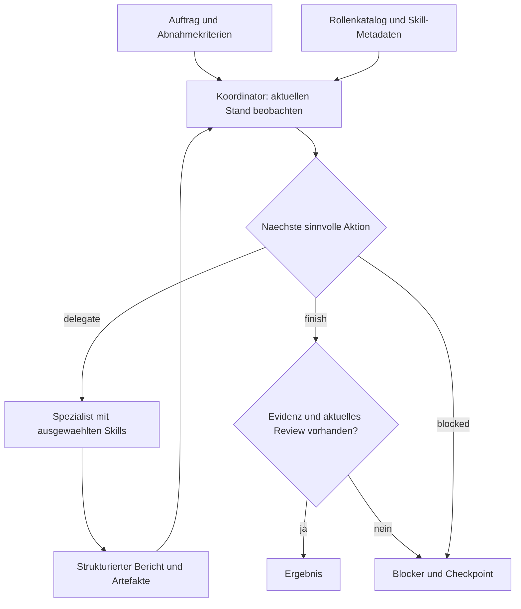

# Architektur und Dynamic Workflow

## Eine kleine gemeinsame Basis

Das Agentenpaket beschreibt **wer** arbeitet und **wie** gute Arbeit aussieht. Der Backendadapter
bestimmt **womit** gearbeitet wird. Paperclip verwaltet **welcher Auftrag wem gehört**.
Diese Grenzen vermeiden die bisherigen agentenspezifischen Kopien von Loops und Tools.

Ein Plan ist eine veränderliche Hypothese. Nach jedem Ergebnis entscheidet das Modell neu.
Die Engine kennt keine Fach-Schlüsselwörter und keinen fest verdrahteten Aufgabenablauf.
Nur die ausdrücklich als Demo benannte Backend-Fixture besitzt deterministische Auswahlregeln.

## Verträge

- `Backend.decide(context, timeout)` liefert `delegate`, `finish` oder `blocked`.
- `Backend.execute(decision, context, timeout)` liefert `success`, `needs_revision` oder `blocked`.
- JSON-Schemas prüfen Form und Größen. Die Engine prüft zusätzlich Rollen-/Skill-Zuordnung,
  Artefaktpfade, Abschluss-Evidenz und den Review-Stand.
- Skill-Metadaten werden zuerst angeboten; nur ausgewählte Skill-Bodies gehen in den Worker-Kontext.
- Zusätzliche Backends implementieren dieses Python-Protocol; CLI-Auswahl explizit ergänzen.
  Es gibt keine automatische Ausführung beliebiger Python-Plugins aus Skill-Ordnern.

`STATUS.md` ist der kanonische Handoff für den aktuellen Stand einer LLM-Session. Die
gemeinsamen Prinzipien stehen im kurzen AGENTS.md. Fachwissen gehört in Skills und
referenzierte Ressourcen. SOUL.md enthält Company-Kontext, keine ständig wachsende Eventhistorie.

## Zustand und Unterbrechungen

Eine Instanz erzeugt pro Lauf `.runs/<uuid>/state.json`. Ein atomarer Dateitausch sichert jeden
Checkpoint. Vor einem Modell-/Worker-Aufruf wird `in_flight` gespeichert; nach einem validierten
Ergebnis wird es entfernt. Nach einem Crash ist dadurch eine möglicherweise bereits ausgeführte
Aktion erkennbar. Keine automatische Wiederholung unbekannter Seiteneffekte.

Neue Läufe speichern die gemeinsamen Anweisungen aus STATUS/AGENTS/SOUL/WORKFLOW
als `core_snapshot`. Planer, Worker und Wiederaufnahme verwenden diesen Stand;
ein explizit abweichender Snapshot kann keine offene Ausführung übernehmen.
Rollen-, Skill- und Laufzeitverträge bleiben getrennt. Die Oberfläche bearbeitet
ausschließlich SOUL.md mit Versionsprüfung und atomarem Dateitausch. Ältere offene
Läufe ohne Snapshot sperren die Bearbeitung; abgeschlossene historische Läufe
werden nicht nachträglich umgeschrieben. Neue Dialognachrichten reservieren ihre
Vorgaben zusammen mit der Nachricht, bevor der Job gestartet wird.

OS-Dateisperren schützen denselben Lauf und denselben Workspace vor parallelen AgentKit-Prozessen.
Sie werden bei Prozessende freigegeben. Das ist keine Sperre gegen Editoren, andere Harnesses oder
Dateizugriffe durch Tools. Das State-File ist ein vertrauenswürdiger lokaler Checkpoint, kein
sicheres Importformat für fremde Laufdaten und kein vollständiges Event-Sourcing-System.

Das kumulative Zeitbudget umfasst Modellaufrufe und Schleifenarbeit, nicht die offline verbrachte
Zeit zwischen zwei Starts. Ein Backend muss das übergebene Timeout einhalten. Der Codex-Adapter
beendet bei Timeout den gestarteten Prozessbaum. Schritte und Fehlschläge bleiben beim Resume erhalten.

## Qualität und Berechtigungen

Jeder mögliche Schreibschritt setzt `dirty`; er entwertet ein früheres Review auch dann,
wenn sein Bericht später einen Fehler meldet. Nur eine nachfolgende erfolgreiche Reviewer-Rolle
mit Evidenz hebt das Review-Gate auf. Ein fehlgeschlagenes Review entwertet es wieder.
Die Engine überprüft existierende Artefaktpfade, aber kann den Wahrheitsgehalt einer Modellbehauptung
nicht generell beweisen. Für kritische Produkte zusätzliche deterministische Abnahmetests im Host.

Die Engine unterstützt nur read-only und workspace-write als Codex-Sandboxauswahl. Auftragsgrenzen,
externe Kommunikation und Veröffentlichungen sind zusätzlich im Prompt definiert. Für untrusted
Workloads separate OS-Benutzer/Container und isolierte Secrets verwenden; keine solche Isolation behaupten.

## Skalierungspfad

### AI Studio als lokale Produktschicht

`cockpit/` bietet Assistentenerstellung und Aufträge über dieselbe Engine. Der HTTP-Server
akzeptiert nur Loopback und gleichursprüngliche Browseranfragen. Agenten-, Ergebnis- und
Modelltexte werden im Browser als Text gerendert. Es gibt keine Remote-Skriptressourcen.

Vor dem Dispatch speichert ein Auftrag seine eindeutige Run-ID. `Engine.run(new_run_id=...)`
erstellt genau diesen Checkpoint; vorhandene Checkpoints verlangen den Resume-Pfad.
Eine vom Browser gehaltene `request_id` identifiziert wiederholte Startanfragen, auch nach
Neustart. Gleiche ID mit verändertem Inhalt wird abgelehnt. Der Browser bewahrt ungeklärte
Anfragen für sichere Wiederholung in sessionStorage auf. Maximal vier Jobs sind gleichzeitig
aktiv; eine Server-Sperre verhindert konkurrierende Prozesse für denselben Job-Speicher.

Folgeaufträge sind neue Läufe mit dem letzten abgeschlossenen Auftrag und dessen
Zusammenfassung als Kontext. Company-, Agenten-, Backend- und Workspace-Bindung bleiben
erhalten. Downloads beschränken sich auf protokollierte Artefaktpfade im Workspace.
Kann der Host ein neu erzeugtes Codex-Artefakt unter der elevated-Windows-Sandbox
nicht direkt lesen, verwendet `agentkit/codex_artifacts.py` den offiziellen Codex-
App-Server mit read-only-Sandbox und deaktiviertem Netzwerk. Der Export bleibt auf
den gebundenen Workspace und 2 MB begrenzt und prüft Länge sowie SHA-256.
Die Dateien können nach dem Review verändert worden sein; die Oberfläche behauptet keinen
unveränderlichen Artefakt-Snapshot. DeepSeek, Demo und der öffentliche Codex-
Freigabemodus unterstützen konkrete [Aktionsfreigaben](ACTION-APPROVALS.md). Codex
liefert read-only strukturierte Vorschläge; der Host-Executor führt ausschließlich
Allowlist-Aktionen nach exakter Bestätigung aus. Das ersetzt keine native per-tool
interception der Codex CLI.

`cockpit/conversations.py` bindet dauerhafte Dialoge an Agent, Company, Workspace,
Backend und Modell. Eine Nachricht wird vor dem Jobstart mit stabiler ID gespeichert;
dieselbe ID dient als Dispatch-Schlüssel. Pro Dialog darf nur ein Schritt aktiv sein.
Vorherige sichtbare Antworten werden als Kontext übergeben. Kontext- und Nachrichtengrenzen
führen zu einem expliziten Fehler statt stiller Kürzung. Reservierungen ohne Job erfordern
eine bewusste Wiederholung; unbekannte Ergebnisse bestehender Jobs bleiben im Resume-Pfad.
Ältere abgeschlossene Jobs werden bei Bedarf von der Platte geladen; der Speichercache
begrenzt weder die Wiederherstellung offener Jobs noch den dauerhaften Dialogverlauf.

`cockpit/attachments.py` speichert begrenzte UTF-8-Dateien außerhalb des Workspace.
Unveränderliche Metadaten, Originalbytes und Hash sind an den Dialog und dessen
Company-/Agent-/Workspace-Kontext gebunden. Nachrichtenduplikate vergleichen auch
Anhangs-IDs. Erst beim Senden werden verifizierte Dateitexte als Referenzdaten in den
Ausführungskontext eingefügt. HTTP-Downloads erzwingen Anhangsbehandlung; Quelltext
und HTML werden nicht importiert oder ausgeführt. Siehe [ATTACHMENTS.md](ATTACHMENTS.md).

`cockpit/github_connector.py` liefert eine ausdrücklich angeforderte öffentliche
GitHub-Textvorschau über einen festen HTTPS-Endpunkt. Antwortgröße, Parallelität,
Metadaten und Git-Blob-Hash werden geprüft. Erst die separate Übernahme im Browser
macht daraus einen normalen Anhang mit Quellenheader. Jobstart und Upload-Retries
greifen auf diese gespeicherten Bytes zu; die Engine ruft den Connector nicht
selbstständig auf. Siehe [GITHUB-CONNECTOR.md](GITHUB-CONNECTOR.md).

DeepSeek erzwingt Rollenrechte vor der Toolausführung und zählt auch gebündelte Toolcalls.
Testprozesse erhalten eine kleine Umgebungs-Whitelist statt Server-Credentials. Das ist
keine OS-Sandbox: lokale Testprogramme bleiben ausführbarer, vertrauenswürdiger Code.

### Company-weite Erweiterung

Werkzeugfreigaben werden vor Dispatch als `pending_approval` gespeichert. Der Status
`awaiting_approval` hat kein `in_flight`; eine verbrauchte Freigabe wird auditiert.
Bei Fortsetzung läuft derselbe Worker mit gespeicherter Modellfortsetzung weiter,
ohne erneuten Planeraufruf. Vor Ausführung wird die Fortsetzung aus dem persistenten
Resume-Feld entfernt und der Worker als laufend markiert. Ein unbekannter Ausgang
darf nur mit neuer Evidenz neu geplant werden. Das Backend bleibt für die konkrete
Werkzeuggrenze verantwortlich; die Engine behauptet keine native CLI-Abfangbarkeit.
Vor dem Host-Executor werden der Digest des sichtbaren Manifests und eine getrennte,
dateisystemkanonische Replay-Identität geprüft. Unter Windows vereinheitlicht sie
Groß-/Kleinschreibung und vorhandene 8.3-Aliase. Pre-upgrade pending approvals ohne
diese Identität werden fail-closed verworfen und neu geplant.

1. Ein Agentenpaket, wenige Skills, messbare Aufgaben; Fehlversuche und Ergebnisqualität beobachten.
2. Neue Rollen per Konfiguration; Skills fachlich schmal halten. Kein kopierter Agenten-Code.
3. Mehrere Prozesse mit separaten Worktrees. Ein Auftrag bleibt genau einem Owner zugewiesen.
4. Paperclip übernimmt Warteschlange, Checkout, Heartbeat und monetäre Budgets. Dieser Runner
   erzeugt bewusst keinen zweiten globalen Scheduler oder eine konkurrierende Message-Bus-Datei.
5. DeepSeek Harness kann die komplette lokale Ausführung übernehmen; native Plugins, Session-Logs
   und Subagent-Scheduling dort verwenden. Kein zweiter Plugin-Kernel in diesem Repository.

Bewusst noch nicht enthalten: verteilte Queue, Live-Paperclip-Synchronisierung, Token-/Euro-Abrechnung,
automatisches Skill-Downloading, autorisierte Deploy-/Outreach-Tools oder autonome Selbstmodifikation.
