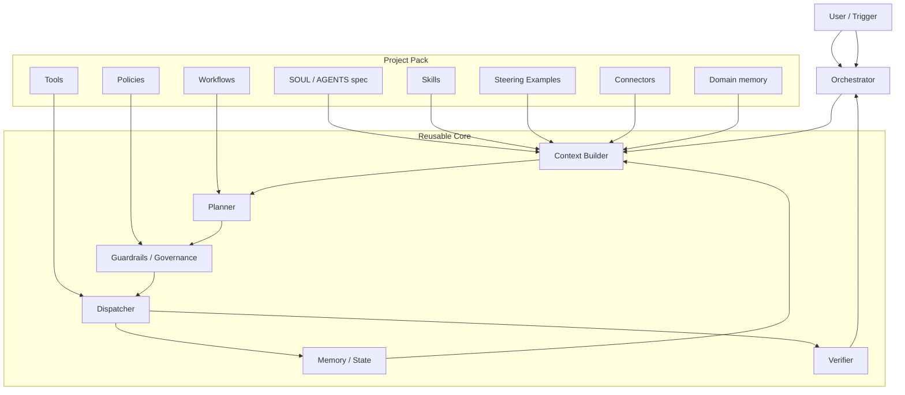

# Automation Agent Architecture

This document describes the reusable structure for all automation projects built on this template.

## Goal

Use one stable core and attach different project packs on top of it.
That lets us reuse the same agent skeleton for Excel automation, CRM workflows, report generation, support triage, and other domain tasks.

## High-Level View



## Layers

### Project Pack

The project pack holds all domain-specific material:

- `SOUL.md` for identity, goals, and quality standards
- `AGENTS.md` for instructions and operating rules
- `manifest.json` for the structured blueprint that powers the planner
- `workflows/` for repeatable task playbooks
- `tools/` for project-specific capabilities
- `policies/` for approvals, write limits, and safety rules
- `knowledge/` for business facts, conventions, and reference material
- `agents/` for specialized subagents
- `memory/` for durable project learnings
- `skills/` for domain-specific task playbooks (see Skills section)
- `steering-examples.json` for few-shot planner guidance
- `connectors.yaml` for declared external data sources (MCP servers)

### Reusable Core

The reusable core stays the same across projects:

- `Context Builder` loads project pack information including skills, examples, and connectors
- `Planner` breaks tasks into steps; uses steering examples and skill hints
- `Guardrails / Governance` checks risk, approval rules, leaf-write pattern, and connector declarations
- `Dispatcher` executes tools and subagents
- `Memory / State` stores task history and learnings
- `Verifier` checks whether the output is good enough
- `Orchestrator` coordinates the full run

### Runtime

Runtime assets are operational, not domain-specific:

- task queue
- heartbeat
- logs
- crash recovery

## Key Concepts

### Skills

Skills are focused, reusable task playbooks — finer than an agent, coarser than a tool.

```
project/skills/
  <skill-name>/
    SKILL.md              ← description, triggers, workflow, output spec
    references/           ← backing material (optional)
      workflow.md
      best-practices.md
```

The planner matches skill `triggers` against the task text and injects the relevant
SKILL.md (and its references) into the active subagent's context.

### Steering Examples

`project/steering-examples.json` provides a small set of labeled input examples.
The planner uses these as few-shot guidance to choose the right skill and subagent
for unfamiliar task phrasings.

```json
[
  {
    "input": "Erstelle eine Marktanalyse für Sektor X",
    "expected_skill": "market-research",
    "expected_subagent": "researcher"
  }
]
```

### Connectors

All external data sources (MCP servers, APIs) must be declared in `project/connectors.yaml`
before use. The governance layer blocks any connector that is not on the list.

```yaml
connectors:
  - name: capiq
    url_env: CAPIQ_MCP_URL
    description: "Capital IQ — Finanzdaten"
```

### Leaf-Write Pattern

Subagents are **read-only by default**. Only one subagent per chain — the leaf — may
produce persistent output. The leaf is declared with `can_write: true` in its
AGENT.md frontmatter. The governance layer enforces this at runtime.

```
researcher (read-only) → verifier (read-only) → reporter (can_write: true) ← leaf
```

This makes the write surface auditable and prevents uncoordinated writes.

### Model Selection

```json
"model": {
  "default": "claude-sonnet-4-6",
  "planner": "claude-sonnet-4-6",
  "subagents": "claude-haiku-4-5"
}
```

Individual subagents can override the default via `model:` in their AGENT.md frontmatter.

### Tool Permissions

Tools are disabled by default. The manifest declares which are allowed:

```json
"tool_permissions": {
  "default": "disabled",
  "enabled": ["read", "grep", "glob", "web_search", "notify"],
  "write_restricted_to_leaf": true
}
```

## Execution Flow

1. A trigger arrives.
2. The orchestrator loads the current context (including skills, examples, connectors).
3. The planner drafts the work plan using steering examples and skill hints.
4. Governance checks whether the task is allowed (risk, approval, connector, leaf-write).
5. The dispatcher executes the approved step, injecting the matched skill into the subagent.
6. The verifier checks the result.
7. Memory stores the outcome and any learnings.
8. The orchestrator either finishes, retries, or escalates.

## Core Rule

The core must never contain customer-specific logic.
If a behavior is specific to one project, it belongs in `project/`.

## Why This Matters

- We can reuse the same agent skeleton for many automations.
- We can add new project packs without rewriting the runtime.
- We can test the core separately from the domain layer.
- We can keep safety and quality rules consistent across projects.
- Skills make domain knowledge portable and testable independently of the agent runtime.
- Steering examples eliminate guesswork for the planner on new phrasings.
- The leaf-write pattern and connector declarations give a complete audit trail of every external interaction.

## Onboarding

See [docs/onboarding.md](onboarding.md) for the guided interview that turns a new project into an actual agent pack.
