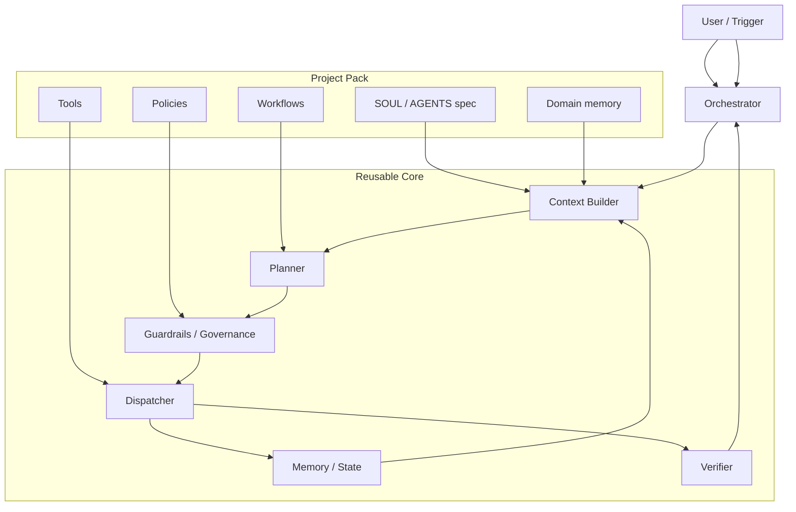

# Automation Agent Architecture

This document describes the reusable structure for all automation projects built on this template.

## Goal

Use one stable core and attach different project packs on top of it.
That lets us reuse the same agent skeleton for Excel automation, CRM workflows, report generation, support triage, and other domain tasks.

This layout is also influenced by Google ADK sample-agent repositories: separate
agent packs, workflow folders, and specialized subagents make the system easier
to scale without mixing core behavior with domain-specific logic.

## High-Level View

## Layers

### Project Pack

The project pack holds all domain-specific material:

- `SOUL.md` for identity, goals, and quality standards
- `AGENTS.md` for instructions and operating rules
- `workflows/` for repeatable task playbooks
- `tools/` for project-specific capabilities
- `policies/` for approvals, write limits, and safety rules
- `knowledge/` for business facts, conventions, and reference material
- `agents/` for specialized subagents
- `memory/` for durable project learnings

### Reusable Core

The reusable core stays the same across projects:

- `Context Builder` loads project pack information
- `Planner` breaks tasks into steps
- `Guardrails / Governance` checks risk and approval rules
- `Dispatcher` executes tools and subagents
- `Memory / State` stores task history and learnings
- `Verifier` checks whether the output is good enough
- `Orchestrator` coordinates the full run

### Runtime

Runtime assets are operational, not domain-specific:

- task queue
- heartbeat
- logs
- crash recovery

## Execution Flow

1. A trigger arrives.
2. The orchestrator loads the current context.
3. The planner drafts the work plan.
4. Governance checks whether the task is allowed.
5. The dispatcher executes the approved step.
6. The verifier checks the result.
7. Memory stores the outcome and any learnings.
8. The orchestrator either finishes, retries, or escalates.

## Core Rule

The core must never contain customer-specific logic.
If a behavior is specific to one project, it belongs in `project/`.

## Why This Matters

- We can reuse the same agent skeleton for many automations.
- We can add new project packs without rewriting the runtime.
- We can test the core separately from the domain layer.
- We can keep safety and quality rules consistent across projects.

## Onboarding

See [docs/onboarding.md](onboarding.md) for the guided interview that turns a new project into an actual agent pack.
