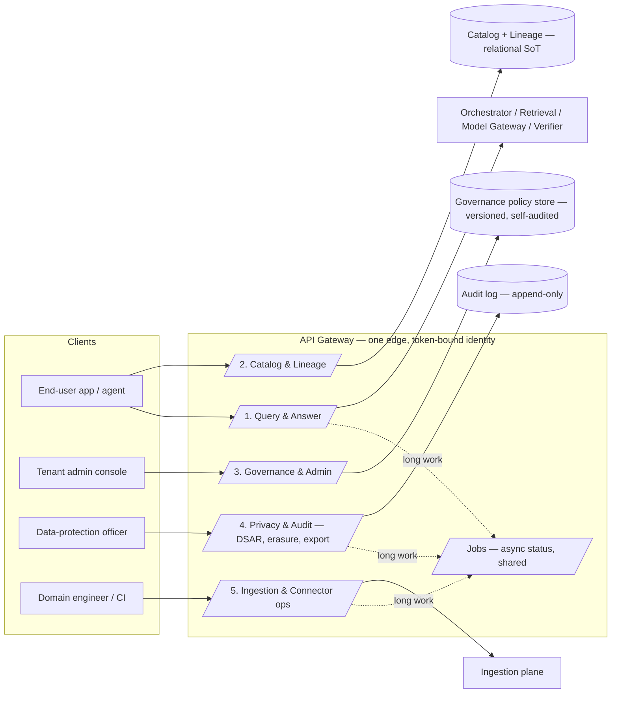

# API — External Surface, Contracts & Versioning

> Status: **Seeded** · Owner: Platform / Enterprise Architecture · Cycle: 9

This document specifies the **external contract** of the platform: the endpoints
clients call, the identity they must present, the shape of every response, how
long-running work is exposed, and how the surface evolves without breaking callers.

It is the **last major un-seeded platform surface**. Everything below is a *contract*,
not a new component — the API is the outward face of the [API Gateway](../architecture/01-platform-overview.md)
(Plane 1) and the [Governance policy store](../governance/00-governance-and-audit.md).
Three prior cycles queued concrete client-facing needs onto this document; §5–§9
discharge them. The cross-component contract decisions are recorded in
**[ADR-0014](../architecture/adr/ADR-0014-api-contract-surface.md)**.

---

## 1. What the API must satisfy (inputs, not choices)

These are **obligations inherited** from earlier cycles. The API does not get to
re-decide them; it must expose them faithfully.

| # | Obligation | Source |
|---|-----------|--------|
| A1 | The request must **carry the end-user subject identity** so query-time enforcement runs against the *real* user, never a service account. | [Permissions §3–§4](../permissions/00-authorization-model.md), [ADR-0004](../architecture/adr/ADR-0004-permission-faithful-retrieval.md) |
| A2 | An answer is **cited and verifier-gated**; the contract must expose citations and the verifier verdict, and must be able to return "no accessible information" as a *success*, not an error. | [RAG §6–§7](../rag/00-retrieval-pipeline.md) |
| A3 | The admin surface must let a tenant admin drive the **Governance policy store** — labels, budgets, retention, model pinning — because Governance owns *policy, not mechanism* and needs an entry point. | [Governance §4, §5, §7, §8](../governance/00-governance-and-audit.md) |
| A4 | **DSAR / right-to-erasure / audit-export** must be callable and their progress observable, because Governance made them SLA-bound workflows and audit-as-evidence. | [Governance §5, §6](../governance/00-governance-and-audit.md) |
| A5 | **Catalog-browse / lineage / DSAR-status** must be queryable, because Metadata made these provable traversals and handed up the surface. | [Metadata §5, §6, §11](../metadata/00-catalog-and-lineage.md) |
| A6 | Every call is **tenant-scoped and audited**; a budget cap or policy must never be relaxable through the API, and the API must never become a way to skip the ACL filter. | [Governance §7](../governance/00-governance-and-audit.md), [Security](../security/00-security-architecture.md) |
| A7 | The surface must **version and deprecate** without forcing lock-step client upgrades — new domains/packs arrive continuously (the core scalability bet). | [Vision](../architecture/00-vision-and-principles.md) |

**Why a single documented contract (and not per-service ad-hoc APIs).** Without one
contract, each plane would leak its own shape to clients, every new pack would invent
its own request format, and the permission-carrying discipline (A1) would be re-argued
per endpoint — the exact failure the [canonical permission model](../permissions/00-authorization-model.md)
was created to avoid, one layer up. One envelope, one identity rule, one versioning
policy makes "new domain = pack, not redesign" true at the edge too.

---

## 2. Design tenets (the API-specific principles)

Six rules govern every endpoint. They are the outward projection of the platform
principles.

1. **Identity travels in the token, not the URL or body (A1, A6).** The subject, the
   tenant, and the delegation chain are proven by the bearer token. A client cannot
   *assert* "I am user X in tenant Y" as a parameter — that would make impersonation a
   request field. Tenancy is therefore **not** in the URL path. See §4.
2. **Fail-closed at the edge.** Invalid/expired token → `401` before any plane runs.
   Valid token, no permitted data → `200` with an explicit empty-grounding answer
   (A2). A budget/policy block → `4xx` that *denies capability*, never a silent
   downgrade of safety ([Governance §7.3](../governance/00-governance-and-audit.md)).
3. **One response envelope (§6).** Every endpoint — query, admin, catalog, job status —
   returns the same `{ ok, data, error, meta }` shape. Errors are structured and
   typed, never a bare string or an HTML stack trace (Security: no leak via errors).
4. **Long work is a job, not a held connection (§10).** Ingestion, erasure, re-embed,
   audit-export are asynchronous. The API returns a `job_id` and a status URL; the
   client polls or subscribes. Only the *query* answer may stream, because it is
   latency-bound and user-facing.
5. **Reads are idempotent; writes are idempotent by key.** Every mutating call accepts
   an `Idempotency-Key`; a replay returns the original result, never a double effect.
   This mirrors the ingestion plane's [at-least-once + idempotent writes](../workers/00-ingestion-architecture.md)
   discipline at the edge.
6. **Versioned and deprecable (A7, §11).** A client pins a major version; the platform
   may add fields freely but removes/renames only across a major with a deprecation
   window. No caller breaks silently.

---

## 3. Surface map

The API divides into **five resource groups**, aligned to who calls them and which
plane/policy owns them.



| Group | Primary caller | Owns | Backing |
|-------|---------------|------|---------|
| **1. Query & Answer** | end-user app / agent | ask a question, get a cited answer | Orchestrator → Retrieval → Model Gateway → Verifier |
| **2. Catalog & Lineage** | end-user app, DPO | browse what exists (permission-filtered), trace provenance | [Metadata](../metadata/00-catalog-and-lineage.md) |
| **3. Governance & Admin** | tenant admin | tenant policy, budgets, labels, model pinning | [Governance policy store](../governance/00-governance-and-audit.md) |
| **4. Privacy & Audit** | DPO / compliance | DSAR, right-to-erasure, audit-export | [Governance §5–§6](../governance/00-governance-and-audit.md) |
| **5. Ingestion & Connector ops** | domain engineer / CI | register/health/backfill a connector, view DLQ | [Workers](../workers/00-ingestion-architecture.md), [Connectors](../workers/01-connector-framework.md) |
| **Jobs** | any of the above | poll/subscribe to async work | shared job store |

---

## 4. AuthN / AuthZ at the edge

The gateway is the **only** actor that turns a token into an identity context; every
downstream plane trusts that context and never re-parses the raw token. This is the
API expression of [Permissions §3.2](../permissions/00-authorization-model.md).

**Token → subject.** Clients present an OIDC/SAML-issued **bearer token** (from the
enterprise IdP, [Overview §1](../architecture/01-platform-overview.md)). The gateway:

1. Validates signature, expiry, audience, and issuer (fail-closed on any).
2. Resolves the **tenant** from the token's issuer/claim — never from the URL (§2.1).
3. Derives the **Subject** and, via the identity graph, the **effective principals**
   ([Permissions §4](../permissions/00-authorization-model.md)) — cached against a
   short revocable TTL bound by the [freshness SLA](../governance/00-governance-and-audit.md).
4. Builds the immutable **identity context** `{ tenant, subject, principals[],
   labels_clearance, delegation }` passed to the Orchestrator.

**Delegation / on-behalf-of (agents & service integrations).** A calling agent or app
may act for a user via **token exchange** (RFC 8693 style): it presents its own client
credential *plus* the user's subject token, and receives a delegated token whose
identity context carries `delegation = { actor, subject }`. Retrieval still runs under
the **subject's** effective principals — the actor never widens access. This is the
edge counterpart of [Permissions §10 OBO](../permissions/00-authorization-model.md);
for the highest-risk classes the connector may additionally read live as the user.

**Client credentials (no user).** Admin/ingestion automation (groups 3 & 5) uses a
**client-credentials** token scoped to a tenant with an admin role. It has **no
end-user principals**, so it can **never** call the query endpoint and receive
user-restricted content — a service account cannot read knowledge, only administer.
This structurally prevents the "index-everything under a service account" anti-pattern
([Overview §8](../architecture/01-platform-overview.md)) from re-entering via the API.

**Authorization tiers.** Three coarse scopes, refined by tenant RBAC:
`query` (end user), `admin` (tenant policy/config), `dpo` (privacy/audit). Audit-log
**read** is `dpo`-gated and itself audited ([Governance §6.2](../governance/00-governance-and-audit.md)).

---

## 5. Group 1 — Query & Answer (the core contract)

The one endpoint the whole platform exists to serve. Request carries a question;
identity comes from the token (§4). Two response modes; **same verifier gate** applies
to both.

### 5.1 Synchronous ask

```
POST /v1/answers
Authorization: Bearer <subject-or-delegated token>
Idempotency-Key: <uuid>        # optional; dedupes retried asks
{
  "query": "What is our revenue-recognition policy for multi-year SaaS?",
  "options": {
    "pack": "finance",           # optional domain-pack hint; identity still governs
    "max_citations": 10,
    "latency_mode": "balanced"   # fast | balanced | thorough → rerank/MMR dial (RAG §5)
  }
}
```

Success (`200`), in the standard envelope (§6):

```jsonc
{
  "ok": true,
  "data": {
    "answer": "Under IFRS 15 the platform ...",
    "citations": [
      { "n": 1, "resource_id": "…", "source_item_version": "…",
        "section_path": "3.2/Table-1", "snippet": "…", "uri": "…" }
    ],
    "verifier": { "verdict": "pass", "grounded": true, "label_compliant": true },
    "grounding": "grounded"      // grounded | no_accessible_information | refused
  },
  "error": null,
  "meta": { "request_id": "…", "model_version": "…", "api_version": "v1",
            "usage": { "tokens_in": 0, "tokens_out": 0 } }
}
```

**Contract invariants (A2):**
- `grounding: "no_accessible_information"` is a **`200` success**, not a `404` — the
  user asked a valid question; the platform truthfully has nothing they may see. The
  API must never let "no permitted chunks" masquerade as an error (which could leak
  *existence*).
- Every factual clause maps to a citation; `citations` is empty **iff** `grounding` is
  not `grounded`. A `pass` verdict with zero citations and `grounded: true` is a
  contract violation and is rejected before it reaches the client.
- `verifier.verdict ∈ {pass, repaired, refused}` is always present — the caller can see
  the guardrail decision ([RAG §7.1](../rag/00-retrieval-pipeline.md)).
- Citations expose the **canonical identifiers** (`resource_id` + `source_item_version`)
  from [Metadata §3](../metadata/00-catalog-and-lineage.md) so a client can deep-link
  into Group 2 lineage — but **only** to items the subject may see (the citation itself
  passed the ACL filter).

### 5.2 Streaming ask (SSE)

```
POST /v1/answers:stream        # same body; server-sent events
```

Emits `token` events as the model generates, then a terminal `final` event carrying the
**same envelope** as §5.1. **Critical gate:** tokens stream, but the answer is not
*contractually complete* until the `final` event, which is emitted **only after the
verifier passes**. If the verifier repairs or refuses, the stream sends a `repair`/
`refuse` event and the partial tokens are superseded by the terminal payload. Streaming
never bypasses grounding — it is a latency-perception optimization, not a safety
exception. Only the query endpoint streams (tenet 4); everything else is a job (§10).

### 5.3 Conversational context

A `conversation_id` may be supplied to thread follow-ups. History is stored in the
per-tenant [cache/session store](../storage/00-storage-architecture.md) under the same
tenant isolation, expires on the cache retention schedule
([Governance §5.1](../governance/00-governance-and-audit.md)), and is **re-filtered
every turn** — prior turns never grant access to content the user has since lost
(query-time principal precedence, [Permissions §8](../permissions/00-authorization-model.md)).

---

## 6. The response envelope & error model

**One envelope, every endpoint** (tenet 3). This is the platform's realization of the
["consistent API response format" pattern](../../project/skills/):

```jsonc
{
  "ok": true|false,
  "data":  { … } | null,      // payload on success
  "error": null | {           // populated iff ok=false
    "type":    "permission_denied|not_found|validation|rate_limited|budget_exceeded|policy_blocked|conflict|internal",
    "message": "human-readable, leak-free",
    "details": { … },         // structured, safe field-level info
    "retriable": true|false
  },
  "meta": {
    "request_id": "…",        // == audit correlation id
    "api_version": "v1",
    "page": { "cursor": "…", "has_more": true }   // present on collections
  }
}
```

**Error rules.**
- Errors are **typed enums**, so clients branch on `type`, not on a message string.
- Messages never leak internals — no stack traces, SQL, source paths, or the *existence*
  of resources the caller can't see (`permission_denied` and `not_found` are chosen so
  that a hidden resource returns `not_found`, never "you lack permission for X", which
  would confirm X exists).
- `request_id` equals the **audit correlation id** — a client can quote it to support
  and it resolves to the exact [audit trace](../governance/00-governance-and-audit.md).
- Status-code map: `400` validation · `401` unauthenticated · `403` authorization
  scope · `404` hidden-or-absent · `409` idempotency/version conflict · `422` policy
  block · `429` rate/budget · `5xx` internal (retriable).

---

## 7. Group 3 — Governance & Admin (the policy-store API)

The tenant admin surface is a **thin, versioned, self-auditing CRUD** over the
[Governance policy store](../governance/00-governance-and-audit.md). It adds no policy
logic — it is the entry point Governance said it needed (A3). **Every write here is
itself an audited governance event** ([Governance §6](../governance/00-governance-and-audit.md)).

| Endpoint | Purpose | Policy owner |
|----------|---------|--------------|
| `GET/PUT /v1/admin/policy/labels` | tenant label→action overrides (**tighten only**) | [Governance §4](../governance/00-governance-and-audit.md) |
| `GET/PUT /v1/admin/policy/retention` | retention/legal-hold overrides | [Governance §5](../governance/00-governance-and-audit.md) |
| `GET/PUT /v1/admin/budgets` | per-tenant/pack budget envelopes | [Governance §7](../governance/00-governance-and-audit.md) |
| `GET     /v1/admin/usage` | metering rollups (tenant→pack→workload) | [Governance §7.2](../governance/00-governance-and-audit.md) |
| `GET/PUT /v1/admin/models` | approved-model pinning / rollback | [Governance §8](../governance/00-governance-and-audit.md) |
| `GET/PUT /v1/admin/connectors` | connector allowlist (`connectors.yaml`) | [ADR-0007](../architecture/adr/ADR-0007-client-configuration-surface.md) |

**Hard invariant (A6):** a `PUT` that would **loosen** a platform-owned floor — widen a
label capability, disable the ACL filter, relax a P0 revocation, raise a budget above a
contracted ceiling — is rejected `422 policy_blocked`. The API can only ever **tighten**
relative to the platform default ([Governance §4.1](../governance/00-governance-and-audit.md)).
This is the same "labels can only subtract capability" invariant, enforced at the edge.
Model promotion goes through the **eval-before-promotion gate**
([Governance §8](../governance/00-governance-and-audit.md)); the API cannot pin an
unapproved model.

> This is the successor entry point to the local `control_panel.py` settings UI
> ([ADR-0007](../architecture/adr/ADR-0007-client-configuration-surface.md)): the
> template's single-tenant local panel becomes the multi-tenant admin API. Same
> concerns (autonomy, models, limits, connectors), now tenant-scoped and audited.

---

## 8. Group 4 — Privacy & Audit (DSAR, erasure, export)

These discharge A4. All three are **jobs** (§10) because Governance made them SLA-bound
workflows with cross-store propagation, not instant reads.

| Endpoint | Returns | Backing |
|----------|---------|---------|
| `POST /v1/privacy/dsar` | `job_id` — assemble a subject's data across stores | [Governance §5.2](../governance/00-governance-and-audit.md) |
| `POST /v1/privacy/erasure` | `job_id` — right-to-erasure (GDPR Art. 17) | [Governance §5.2](../governance/00-governance-and-audit.md), [Storage §9](../storage/00-storage-architecture.md) |
| `GET  /v1/privacy/{job_id}` | DSAR/erasure **status** + completeness proof | [Metadata §5.2, §6](../metadata/00-catalog-and-lineage.md) |
| `POST /v1/audit/export` | `job_id` — filtered audit-log export (`dpo` scope) | [Governance §6](../governance/00-governance-and-audit.md) |

**Erasure is provable, not asserted.** The status response returns the
[lineage-tombstone](../metadata/00-catalog-and-lineage.md) evidence: the graph walk
showing every derived artifact (`source→raw→parsed→chunk→vector`) was tombstoned or
erased, with the **audit trail itself exempt** and the **erasure recorded as an audit
event**. `legal_hold` on a matter **blocks** erasure and the job returns `422
policy_blocked` naming the hold (precedence `legal-hold > erasure > retention`,
[Governance §5.3](../governance/00-governance-and-audit.md)).

**Audit-export** is a `dpo`-scoped job whose own invocation is audited; it can serve as
the [SLA/compliance evidence](../governance/00-governance-and-audit.md) bundle for a
regulator without granting standing audit read access.

---

## 9. Group 2 — Catalog & Lineage (browse & provenance)

Discharges A5. Read-only, **permission-filtered by the same predicate as retrieval** —
browsing the catalog can never reveal an item the subject couldn't retrieve.

| Endpoint | Purpose |
|----------|---------|
| `GET /v1/catalog/documents` | list Documents/Items the subject may see (paginated, filterable by pack/label/source) |
| `GET /v1/catalog/documents/{resource_id}` | one catalog entry (Doc→Item→Chunk→Version, [Metadata §3](../metadata/00-catalog-and-lineage.md)) |
| `GET /v1/catalog/lineage/{resource_id}` | forward/backward lineage traversal (provenance of a cited answer) |

**Filter parity invariant.** The catalog list endpoint applies the **identical**
`principals` set-overlap + `tenant_id` + `acl_confidence=exact` predicate used by
[Retrieval §4.2](../rag/00-retrieval-pipeline.md). There is no "list mode" that skips
the filter — otherwise catalog browse would become a permission side-channel that leaks
existence and titles. Lineage is exposed at the **Item** granularity that carries the
ACL, so a subject sees provenance only for content they may read.

---

## 10. Cross-cutting contracts

### 10.1 Asynchronous jobs

Long work returns immediately with a job handle; the client polls or subscribes.

```
POST /v1/privacy/erasure  →  202 { "ok": true, "data": { "job_id": "job_…", "status_url": "/v1/jobs/job_…" } }
GET  /v1/jobs/job_…       →  200 { "ok": true, "data": { "state": "running|succeeded|failed",
                                                          "progress": 0.6, "result": null|{…} } }
```

Job `state` is a closed enum; `result` is populated only on `succeeded`. Jobs are
tenant-scoped and their lifecycle events are audited. This single pattern serves DSAR,
erasure, audit-export, connector backfill, and re-embed — one shape, not five.

### 10.2 Pagination, filtering, sorting

Collections use **opaque cursor pagination** (`meta.page.cursor` / `has_more`) — not
offset, which is unstable under concurrent ingestion and leaks total counts. Filtering
is via typed query params validated at the boundary (fail-fast, [coding-style: input
validation](../../rules/common/coding-style.md)); an unknown filter is `400`, never
silently ignored (silent-ignore is how a client thinks it's scoped when it isn't).

### 10.3 Rate limiting & budget coupling

Per-token and per-tenant rate limits return `429` with a `Retry-After` header.
**Rate/budget limits couple to Governance** ([§7.3](../governance/00-governance-and-audit.md)):
crossing a budget envelope degrades *capability* (cheaper model tier, deferred P2) and,
at the ceiling, returns `429 budget_exceeded` for new low-priority (P2) work — but a
`429` can **never** be returned for a **P0 revocation or an ACL check**. The API
throttles cost, never safety (A6).

### 10.4 Idempotency & concurrency

Mutating calls accept `Idempotency-Key`; replays return the stored result (tenet 5).
Optimistic concurrency on admin resources uses `ETag`/`If-Match`; a stale write is
`409 conflict`, mirroring the store's version-keyed writes.

---

## 11. Versioning & deprecation policy (A7)

- **Major version in the URL** (`/v1/…`). Chosen over header-only negotiation because
  it is explicit, cache-friendly, and trivially visible in logs/audit — a caller and a
  reviewer can both see the contract version at a glance.
- **Additive changes are non-breaking and unversioned:** new endpoints, new optional
  request fields, new response fields. Clients **must ignore unknown fields** (stated in
  the contract) so packs can enrich responses without a major bump.
- **Breaking changes require a new major** (`/v2/…`) and a **deprecation window**: the
  old major keeps serving, responses carry a `Deprecation` + `Sunset` header, and the
  admin usage endpoint reports per-version call volume so a tenant can see its migration
  exposure before sunset.
- **Pack/domain growth is not an API version event.** A new Finance/HR/Legal pack adds
  data and maybe an optional `pack` hint — it never changes the query contract. This is
  the "new domain = pack, not redesign" bet applied to the wire format.

---

## 12. Trade-offs

- **One envelope for everything** adds a tiny payload wrapper and forces even trivial
  reads through `data/meta`. Accepted: uniform client code, uniform error handling, and
  one place to carry the audit `request_id` outweigh the few bytes.
- **Tenancy in the token, not the URL** (§2.1) means you can't eyeball the tenant from a
  path and multi-tenant admin tooling must decode tokens. Accepted: it makes
  cross-tenant access *unrepresentable* as a request, which is worth more than URL
  readability (and aligns with the [Storage](../storage/00-storage-architecture.md)
  `VectorIndex` "tenant on every call" stance).
- **Async-by-default for heavy work** pushes polling/subscription complexity onto
  clients. Accepted: held connections don't survive erasure/export durations and would
  couple client timeouts to backend work; the shared job pattern (§10.1) amortizes the
  cost across all heavy endpoints.
- **Streaming only for query** denies progress bars to jobs. Accepted: job status
  polling covers it without a second streaming transport to secure and verifier-gate.
- **Cursor-only pagination** can't jump to page N. Accepted: stable pagination under
  live ingestion and non-leaking totals matter more than random page access.

---

## 13. Alternatives considered

| Alternative | Verdict |
|-------------|---------|
| **GraphQL single endpoint** | Rejected as the primary surface: arbitrary client-shaped queries fight the permission-filter and per-field label redaction (a resolver could become an ACL side-channel), and rate/cost attribution per field is hard. REST resource groups keep the ACL predicate at a small number of audited choke points. May be offered later as a read-only, filter-wrapped catalog view. |
| **Tenancy in the URL path** (`/t/{tenant}/…`) | Rejected: makes the tenant a client-supplied assertion (A1/A6 violation surface); token-derived tenant is the only trustworthy source. |
| **gRPC-first** | Rejected as the external default: browser/agent reach and human-debuggable audit favor HTTP+JSON at the edge; gRPC remains an option for internal plane-to-plane traffic. |
| **Synchronous DSAR/erasure/export** | Rejected: cross-store propagation and completeness proofs take longer than any safe request timeout; jobs make progress and evidence first-class. |
| **Header-only versioning** | Rejected as primary: less visible in logs/audit and easy to omit; URL-major is explicit. Deprecation *signaling* still uses headers (§11). |
| **Let admin API write policy directly to stores** | Rejected: bypasses the Governance eval gate and self-audit; the API must go *through* the policy store's validated mutations. |

---

## 14. Future scalability

- **New domain pack** = data + an optional `pack` hint; no contract change (§11).
- **New client type** (e.g. an autonomous multi-agent that calls on behalf of many
  users) = token-exchange delegation (§4) already models it; the actor never widens the
  subject's access.
- **Webhooks / push** for job completion = an additive delivery of the same job payload
  (§10.1); polling stays as the floor for clients that can't receive callbacks.
- **Per-region endpoints** for data residency = the same contract behind a
  residency-routing gateway; tenancy-in-token makes region a deployment concern, not a
  contract change ([Deployment](../deployment/), pending).
- **Fine-grained scopes** beyond `query/admin/dpo` = additive scope claims; existing
  tokens keep working (additive rule).
- **Bulk/batch query** for analytics = a job-based batch-answers endpoint reusing §10.1
  and the exact same per-item permission filter — throughput without a second security
  model.

---

## Related

- [Platform Overview §2, §4](../architecture/01-platform-overview.md) — the API Gateway and request lifecycle this contract fronts
- [Permissions §3, §4, §10](../permissions/00-authorization-model.md) — token→subject, effective principals, OBO
- [RAG §6, §7](../rag/00-retrieval-pipeline.md) — the answer/citation/verifier contract
- [Governance §4, §5, §6, §7, §8](../governance/00-governance-and-audit.md) — the policy/DSAR/audit/budget surfaces exposed here
- [Metadata §3, §5, §6, §11](../metadata/00-catalog-and-lineage.md) — catalog/lineage/erasure-evidence
- [ADR-0004](../architecture/adr/ADR-0004-permission-faithful-retrieval.md), [ADR-0007](../architecture/adr/ADR-0007-client-configuration-surface.md), **[ADR-0014](../architecture/adr/ADR-0014-api-contract-surface.md)** — the *why*
