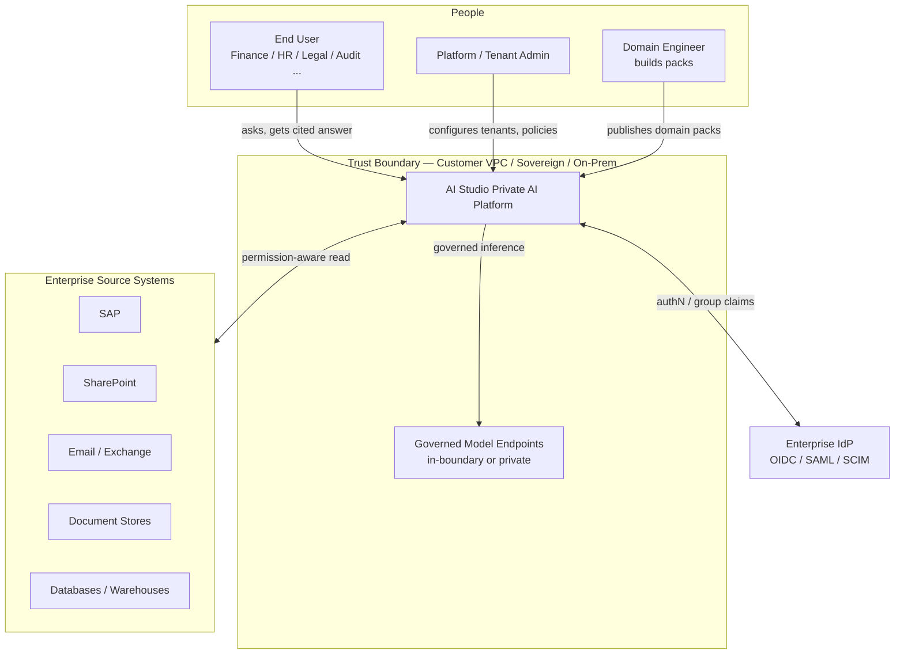
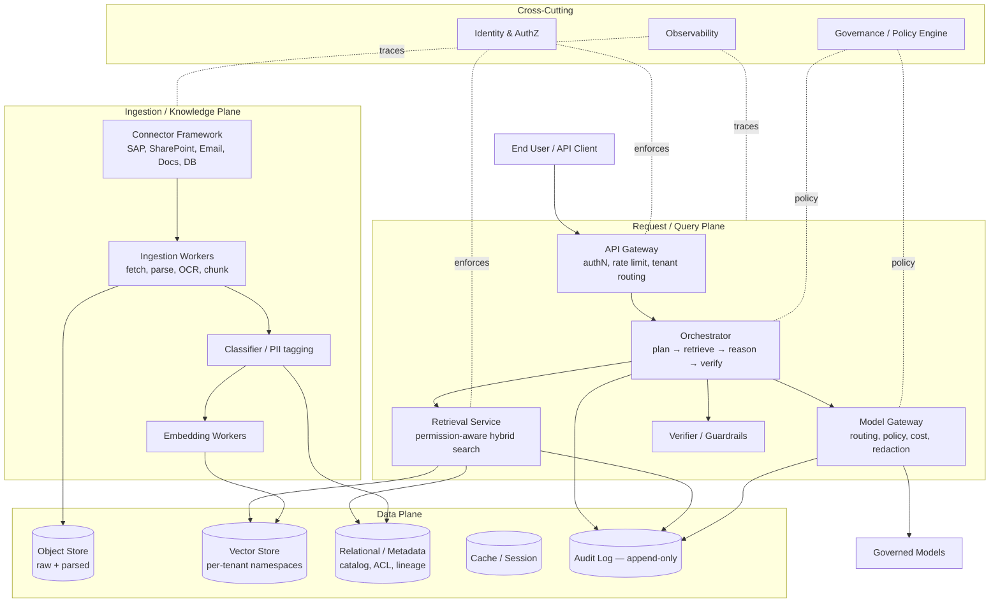
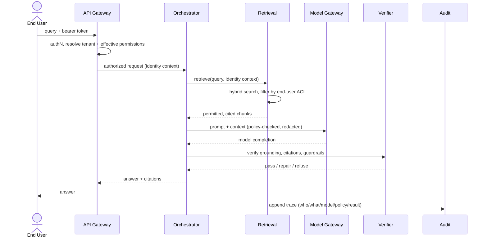
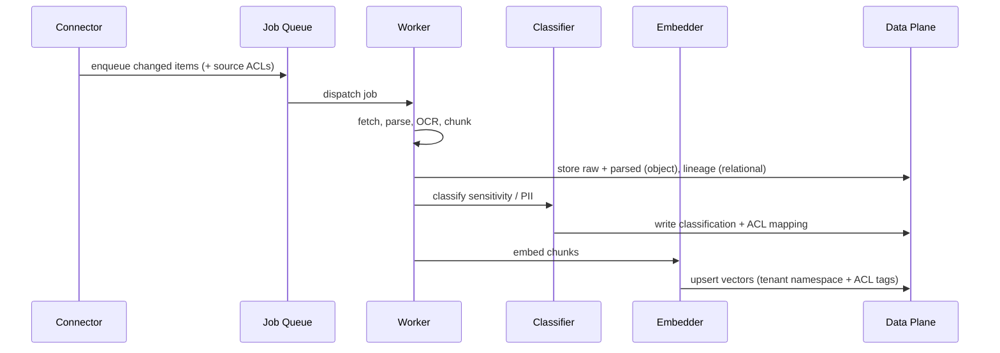

# Platform Overview (High-Level Architecture)

> Status: **Foundational** · Owner: Enterprise Architecture · Cycle: 1

This document gives the high-level (C4 Context and Container) view of the private AI
platform. Component-level detail lives in the per-concern folders (rag/, permissions/,
storage/, etc.) and is written in later cycles.

## 1. System context (C4 — Level 1)

**Key boundary rule:** `Boundary` contains the platform *and* the models. Source
systems are read through connectors under the end user's effective permissions. The
only actors that cross the boundary are authenticated humans and the IdP.

## 2. Container view (C4 — Level 2)

## 3. The three planes

The platform separates into three planes so each can scale and be secured
independently. This separation is the backbone of the architecture.

### 3.1 Request / Query Plane (synchronous, latency-sensitive)
Serves user questions. **Orchestrator** runs the agentic loop: plan → retrieve →
reason → verify → answer. **Retrieval Service** performs permission-aware hybrid
(vector + keyword) search. **Model Gateway** mediates all inference. **Verifier**
enforces grounding, citations, and guardrails before an answer is returned.

### 3.2 Ingestion / Knowledge Plane (asynchronous, throughput-sensitive)
Turns source systems into retrievable, classified, permission-tagged knowledge.
**Connectors** read sources; **Workers** parse/OCR/chunk; **Classifier** tags
sensitivity/PII; **Embedding Workers** produce vectors. Runs on a queue so ingestion
load never affects query latency. See [Workers](../workers/).

### 3.3 Data Plane (stateful)
Object store (raw + parsed artifacts), vector store (per-tenant namespaces),
relational/metadata store (catalog, ACLs, lineage), cache, and an **append-only audit
log**. See [Storage](../storage/) and [Metadata](../metadata/).

### Cross-cutting
**Identity & AuthZ**, **Governance/Policy engine**, and **Observability** touch every
plane and are never optional. See [Security](../security/00-security-architecture.md)
and [Governance](../governance/).

## 4. Request lifecycle (happy path)

**Fail-closed points:** token invalid → reject at gateway; no permitted chunks →
answer "no accessible information" (never fabricate); verifier fails → repair or
refuse. Every branch writes to the audit log.

## 5. Ingestion lifecycle (happy path)

**Critical:** ACLs are captured **at ingestion** and re-verified **at query**. See
[Permissions](../permissions/) for how source ACLs map to query-time enforcement.

## 6. Why this shape

- **Plane separation** lets ingestion spikes and query latency scale independently,
  and lets us secure the query path (user-facing) more tightly than batch ingestion.
- **Model Gateway indirection** gives one governed choke point for cost, routing,
  redaction, and vendor independence (Principle 6).
- **Connector framework** makes new domains additive: a domain is a connector + pack,
  not a platform change (the core scalability bet).
- **Append-only audit** makes the whole system explainable and compliant by
  construction (Principle 5).

## 7. Trade-offs

- More moving parts than a monolith → higher operational complexity. Mitigated by
  clear plane boundaries, shared observability, and deployment automation.
- Permission-aware retrieval adds a query-time authorization hop → latency cost.
  Accepted per Principle 2; optimized with caching of permission decisions.
- Per-tenant isolation raises storage cost → addressed by tenant tiers
  (namespace-per-tenant vs. cluster-per-tenant) in [Storage](../storage/).

## 8. Alternatives considered

| Alternative | Verdict |
|-------------|---------|
| Monolithic app (all planes in one process) | Rejected: can't scale ingestion vs. query independently; larger security blast radius. |
| Direct model calls from services (no gateway) | Rejected: no central governance, cost control, or vendor swap. |
| Index-everything with a service account, filter later | Rejected: violates permission-faithful retrieval; leaks via ranking/snippets. |
| Fine-tune per domain instead of RAG | Rejected: stale, unauditable, can't honor per-user ACLs (see Vision §5). |

## 9. Future scalability

- **New domain:** add a connector + domain pack. No plane changes.
- **New tenant:** provision namespaces/policies; no code changes.
- **10× data:** ingestion workers and vector store scale horizontally; query plane
  scales on read replicas + caching.
- **New model vendor:** register at the gateway; routing policy does the rest.

## Related

- [Vision & Principles](00-vision-and-principles.md)
- [Security Architecture](../security/00-security-architecture.md)
- [ADR Log](adr/) — the *why* behind these choices
- Deep dives (planned): [RAG](../rag/), [Permissions](../permissions/),
  [Storage](../storage/), [Workers](../workers/)
