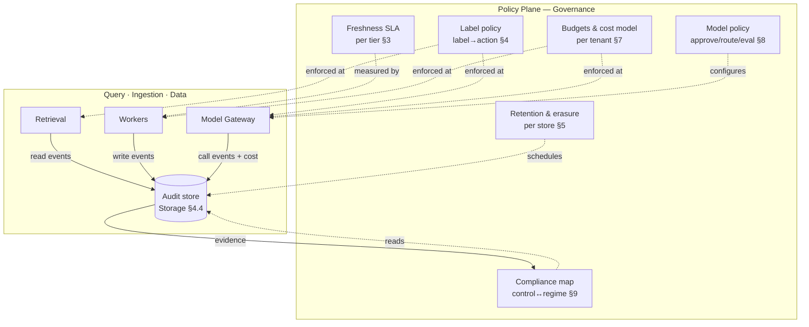

# Governance, Audit & Cost

> Status: **Foundational** · Owner: Platform Governance / Security / Finance-Ops · Cycle: 7
> Implements [ADR-0012](../architecture/adr/ADR-0012-governance-audit-and-cost.md).
> **Ratifies** the three decisions upstream cycles queued for Governance and could not
> close themselves: the **freshness SLA** ([Permissions §8](../permissions/00-authorization-model.md),
> open Q#7), the **sensitivity-label policy** ([Permissions §7](../permissions/00-authorization-model.md)),
> and **retention + legal-hold + right-to-erasure + per-tenant cost metering**
> ([Storage §9–§10](../storage/00-storage-architecture.md), [Workers §8, §10](../workers/00-ingestion-architecture.md)).
> This document does **not** re-open the authorization, retrieval, storage, or ingestion
> designs — it specifies the **policy surface** that binds them: what numbers are promised,
> what is retained and for how long, what an answer is allowed to cost, and how all of it is
> proven to an auditor.

Governance is the platform's **policy plane** — the cross-cutting concern that sits above
Query, Ingestion, and Data ([Overview §3](../architecture/01-platform-overview.md)) and
makes the platform's promises *contractual* rather than merely *implemented*. Cycles 1–6
built machinery that is **capable** of being fresh, isolated, auditable, and bounded; every
one of them deferred the same class of question to here: **"what is the actual promised
number, retained for how long, at what cost, and who ratifies it?"** Three cycles
explicitly handed ratifications up ([NEXT_STEPS §6, Cycle 7](../NEXT_STEPS.md)); this
document closes them.

It is the anchor for risk **R5** (cost blow-up) and the ratification owner for **R3**'s SLA
number, and it turns Principle 5 (*everything is auditable*) from an assertion into a
specified, retained, access-controlled artifact.

---

## 1. What Governance must satisfy (inputs, not choices)

These arrived as **queued ratifications and hard requirements** from upstream cycles. A
governance design that leaves any of them an implementation detail has failed its one job.

| # | Requirement | Source | Why it is Governance's to close |
|---|-------------|--------|---------------------------------|
| G1 | **Ratify the freshness SLA** — fix the contractual staleness numbers per tenant tier | [Permissions §8](../permissions/00-authorization-model.md) (Q#7), [Workers §4.2, §10](../workers/00-ingestion-architecture.md) | Workers *implements and measures* ≤5/≤15 min; only a policy owner can make them a **promise** with consequences. |
| G2 | **Ratify the sensitivity-label policy** — what each label *does* to an answer | [Permissions §7](../permissions/00-authorization-model.md) | The ACL predicate is identity-based and stable; the label→action mapping is domain-specific and changes often — it must live here, not in the predicate. |
| G3 | **Ratify retention, legal-hold & right-to-erasure** — how long each store keeps data, and the erasure/hold balance | [Storage §4.4, §9](../storage/00-storage-architecture.md) | Storage built the mechanisms (crypto-erasure, tombstone, append-only audit); the *durations and the legal balance* are a compliance decision. |
| G4 | **Specify audit *usage*** — retention, access control, compliance mapping over the existing audit store | [Storage §4.4](../storage/00-storage-architecture.md), [RAG §7.3](../rag/00-retrieval-pipeline.md), [Workers §9](../workers/00-ingestion-architecture.md) | The store exists and both read- and write-side events flow into it; Governance defines *who may read it, for how long, and to satisfy which control*. |
| G5 | **A per-tenant cost model & budgets** (R5) — meter, attribute, cap, and degrade gracefully | [Storage §10](../storage/00-storage-architecture.md), [Workers §4.3, §8, §10](../workers/00-ingestion-architecture.md), [ADR-0003](../architecture/adr/ADR-0003-model-gateway-indirection.md) | Every cost lever (model tiering, quantization, batching, storage tiering, DLQ) was built upstream; nobody yet **owns the budget** that decides when to pull them. |
| G6 | **Model governance** — approval, versioning, routing policy, and evaluation of models offered through the Gateway | [ADR-0003](../architecture/adr/ADR-0003-model-gateway-indirection.md), Principle 6 | The Gateway is the choke point; Governance is the policy that flows through it (which model, which tenant, which data class). |
| G7 | **Compliance mapping** — bind platform controls to external regimes (GDPR, SOX, ISO 27001, sector rules) per domain | Principle 5, [Vision §3](../architecture/00-vision-and-principles.md) | "Supportable without redesign" (Vision) includes *provably compliant* — a domain pack must inherit a control map, not invent one. |

The rest of this document closes G1–G7 in order (§3–§9), then states the trade-offs (§10),
alternatives (§11), and future scalability (§12).

---

## 2. Governance as a plane (where it sits)



Governance **owns policy, not mechanism.** Every arrow into the planes is a *configuration*
consumed by an already-built enforcement point — the Model Gateway ([ADR-0003](../architecture/adr/ADR-0003-model-gateway-indirection.md)),
the retrieval filter/redactor ([RAG §6.4](../rag/00-retrieval-pipeline.md)), the worker
priority scheduler ([Workers §4.2](../workers/00-ingestion-architecture.md)), the audit
store ([Storage §4.4](../storage/00-storage-architecture.md)). Governance adds **no new
runtime component on the hot path**; it adds a **policy store** (versioned, itself audited)
and the **reporting/metering surface** that reads the audit log. This keeps the policy that
changes often decoupled from the mechanism that must stay stable — the same separation
[Permissions §7](../permissions/00-authorization-model.md) drew between ACL and label.

---

## 3. G1 — Freshness SLA, ratified (closes open question #7)

[Workers §4.2 and §10](../workers/00-ingestion-architecture.md) **implement and measure**
the ≤5/≤15 min targets and alarm on breach; [Permissions §8](../permissions/00-authorization-model.md)
proposed them. Governance now **fixes them as contractual per-tier numbers with defined
consequences.** These are the ratified values.

### 3.1 The ratified SLA table

| Change class | Standard tier | Isolated / regulated tier | Enforcement point | On breach |
|--------------|:-------------:|:-------------------------:|-------------------|-----------|
| **Principal change** (offboard, group/role change, deactivate) | **≤ 5 min** | **≤ 2 min** | Identity-graph re-sync (P0) + decision-cache invalidation ([Workers §7.2](../workers/00-ingestion-architecture.md), [Storage §4.3](../storage/00-storage-architecture.md)) | Queue-lag alarm (§10); **pages** in Isolated tier |
| **Restrictive resource-ACL change** (deny added, un-shared, newly restricted) | **≤ 15 min** | **≤ 5 min** | P0 change-driven re-sync + outbox relay ([Workers §5, §7.1](../workers/00-ingestion-architecture.md)) | SLA-breach alarm; relay-lag alarm |
| **Widening / neutral content edit** | **≤ 60 min** | **≤ 15 min** | P1 re-sync | Alarm only (no safety exposure) |
| **New public content** | Best-effort (hours) | Best-effort | P2 backfill | Dashboard only |

**Why these numbers.** The two safety-critical rows (principal + restrictive) are held tight
because they are the R3 leak vector; the widening/public rows are loose because a delay
there costs *recall*, never *safety* — the same asymmetry [Workers §8.3](../workers/00-ingestion-architecture.md)
built the retry policy around. Isolated-tier numbers are stricter because those tenants pay
for reserved P0 capacity (§7) and typically carry the regulated content where a stale
permission is a reportable incident.

### 3.2 The defense-in-depth footnote that makes the SLA affordable

The SLA is a promise about the **chunk-ACL** (the resource re-tag path). The **highest-severity
change — offboarding — is already closed independent of it** by query-time principal
precedence ([Storage §7 rule 3](../storage/00-storage-architecture.md),
[Permissions §8](../permissions/00-authorization-model.md)): a deactivated subject's
principal set collapses at the *next query*, before any chunk is re-tagged. So the ≤5/≤2 min
principal row is really an SLA on the **decision-cache TTL + invalidation**, not on a re-tag
storm — which is why it is both the tightest number and the cheapest to hold. Governance
ratifies the numbers *and* the reasoning, so a future cost-cutting cycle cannot quietly
loosen the principal SLA without understanding it was never the expensive one.

### 3.3 Consequence & breach handling

A ratified SLA is a promise with teeth: a sustained breach is (a) an **operational alarm**
([Workers §10](../workers/00-ingestion-architecture.md)), (b) a **governance incident** with
a recorded root cause, and (c) for Isolated-tier tenants, a **contractual reporting event**.
The cost of holding the SLA (reserved P0 worker capacity, relay poll frequency) is a
[Deployment](../deployment/) tuning knob (Workers §13) — Governance sets the *target*,
Deployment sizes to meet it, and the audit log *proves* it was met (§6.3).

---

## 4. G2 — Sensitivity-label policy, ratified

[Permissions §7](../permissions/00-authorization-model.md) established that labels are a
**second, independent gate** that can only *further restrict* (`permitted = ACL-allow AND
label-policy-allow`) and deliberately left the label→action mapping to Governance so the
often-changing compliance policy never touches the stable authorization predicate. Here is
that mapping.

### 4.1 The label→action matrix (the ratified default; tenants may tighten, never loosen)

| Label | Retrieval | Prompt assembly | Model routing | Egress / export |
|-------|-----------|-----------------|---------------|-----------------|
| `public` | Allowed | Verbatim | Any approved model | Allowed per tenant policy |
| `internal` | Allowed | Verbatim | In-boundary models only | Blocked to external; internal export logged |
| `confidential` | Allowed if ACL-permitted | Allowed; **watermarked citation**, no verbatim bulk-quote beyond N tokens | **Highest-trust in-boundary tier only** ([ADR-0003](../architecture/adr/ADR-0003-model-gateway-indirection.md)) | Blocked; override = logged, approved egress (Principle 1) |
| `pii` | Allowed if ACL-permitted | **Masked/redacted** in context ([RAG §6.4](../rag/00-retrieval-pipeline.md)) unless the query is entitled to unmasked PII | In-boundary only; PII never in a batch/telemetry sample | Blocked; DSAR-only export path |
| `legal_hold` | Allowed if ACL-permitted | Verbatim | In-boundary only | **Never auto-deleted** (§5.3); export only under the matter |
| `restricted:<class>` | Allowed only to the class's principals | Per class policy | Per class policy | Per class policy |

- **Labels compose by "most restrictive wins"** — a `confidential` + `pii` chunk gets both
  the highest-trust routing *and* masking. This mirrors the deny-wins precedence of the ACL
  predicate ([Permissions §3.1](../permissions/00-authorization-model.md)), so the mental
  model is uniform: *restriction always dominates.*
- **The enforcement points already exist.** Retrieval honors the label filter
  ([RAG §6.4](../rag/00-retrieval-pipeline.md)); the Model Gateway honors routing + redaction
  ([ADR-0003](../architecture/adr/ADR-0003-model-gateway-indirection.md)). Governance
  supplies the *table*, versioned in the policy store; it invents no new mechanism (§2).
- **Labels never widen** (Permissions §7 invariant, preserved): every row can only subtract
  capability. A misconfigured label policy can over-restrict (a recall bug, self-correcting)
  but can **never** turn a `confidential` chunk `public` — fail-closed (Principle 7).

### 4.2 Who sets it

The **default matrix is platform-owned** (this table). A tenant's compliance officer may
**tighten** any cell via tenant policy config (e.g. `internal` → in-boundary-only export even
for export-allowed tenants). A loosening request is a **governance change request**, recorded
and approved, never a silent config flip — and structurally cannot breach the ACL gate, which
is upstream and independent.

---

## 5. G3 — Retention, legal-hold & right-to-erasure, ratified

[Storage §9](../storage/00-storage-architecture.md) built the *mechanisms* — version-scoped
delete, crypto-erasure (destroy the tenant DEK), `legal_hold` tombstone, and the **audit log
that is never erased**. Governance sets the **durations and the legal balance.**

### 5.1 Retention schedule (ratified defaults; per-tenant/-regime overridable)

| Store | Class | Default retention | Basis |
|-------|-------|-------------------|-------|
| **Object** (raw) | Source originals | Mirror source or **90 days** post-parse, then archival tier | Re-parse insurance; cost lever ([Storage §4.1, §10](../storage/00-storage-architecture.md)) |
| **Object** (parsed) | Re-embed source artifact | Life of the derived chunks | [Workers §6](../workers/00-ingestion-architecture.md) re-embed needs it |
| **Vector + relational** | Derived knowledge | Life of the source item (+ version history per Principle 8) | Deleted on source delete / erasure (§5.2) |
| **Cache** | Decisions/sessions | **5–15 min TTL** ([Storage §4.3](../storage/00-storage-architecture.md)) | Already required for freshness (§3) |
| **Audit** | Read + write + Gateway events | **≥ 1 year hot, ≥ 7 years cold** (SOX/financial default; tenant/regime tunable) | Non-repudiation & regulator lookback (§6) |
| **DLQ** ([Workers §8](../workers/00-ingestion-architecture.md)) | Permanently-failed items | **30 days** then archived with lineage tombstone | Debuggability without unbounded growth |

### 5.2 Right-to-erasure (GDPR Art. 17) — the ratified flow

Storage §9 specified the *propagation* (`delete ⇒ object + vector + relational + cache;
audit RETAINED`). Governance ratifies the **policy around it**:

- **A DSAR/erasure request is a first-class, SLA-bound governance workflow**, not an ad-hoc
  ops task: acknowledged, scoped (subject → resources via lineage), executed via Storage §9's
  propagation, and **the erasure itself is recorded in the audit log as an event** (proving
  *what* and *when* without retaining the content — [Storage §9](../storage/00-storage-architecture.md)).
- **Erasure SLA:** complete within the regime's window (GDPR: without undue delay, ≤ 30 days);
  whole-tenant offboarding uses **crypto-erasure** ([Storage §6, §9](../storage/00-storage-architecture.md))
  for provable, immediate, at-once destruction across all five stores.
- **The audit trail is exempt from erasure** — a standard, defensible balance: erasure applies
  to *content*, not to the non-repudiation record of *who did what*. Governance ratifies this
  explicitly as the platform's documented GDPR position, so it is a decision, not an accident.

### 5.3 Legal-hold overrides erasure & retention

A `legal_hold`-labeled item ([Permissions §2.2](../permissions/00-authorization-model.md),
§4.1 above) is **exempt from both the retention schedule and erasure**: it is *tombstoned*,
not deleted, until the hold clears ([Storage §9](../storage/00-storage-architecture.md)).
Governance owns the **hold lifecycle** — who may place/release a hold (a recorded, audited
privileged action), and the precedence rule: **legal-hold > erasure > retention.** This makes
the Storage tombstone mechanism *usable* by defining the authority and precedence around it.

---

## 6. G4 — Audit usage: retention, access, and evidence

The audit **store** exists and is populated ([Storage §4.4](../storage/00-storage-architecture.md));
read-side ([RAG §7.3](../rag/00-retrieval-pipeline.md)) and write-side
([Workers §9](../workers/00-ingestion-architecture.md)) events flow into it. Governance
specifies how audit is **used** — this is where Principle 5 (*everything is auditable*)
becomes a control, not a claim.

### 6.1 What is captured (consolidated view)

| Event | Source | Key fields |
|-------|--------|------------|
| **Retrieval** | [RAG §7.3](../rag/00-retrieval-pipeline.md) | subject, effective principals used, query, chunk IDs, rerank scores, labels applied, verifier verdict, model + policy |
| **Ingestion / write** | [Workers §9](../workers/00-ingestion-architecture.md) | resource_id, version, `acl_confidence`, worker identity, trace_id |
| **Model call** | [ADR-0003](../architecture/adr/ADR-0003-model-gateway-indirection.md) Gateway | model, tokens in/out, cost, tenant, data-class routed, redactions applied |
| **Governance action** | this doc | policy change, hold place/release, erasure, SLA-breach incident, budget action, cross-tenant admin read |

### 6.2 Access control over the audit log (audit is sensitive)

The audit log records *who asked what* — itself `confidential`-class. Therefore:

- **Read access is role-gated and itself audited** (a meta-audit event) — reading the audit
  log is a privileged action ([Storage §4.4](../storage/00-storage-architecture.md):
  "cross-tenant audit access is an explicit, itself-audited admin operation").
- **Tenant-scoped by default**; cross-tenant audit access exists only for platform incident
  response and leaves its own trail.
- **Append-only & tamper-evident** is a *mechanism* Storage guarantees (hash-chain); Governance
  requires **periodic hash-chain verification** as a scheduled control whose result is itself
  logged.

### 6.3 Audit as SLA & compliance evidence

The audit log is the **evidence base** for every promise this document makes: the freshness
SLA (§3) is *proven* met by the re-sync-latency events; the label policy (§4) by the
redaction/routing events; erasure (§5.2) by the erasure events; budgets (§7) by the cost
events. **A promise the audit log cannot evidence is not a governable promise** — this is the
design test for any future control.

---

## 7. G5 — Cost model & budgets (R5)

R5 (cost blow-up at 10× data/tenants) is the last open high-severity risk without a design
mitigation. Every *lever* was built upstream; Governance builds the **meter, the attribution,
the budget, and the graceful-degradation policy** that pull them.

### 7.1 The four cost centers and their (already-built) levers

| Cost center | Dominant driver | Lever (owner) |
|-------------|-----------------|---------------|
| **Inference** | Tokens × model tier | Model tiering + routing ([ADR-0003](../architecture/adr/ADR-0003-model-gateway-indirection.md)); prompt-caching; embed **batching** ([Workers §4.3](../workers/00-ingestion-architecture.md)) |
| **Vector/index compute** | RAM for ANN | **Quantization**, stay-on-pgvector below graduation ([Storage §3.3, §10](../storage/00-storage-architecture.md)) |
| **Object/relational storage** | Bytes × time | **Tiering** raw→archival, partition cold lineage ([Storage §10](../storage/00-storage-architecture.md)) |
| **Ingestion compute** | Re-embed + backfill fleets | P2 throttling ([Workers §4.2, §6](../workers/00-ingestion-architecture.md)); DLQ caps waste ([Workers §8](../workers/00-ingestion-architecture.md)) |

### 7.2 Metering & attribution

- **Every cost-bearing event carries `tenant_id`** and lands in the audit/metering stream:
  Gateway calls (tokens × price), ingestion tasks (embed calls, worker-seconds), and storage
  (bytes × tier, sampled). This is why [Storage §10](../storage/00-storage-architecture.md)
  and [Workers §10](../workers/00-ingestion-architecture.md) handed per-tenant attribution *up*
  — Governance is where the per-tenant bill is assembled.
- **Attribution is by tenant → domain pack → workload class**, so a customer can see that
  (say) the Legal pack's re-embed migration, not their daily Q&A, drove last month's spike.

### 7.3 Budgets & graceful degradation (fail-closed on spend, not on safety)

Each tenant has a **budget envelope** (per period, per cost center). As consumption climbs,
policy degrades **capability before it degrades safety or correctness**:

```
  < 80% budget   → normal
  80–100%        → soft actions: route non-critical queries to a cheaper model tier;
                   defer P2 re-embed/backfill; tighten cache TTL toward the max
  at 100%        → hard actions: block new P2 bulk jobs; queue (not drop) P1;
                   alert tenant admin + platform ops
  P0 revocation / security re-sync is NEVER throttled by budget
```

**The load-bearing rule: a budget cap can slow ingestion, downgrade a model, or defer a
backfill — it can never relax a permission, skip the ACL filter, or throttle a P0 revocation.**
Cost control degrades *recall and latency*, never *safety* — the exact asymmetry
[Workers §8.3](../workers/00-ingestion-architecture.md) applies under load, now applied under
budget pressure. This keeps R5 mitigation from ever becoming an R1/R3/R4 regression.

### 7.4 R5 status after this cycle

R5 moves from *"named, levers exist"* to **design-mitigated**: metering + per-tenant
attribution + budget envelopes + a graceful-degradation ladder that is structurally forbidden
from touching safety. Residual: the **actual prices and envelope sizes** per tenant tier (a
commercial input, tuned in [Deployment](../deployment/) with real usage telemetry).

---

## 8. G6 — Model governance

The [Model Gateway](../architecture/adr/ADR-0003-model-gateway-indirection.md) is the choke
point (Principle 6); Governance is the **policy that flows through it.**

- **Model approval & registry.** No model serves a tenant until it is in the **approved-model
  registry** with a recorded provenance, hosting posture (in-boundary vs. contractually-private
  endpoint — open Q#3, still open, see §13), data-handling terms, and an eval score (below).
  This is the model analogue of the connector conformance gate ([Workers §5](../workers/00-ingestion-architecture.md)):
  *nothing serves production until it passes a gate.*
- **Routing policy by data class.** The label matrix (§4) drives routing: `confidential`/`pii`
  → highest-trust in-boundary tier only; `public`/`internal` may use cheaper tiers (§7.1). The
  Gateway enforces; Governance authors the policy.
- **Evaluation before promotion.** A candidate model (or version) is scored on a **held-out
  eval set** (grounding, citation validity, refusal calibration per the [RAG verifier
  contract §7](../rag/00-retrieval-pipeline.md); safety/jailbreak resistance for R2; and
  domain-pack task accuracy) before it may be routed to production traffic. Promotion is a
  recorded governance decision.
- **Versioning & rollback.** Model versions are pinned per tenant; a regression rolls back to
  the pinned prior version. Model version is captured in every retrieval audit event (§6.1) so
  an answer is always attributable to an exact model — required for reproducibility in a
  regulated dispute.

---

## 9. G7 — Compliance mapping (control ↔ regime, per domain)

"Supportable without redesign" ([Vision §3](../architecture/00-vision-and-principles.md))
must include *provably compliant*. Governance maintains a **control map** binding
already-built platform controls to external regimes, so a domain pack **inherits** a
compliance posture instead of inventing one.

| Regime | Primary domains | Platform controls that satisfy it |
|--------|-----------------|-----------------------------------|
| **GDPR** | HR, Legal, all EU tenants | Right-to-erasure (§5.2, [Storage §9](../storage/00-storage-architecture.md)); DSAR workflow; PII masking (§4, [RAG §6.4](../rag/00-retrieval-pipeline.md)); data residency (per-tenant region, [Storage §13](../storage/00-storage-architecture.md)); private-by-default (Principle 1) |
| **SOX** | Finance, Audit | Append-only audit (§6, [Storage §4.4](../storage/00-storage-architecture.md)); immutable versioned knowledge (Principle 8); access control + segregation (per-stage least privilege, [Workers §9](../workers/00-ingestion-architecture.md)); ≥7-yr audit retention (§5.1) |
| **ISO 27001 / SOC 2** | All | Encryption + BYOK ([Storage §6](../storage/00-storage-architecture.md)); tenant isolation ([Storage §5](../storage/00-storage-architecture.md)); STRIDE/threat model ([Security](../security/00-security-architecture.md)); change-managed policy store (§2) |
| **Sector (e.g. finance supervisory, HIPAA-like)** | per tenant | Isolated tier + BYOK + dedicated model pool + stricter SLA (§3.1); quarantine of unmappable sources ([Permissions §9](../permissions/00-authorization-model.md), [Storage §5.3](../storage/00-storage-architecture.md)) |

- **The map is evidence-backed.** Each cell links to the control *and* to the audit-event type
  that proves it operates (§6.3) — an auditor gets both the design and the running proof.
- **A new domain pack declares its regimes** and inherits the relevant rows; it does not
  re-derive controls. This is the compliance expression of "new domain = pack, not redesign."

---

## 10. Trade-offs

- **Ratified numbers vs. flexibility.** Fixing the SLA (§3) and retention (§5) as contractual
  numbers removes wiggle room but is the entire point — an un-ratified SLA is not a promise. Per-
  tenant/-regime overrides preserve the flexibility that matters without dissolving the default.
- **Policy plane vs. no new component.** Governance deliberately adds **no hot-path runtime
  component** (§2) — only a policy store and a reporting surface. This keeps the often-changing
  policy from destabilizing the stable enforcement mechanisms, at the cost that a policy change
  is a *deploy of config*, not a live toggle (acceptable: policy changes are deliberate, recorded).
- **Budget degradation vs. availability.** Degrading capability at budget limits (§7.3) can make
  a tenant's answers cheaper/slower near month-end — an intentional, transparent trade preferred
  over a surprise overage or, worse, a safety relaxation. Safety is never a budget lever.
- **Audit everything vs. audit cost.** Comprehensive audit (§6) is itself a storage cost (§5.1
  retention) and a privacy surface (§6.2). We accept it: Principle 5 is non-negotiable, and the
  audit log is the evidence base without which none of §3–§9 is *provable*.
- **Central label default vs. tenant autonomy.** A platform-owned default matrix (§4) with
  tighten-only tenant overrides trades some tenant freedom for a guaranteed floor — a
  loosening can never silently breach the gate.

## 11. Alternatives considered

| Alternative | Verdict |
|-------------|---------|
| **Leave SLA/retention as per-deployment config** (no ratified default) | Rejected: an un-promised SLA can't be a contract or an incident; every tenant would re-derive it. A ratified default with overrides is both firm and flexible. (§3, §5) |
| **Label policy inside the authorization predicate** | Rejected ([Permissions §7](../permissions/00-authorization-model.md)): couples often-changing compliance policy to the stable identity predicate; kept separate and versioned in the policy store. (§4) |
| **Erase the audit trail on GDPR request** | Rejected: erasure applies to content, not to the non-repudiation record; retaining the audit event (not the content) is the standard, defensible balance. (§5.2) |
| **Hard budget cut-off (drop requests at 100%)** | Rejected: a cliff harms availability and could pressure a safety shortcut; a graceful ladder that degrades capability-before-safety is the fail-closed-on-spend design. (§7.3) |
| **A runtime "governance service" on the hot path** | Rejected: adds latency and a new failure point to every query; policy is compiled config consumed by existing enforcement points instead. (§2) |
| **Per-domain bespoke compliance write-ups** | Rejected: re-derives controls per pack (the Vision anti-pattern); a shared, evidence-backed control map that packs inherit is the "pack not redesign" posture. (§9) |
| **Model governance by trust/allowlist only** | Rejected: an allowlist without an eval gate admits a regressed model; the eval-before-promotion gate mirrors the connector conformance gate. (§8) |

## 12. Future scalability

- **New regime** (e.g. a new sector rule, an EU AI Act obligation) = a new **compliance-map row**
  linking existing controls + the audit events that evidence them; a genuinely new control is a
  scoped addition, not a redesign. (§9)
- **New label** = a new **row in the label matrix** (§4) consumed by the already-built retrieval
  filter and Gateway redactor; no predicate or pipeline change.
- **Tighter SLA for a tenant tier** = a ratified number change (§3) → Deployment raises reserved
  P0 capacity + relay poll frequency ([Workers §13](../workers/00-ingestion-architecture.md)); no
  redesign.
- **New cost center** (e.g. GPU fine-tune, egress) = a new metering dimension + budget cell (§7);
  the attribution stream and degradation ladder generalize.
- **New model / model vendor** = an entry through the approval + eval gate (§8), routed by the
  existing label→trust policy; the Gateway indirection ([ADR-0003](../architecture/adr/ADR-0003-model-gateway-indirection.md))
  keeps it a config change.
- **10× tenants** = the policy store and metering scale as ordinary per-tenant config + an
  append-only stream; audit retention tiering (§5.1) keeps the evidence base affordable.

## Related

- [Permissions §7 — labels (this doc ratifies the label→action policy), §8 — freshness (this doc ratifies the SLA)](../permissions/00-authorization-model.md)
- [Storage §4.4 — audit store, §9 — erasure, §10 — cost model & per-tenant attribution](../storage/00-storage-architecture.md)
- [Workers §4.2 — priority/SLA, §8 — DLQ, §9 — write audit, §10 — SLA observability](../workers/00-ingestion-architecture.md)
- [RAG §6.4 — label redaction, §7.3 — read-side audit event](../rag/00-retrieval-pipeline.md)
- [ADR-0003 — Model Gateway (the choke point model governance flows through)](../architecture/adr/ADR-0003-model-gateway-indirection.md)
- [Security §6, §8 — encryption/BYOK, audit backbone](../security/00-security-architecture.md)
- [Vision — Principle 5 (auditable), Principle 7 (fail closed), §3 (domains this maps to compliance)](../architecture/00-vision-and-principles.md)
- [ADR-0012 — Governance, audit & cost (this doc's decision)](../architecture/adr/ADR-0012-governance-audit-and-cost.md)
- Downstream: [Deployment](../deployment/) (price/envelope tuning, SLA capacity sizing, region/residency),
  [Metadata](../metadata/) (classification schema the label policy consumes),
  [API](../api/) (the surface that exposes budgets, DSAR, and audit export to clients)
