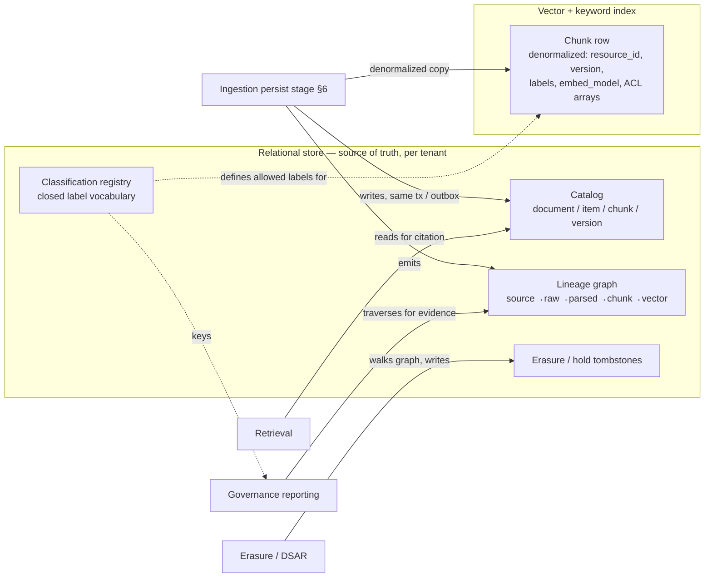

# Metadata — Catalog, Lineage & Classification Schema

> Status: **Foundational** · Owner: Data / Platform Architecture · Cycle: 8
> Implements [ADR-0013](../architecture/adr/ADR-0013-canonical-metadata-lineage-schema.md).
> Consumes what upstream cycles already *hold*, *emit*, and *consume* — this document does
> **not** re-open storage topology, ingestion mechanics, the authorization model, or the
> governance policy. It **canonicalizes the schema** those cycles have been referring to
> informally, so the catalog, the lineage graph, and the classification vocabulary become a
> single, versioned, shared contract instead of four component-local shapes.

Metadata is not a plane — it is the **connective tissue** every plane already touches.
[Storage §4.2](../storage/00-storage-architecture.md) says the relational store *holds* the
catalog, the identity graph, and the lineage; [Workers §2, §9](../workers/00-ingestion-architecture.md)
says the persist stage *emits* lineage and an ingestion audit event;
[Governance §4](../governance/00-governance-and-audit.md) says the label→action matrix
*consumes* a classification schema; [RAG §3.1](../rag/00-retrieval-pipeline.md) and
[Permissions §2.2](../permissions/00-authorization-model.md) *produce* the labels and
version keys that ride on every chunk. Each cycle named the same nouns — `resource_id`,
`source_item_version`, `labels`, `embed_model`, "lineage tombstone" — but **no document owns
their definitions**. This is the last un-seeded cross-cutting store concern
([NEXT_STEPS §5](../NEXT_STEPS.md)), and it is the one whose absence would let the four
consumers drift apart. This cycle fixes the vocabulary and the graph that binds them.

It is not the anchor for a new risk; it is a **correctness multiplier** for the existing
ones — a coherent catalog is what makes R3's re-sync addressable, R1's quarantine
auditable, and Governance's erasure/retention *provable*. Its failure mode is silent
schema drift, which §8 addresses head-on.

---

## 1. What Metadata must satisfy (inputs, not choices)

These arrived as **hard requirements** from upstream cycles — every one is a place an
existing document said "the metadata carries this" without pinning the shape. A schema that
cannot express them breaks a guarantee already made elsewhere.

| # | Requirement | Source | Why it is non-negotiable |
|---|-------------|--------|--------------------------|
| M1 | **A stable, addressable catalog** keyed on `resource_id` + `source_item_version` at document / item / chunk / version granularity | [Storage §3, §4.2](../storage/00-storage-architecture.md), [RAG §2.2](../rag/00-retrieval-pipeline.md) | Versioned upsert/delete (S3), citations, and re-sync all address the same identifiers; four components must agree on them exactly. |
| M2 | **A lineage graph** `source → raw → parsed → chunk → vector`, traversable both directions | [Workers §2, §9](../workers/00-ingestion-architecture.md), [Storage §4.2](../storage/00-storage-architecture.md) | Re-embed reads the parsed artifact, erasure must reach every derived node, and audit must explain "where did this citation come from." |
| M3 | **A classification / label schema** — the vocabulary the ACL `labels` and the Governance matrix key off | [Permissions §2.2](../permissions/00-authorization-model.md), [Governance §4](../governance/00-governance-and-audit.md) | The label→action matrix is only well-defined if the label set is closed and shared; an undefined label is an unenforceable policy. |
| M4 | **An erasure/legal-hold tombstone** that proves *what* was deleted and *when* without retaining the content | [Storage §9](../storage/00-storage-architecture.md), [Governance §5](../governance/00-governance-and-audit.md) | GDPR erasure + the "audit trail never erased" balance require a content-free record of the deletion. |
| M5 | **Lineage that backs audit evidence** — a retrieval or ingestion audit event must resolve to concrete catalog + lineage rows | [Governance §6.3](../governance/00-governance-and-audit.md), [RAG §7.3](../rag/00-retrieval-pipeline.md), [Workers §9](../workers/00-ingestion-architecture.md) | "A promise the audit log can't evidence is not governable" — the evidence is a lineage traversal. |
| M6 | **Schema versioning + validation at the write boundary** | [Workers §8.1](../workers/00-ingestion-architecture.md) (`map_acl` schema violation → DLQ), Principle 8 | Four components share this schema; an unvalidated shape change is a silent cross-component break. |
| M7 | **Tenant-scoped, in-boundary, transactional** with the ACL of record | [Storage §4.2, §5](../storage/00-storage-architecture.md) | The catalog is written in the *same* transaction as the ACL at the pgvector tier (§7 coherence); it inherits tenancy and isolation, it does not re-invent them. |

If the catalog were just "some columns on the chunk table," this cycle would be trivial.
It is not: the **same identifiers and the same lineage** are addressed by re-sync (Workers),
erasure (Storage), citation (RAG), and evidence (Governance). This document makes that
shared shape explicit and validated so the four never drift (M6).

---

## 2. Where metadata lives (it is not a new store)

Metadata is **held in the relational source-of-truth store** ([Storage §4.2](../storage/00-storage-architecture.md)),
with a **denormalized subset riding on each chunk** in the vector index so the retrieval
filter and the citation are single-store reads. This document specifies the *schema and the
graph*, not a new storage engine — a deliberate non-decision (§10 trade-offs).



| Artifact | Home | Denormalized copy | Why here |
|----------|------|-------------------|----------|
| **Catalog** (document/item/chunk/version) | Relational (source of truth) | Chunk carries `resource_id`, `source_item_version` | Strong consistency with the ACL of record; citations resolve here |
| **Lineage graph** | Relational (edges) | — (server-side only) | Traversal is an admin/audit/erasure operation, never on the hot query path |
| **Classification registry** | Relational (small, tenant + platform scope) | Chunk carries the *applied* `labels` | The closed vocabulary must be one authority; the applied label is copied for the filter |
| **Tombstones** | Relational + audit event | — | Content-free proof of deletion (M4); the audit event is the non-repudiation half |

The **coherence rules are already fixed** by [Storage §7](../storage/00-storage-architecture.md):
same-transaction at the pgvector tier, transactional outbox at the dedicated-engine tier.
Metadata does not re-open them — it defines *what* is written coherently.

---

## 3. The catalog schema (M1)

The catalog is a **four-level hierarchy**, each level addressable and versioned. The names
are the ones already used across Storage, Workers, RAG, and Permissions — this section makes
them canonical.

```
Document          # a logical source object: a SharePoint file, an email, a SAP report
  └─ Item         # a source-addressable unit with one ACL + one version (often 1:1 with Document,
                  #   but an email thread → per-message items; a workbook → per-sheet items)
      └─ Chunk    # a retrievable unit (RAG §2): heading/clause/table-row/message-scoped
          └─ Version   # every (item, source_item_version) is immutable; a change is a new version
```

### 3.1 Catalog row (relational, canonical)

```json
{
  "tenant_id": "acme",                                  // M7 — every row tenant-scoped
  "resource_id": "sharepoint:site/legal:item/123",      // stable, source-addressable (Permissions §2.1 discipline)
  "document_id": "sharepoint:site/legal:file/123",      // parent logical object
  "source": "sharepoint",                               // sharepoint | sap | exchange | fileshare | ...
  "source_item_version": "etag-9f3c",                   // the idempotency + coherence key (Workers W1, Storage S3)
  "content_type": "application/pdf",
  "title": "FY25 Audit Plan",
  "labels": { "sensitivity": "confidential", "pii": false, "legal_hold": true },  // §5, applied from the registry §4
  "acl_confidence": "exact",                            // exact | approximate | unknown (Permissions §9)
  "chunk_count": 42,
  "ingested_at": "2026-07-06T09:00:00Z",
  "superseded_by": null,                                // set when a newer version replaces this (Principle 8)
  "state": "active"                                     // active | superseded | tombstoned (§5)
}
```

- **`resource_id` is the join key of the whole platform.** The chunk in the vector index, the
  ACL of record, the lineage nodes, the audit event, and a citation all address the *same*
  string. Its construction discipline (stable, non-reusable source id, tenant-namespaced) is
  Permissions' ([§2.1](../permissions/00-authorization-model.md)); the catalog is where it is
  *cataloged*, not re-defined.
- **`source_item_version` is the coherence key** ([Storage §7 rule 4](../storage/00-storage-architecture.md)):
  a chunk is only ever filterable under one ACL because a re-tag/re-embed writes a new version
  and deletes the old version-scoped. The catalog records the version chain
  (`superseded_by`), so version history (Principle 8) is queryable, not implicit.
- **Item vs. Document is the mixed-ACL boundary.** [RAG §2.2](../rag/00-retrieval-pipeline.md)'s
  invariant — a chunk never spans two ACLs — is expressed here: an **Item** is defined as the
  finest source unit that carries *one* ACL. An email thread with per-message permissions
  becomes per-message Items; that is why the item level exists between document and chunk.

### 3.2 Chunk-level catalog (the denormalized subset)

Each chunk in the vector index carries a **catalog projection** — exactly the fields the
retrieval filter, the citation, and the re-embed migration need, no more:

```
chunk: { resource_id, source_item_version, chunk_ordinal,
         labels, allow[], deny[], visibility,           # denormalized ACL (Storage §4.2), filter reads here
         embed_model, embed_dim,                        # RAG §3.1 — a query only compares within its own space
         section_path }                                 # e.g. "Header > Table 3 > row 12" — powers citations
```

`section_path` is the citation backbone: RAG's context assembly cite-tags a chunk
([RAG §6](../rag/00-retrieval-pipeline.md)) with `resource_id#chunk_ordinal`, and the catalog
resolves that back to a human-readable location and the source document for the user-facing
citation. This is metadata paying its way on the read path.

---

## 4. The classification / label schema (M3)

[Governance §4](../governance/00-governance-and-audit.md)'s label→action matrix is only
well-defined if the **label set is closed and shared**. This is that closed set — the
vocabulary the ACL `labels` field ([Permissions §2.2](../permissions/00-authorization-model.md))
draws from and the Governance matrix keys on. Neither of those documents owns the vocabulary;
this one does.

### 4.1 The label dimensions

Labels are **orthogonal to the ACL** (Permissions §7): the ACL answers *who*, labels answer
*what handling*. Three dimensions, each a closed enum plus a controlled extension point:

| Dimension | Values (closed) | Extension | Keys which Governance action |
|-----------|-----------------|-----------|------------------------------|
| **`sensitivity`** | `public` · `internal` · `confidential` | `restricted:<class>` (registered) | Retrieval / prompt / routing / egress ([Governance §4.1](../governance/00-governance-and-audit.md)) |
| **`pii`** | `true` · `false` | `pii_class:<type>` (e.g. `pii_class:health`) for sector rules | Masking / redaction, batch-exclusion, DSAR export path |
| **`legal_hold`** | `true` · `false` | `matter:<id>` binds the hold to a matter | Retention override (never auto-deleted, §5) |

- **The closed core is platform-owned; the extension points are registered, never free-text.**
  A `restricted:<class>` or `pii_class:<type>` value must be **registered in the tenant's
  classification registry before use** — an unregistered label is a schema violation (M6), routed
  to DLQ like a malformed ACL ([Workers §8.1](../workers/00-ingestion-architecture.md)), never
  silently stored. This is what makes the Governance matrix total: every label a chunk can
  carry has a defined action, because the vocabulary is closed at the write boundary.
- **Most-restrictive-wins composition** ([Governance §4.1](../governance/00-governance-and-audit.md))
  is a property of the *values*, so it belongs here: `sensitivity` is ordered
  `public < internal < confidential < restricted:*`; `pii:true` and `legal_hold:true` only ever
  add restriction. The schema encodes the lattice; Governance encodes the action per point in it.

### 4.2 How a label is assigned

A chunk's labels come from three sources, merged most-restrictive-wins at the map-ACL stage
([Workers §2 stage 3](../workers/00-ingestion-architecture.md)):

1. **Source-native labels** — an MIP/Purview sensitivity label on a SharePoint file, an SAP
   authorization class — mapped by the connector's `map_acl` into the canonical vocabulary.
2. **Tenant classification rules** — a tenant policy that says "everything under
   `site/legal/*` is `confidential`, everything in the `matter/*` tree is `legal_hold`."
3. **Platform defaults** — an unlabeled item defaults to `internal`, never `public`
   (fail-closed classification: absence of a label is not permission to expose).

The registry (§2) is the authority for which values are legal; the merge is deterministic and
recorded in lineage (§5) so an auditor can see *why* a chunk carries a label.

---

## 5. The lineage graph (M2) and the erasure tombstone (M4)

Lineage is a **directed graph of derivation edges**. It is the structure that makes erasure
complete, re-embed source-independent, and audit explainable — three guarantees three
different cycles already made and left for Metadata to make traversable.

```mermaid
flowchart LR
  SRC[source item<br/>source + source_item_version] --> RAW[raw artifact<br/>object store, versioned]
  RAW --> PAR[parsed artifact<br/>object store]
  PAR --> CHK[chunk<br/>resource_id#ordinal, version]
  CHK --> VEC[vector<br/>embed_model, space]
  PAR -. re-embed reads .-> CHK2[chunk (new embed_model)]
  CHK2 --> VEC2[vector v2]
```

### 5.1 The lineage node and edge

```
LineageNode:  { node_id, tenant_id, kind, ref, version }
              # kind ∈ source_item | raw_artifact | parsed_artifact | chunk | vector
              # ref  = object-store key | resource_id#ordinal | vector-space coordinate
LineageEdge:  { from_node, to_node, relation, created_at, job_trace_id }
              # relation ∈ fetched_as | parsed_as | chunked_into | embedded_as | re_embedded_from
```

- **Emitted at persist time** ([Workers §2 stage 6, §9](../workers/00-ingestion-architecture.md)):
  the same worker that writes the catalog row and the vector writes the edges, carrying the
  `job_trace_id` that already correlates all six ingestion stages. Lineage is therefore
  *free* — it is a byproduct of the write the pipeline already does, not a separate crawl.
- **Bidirectional traversal is the point.** *Forward* (source → vectors) answers "what did we
  derive from this item?" — the erasure and re-embed query. *Backward* (vector → source)
  answers "where did this citation come from?" — the audit/evidence query (M5).
- **`re_embedded_from`** records that a v2 chunk was derived from the *parsed artifact*, not
  re-fetched from source ([Workers §6](../workers/00-ingestion-architecture.md)) — so lineage
  itself is the proof that the re-embed migration was source-independent (W4).

### 5.2 Erasure & legal-hold tombstone (M4)

[Storage §9](../storage/00-storage-architecture.md) propagates a delete across all five
stores and keeps a "lineage tombstone"; [Governance §5](../governance/00-governance-and-audit.md)
sets the durations and the legal balance. This is the tombstone's **shape**:

```json
{
  "tenant_id": "acme",
  "resource_id": "sharepoint:site/legal:item/123",
  "erased_at": "2026-07-06T10:00:00Z",
  "reason": "dsar_erasure",                    // dsar_erasure | source_deleted | retention_expired
  "scope": ["raw", "parsed", "chunk", "vector", "cache"],   // nodes tombstoned (audit RETAINED)
  "legal_hold_blocked": false,                 // true ⇒ content tombstoned-but-retained under a matter
  "erasure_audit_event": "aud:evt:8b21...",    // the non-repudiation record (Governance §6)
  "content_retained": false                    // false = content gone; only this content-free record remains
}
```

- **Content-free by construction.** The tombstone records *that* `resource_id` was erased,
  *when*, *why*, and *which nodes* — never the erased content. This is exactly the balance
  [Governance §5](../governance/00-governance-and-audit.md) ratified: erasure applies to
  content; the *event* and its lineage-shaped proof are retained.
- **Legal-hold precedence** (`legal_hold > erasure > retention`,
  [Governance §5](../governance/00-governance-and-audit.md)): a `legal_hold:true` /
  `matter:<id>` label flips the tombstone to *tombstoned-but-retained* — the content is frozen,
  removed from retrieval, and released only when the matter clears. The tombstone is where that
  state is recorded and auditable.
- **Completeness is a graph walk.** Erasure walks the forward lineage from the `source_item`
  node and tombstones every reachable derived node — so "no silent orphans"
  ([Storage §9](../storage/00-storage-architecture.md)) is *provable*: an orphan is a derived
  node with no live path to a source item, which a periodic lineage-integrity check surfaces
  (§7).

---

## 6. Metadata as audit evidence (M5)

[Governance §6.3](../governance/00-governance-and-audit.md) makes audit-as-evidence the design
test: *a promise the audit log can't evidence is not governable.* Metadata is **how the log is
evidenced** — an audit event is a pointer; the catalog and lineage are what it points at.

| Governance promise | Audit event records | Metadata evidence (the traversal) |
|--------------------|---------------------|-----------------------------------|
| **Permission-faithful answer** ([RAG §7.3](../rag/00-retrieval-pipeline.md)) | effective principals + chunk IDs retrieved | Backward lineage: each chunk ID → its `resource_id` → the ACL of record at that `source_item_version` |
| **Freshness SLA met** ([Governance §3](../governance/00-governance-and-audit.md)) | change signal ts → index-reflect ts | Catalog `source_item_version` transition + the re-sync `job_trace_id` |
| **Right-to-erasure honored** ([Governance §5](../governance/00-governance-and-audit.md)) | erasure event | The §5.2 tombstone + the empty forward lineage (nothing live derives from the erased item) |
| **Label policy applied** ([Governance §4](../governance/00-governance-and-audit.md)) | routing/redaction decision | Catalog `labels` at that version + the §4.2 assignment provenance |
| **Re-embed didn't resurrect a stale ACL** ([Workers §6](../workers/00-ingestion-architecture.md)) | migration job event | `re_embedded_from` edge + the ACL carried onto the new-space chunk |

The design consequence: **every field an auditor needs is a catalog column or a lineage edge,
addressable by the `resource_id`/`job_trace_id` the audit event already carries.** No separate
evidence store, no reconstruction — the metadata *is* the evidence base, which is why it lives
transactionally with the ACL of record (M7), not in a lossy analytics copy.

---

## 7. Consistency, integrity & the "no orphan" invariant

The catalog and lineage inherit [Storage §7](../storage/00-storage-architecture.md)'s coherence
rules (same-tx / outbox) — this section adds the **integrity invariants** unique to a graph:

1. **Every chunk has a live lineage path to a source item** (or a tombstone). A chunk with no
   path is an orphan — a re-embed that half-completed, or an erasure that missed a node. A
   periodic **lineage-integrity check** (a P2 reconciliation job,
   [Workers §7.4](../workers/00-ingestion-architecture.md) family) reports orphans; a P0-tagged
   orphan on the *restrictive* side (a chunk whose source ACL is gone) is quarantined, not
   served (fail-closed).
2. **Version monotonicity.** `superseded_by` forms a chain, never a cycle; the vector index
   only serves the head version's chunks for an item (older versions are history, queryable for
   audit, not for retrieval). This is the catalog expression of Principle 8.
3. **Label ⊆ registry.** Every applied label value exists in the tenant's classification
   registry (§4.1). Enforced at the write boundary (M6); a drift here is a Governance-matrix hole,
   so it is a hard validation, not a warning.
4. **Tenant containment.** A lineage edge never crosses `tenant_id` (M7, reinforces R4) — the
   graph is a disjoint union of per-tenant subgraphs; a cross-tenant edge is unrepresentable.

---

## 8. Schema versioning & validation (M6) — the anti-drift discipline

This schema is shared by **four consumers** (Storage holds it, Workers writes it, RAG/citation
and Governance/evidence read it). An unvalidated change to it is a silent cross-component break —
the single failure mode unique to Metadata. Two disciplines prevent it:

- **A versioned schema, validated at the write boundary.** The catalog row, the label set, and
  the lineage edge each have a `schema_version`; the persist stage validates every write against
  it, and a violation dead-letters ([Workers §8.1](../workers/00-ingestion-architecture.md)) — the
  same mechanism `map_acl` schema violations already use. A malformed metadata write **never
  reaches the store**, exactly as a malformed ACL never does.
- **Additive-by-default evolution.** New fields are optional with defaults; a required-field or
  semantics change is a **migration** (backfill the catalog, like a re-embed is a migration for
  vectors) plus a `schema_version` bump — never an in-place reinterpretation. Consumers read
  through a version-aware accessor, so an old row and a new row coexist during rollout (the same
  blue/green discipline [Storage §8](../storage/00-storage-architecture.md) uses for embedding
  spaces).

This is why the schema is **canonicalized in one document with an ADR**
([ADR-0013](../architecture/adr/ADR-0013-canonical-metadata-lineage-schema.md)): a shared
contract needs a single owner and an append-only change record, or it is not a contract.

---

## 9. Trade-offs

- **Denormalized chunk projection vs. join-at-query.** The chunk carries a copy of `labels`,
  ACL arrays, `embed_model`, and `section_path` (§3.2) so retrieval and citation are single-store
  reads — inheriting [Storage §7](../storage/00-storage-architecture.md)'s coherence tax (the copy
  can drift) in exchange for keeping the hot path a single index read. The catalog source-of-truth
  makes the drift *detectable and repairable* (§7), which is the price of the speed.
- **A closed label vocabulary vs. free-text tags.** Closing the set (§4) makes the Governance
  matrix total and enforceable, at the cost of a registration step for a new class. We accept the
  friction because a free-text label is an *unenforceable* label — a policy hole disguised as
  flexibility.
- **Explicit lineage graph vs. deriving it on demand.** Storing edges costs write volume and a
  store to keep coherent; deriving lineage from object-store keys + naming conventions would be
  cheaper but fragile and un-auditable. We store it because erasure-completeness and audit-evidence
  (M4/M5) must be a *query*, not a reconstruction that can be wrong.
- **Metadata in the relational store vs. a dedicated catalog product** (e.g. a data catalog /
  lineage tool). Reusing the source-of-truth store keeps metadata transactional with the ACL (M7)
  and adds no surface to isolate/encrypt/BYOK; a bolt-on catalog product would be a second system
  to keep coherent with the ACL and would sit *outside* the trust boundary discipline. Rejected
  as default (§11), revisited only at cross-tenant-analytics scale.
- **Schema rigor vs. iteration speed.** Write-boundary validation + versioned migration (§8) slows
  a casual field addition; that is the intended cost of a contract four components depend on —
  drift here is more expensive than the ceremony that prevents it.

## 10. Alternatives considered

| Alternative | Verdict |
|-------------|---------|
| **A dedicated data-catalog / lineage product** (OpenMetadata, DataHub, Marquez) | Rejected as default: a second system to keep coherent with the ACL of record, typically outside the per-tenant trust boundary (Principle 1). Reconsider only if cross-tenant data-governance analytics becomes a first-class product need (§12). |
| **Free-text / open tag vocabulary** | Rejected: makes the [Governance §4](../governance/00-governance-and-audit.md) matrix partial — an unmapped label has no defined action, a fail-*open* hole. Closed set + registered extensions instead (§4.1). |
| **Derive lineage on demand from object-store key conventions** | Rejected: erasure-completeness and audit-evidence would be a best-effort reconstruction, not a provable traversal (M4/M5). Explicit edges emitted at persist time (§5.1). |
| **Metadata as an eventually-consistent analytics copy** (ETL to a warehouse) | Rejected as the source of truth: audit evidence and erasure must read the transactional truth, not a lagging copy. An analytics *export* is fine downstream; the authority stays in the relational store (M7). |
| **No item level — chunk hangs directly off document** | Rejected: loses the mixed-ACL boundary ([RAG §2.2](../rag/00-retrieval-pipeline.md)); a per-message-permissioned email thread needs the item level to carry one ACL per unit (§3.1). |
| **Version as a mutable "current" flag only** | Rejected: loses version history (Principle 8) and makes a partially-applied migration ambiguous; the `superseded_by` chain keeps history queryable and coherence provable (§7). |

## 11. Future scalability

- **New source** = the connector's `map_acl` emits the canonical catalog + labels; the schema,
  the graph, and the evidence traversals are unchanged. "New domain = pack, not redesign"
  ([Vision](../architecture/00-vision-and-principles.md)) applied to metadata — a Finance or SAP
  pack registers its `restricted:<class>` values in the registry (§4.1) and inherits everything
  else.
- **New label / classification regime** (e.g. an EU AI Act content class) = a registered value +
  a Governance-matrix row ([Governance §4](../governance/00-governance-and-audit.md)); no schema
  change, because the vocabulary was designed with a registered extension point.
- **New derived artifact type** (e.g. a summary index, a knowledge-graph triple) = a new
  `LineageNode.kind` + `relation`; the graph is designed to grow node kinds, and erasure/evidence
  traversals pick up the new node automatically (they walk *reachability*, not a fixed depth).
- **10× catalog rows** = partition the catalog by tenant/time and archive cold lineage
  ([Storage §10](../storage/00-storage-architecture.md)); the head-version working set stays small
  because history is separable.
- **Cross-tenant governance analytics** (a future product) = an *export* of the closed-vocabulary
  metadata to an analytics store, which is safe precisely because the vocabulary is closed and the
  source of truth stays in-boundary — the one scenario that would reopen the §10 dedicated-catalog
  trade-off.
- **Tighter evidence needs** (e.g. per-token provenance for a regulated answer) = extend
  `section_path` / add a chunk-substring lineage edge; an additive schema change (§8), not a
  redesign.

## Related

- [Storage §3, §4.2, §7, §9 — the store that holds this, the coherence rules, erasure propagation](../storage/00-storage-architecture.md)
- [Workers §2, §6, §8.1, §9 — the persist stage that emits catalog + lineage, re-embed, write-boundary validation, ingestion audit](../workers/00-ingestion-architecture.md)
- [Permissions §2.1, §2.2, §9 — `resource_id`/CPI discipline, the ACL+labels shape, quarantine confidence](../permissions/00-authorization-model.md)
- [Governance §4, §5, §6 — the label→action matrix (consumes §4), retention/erasure (uses §5.2), audit-as-evidence (uses §6)](../governance/00-governance-and-audit.md)
- [RAG §2.2, §3.1, §6, §7.3 — mixed-ACL invariant, embedding versioning, citation, read-side audit](../rag/00-retrieval-pipeline.md)
- [ADR-0013 — Canonical metadata, catalog & lineage schema (this doc's decision)](../architecture/adr/ADR-0013-canonical-metadata-lineage-schema.md)
- Downstream: [API](../api/) (catalog browse / lineage / DSAR-status surface),
  [Deployment](../deployment/) (catalog partitioning, lineage archival, integrity-check schedule)
