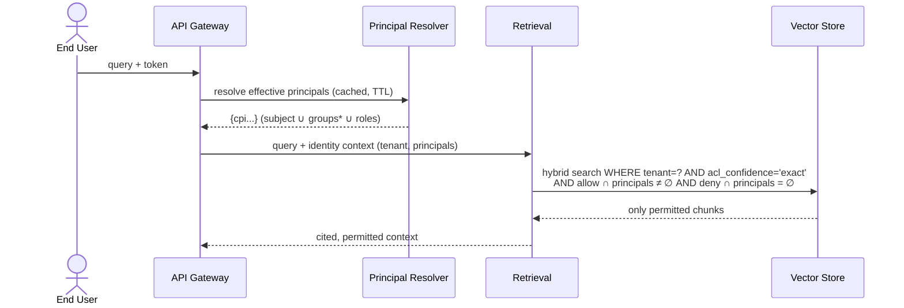
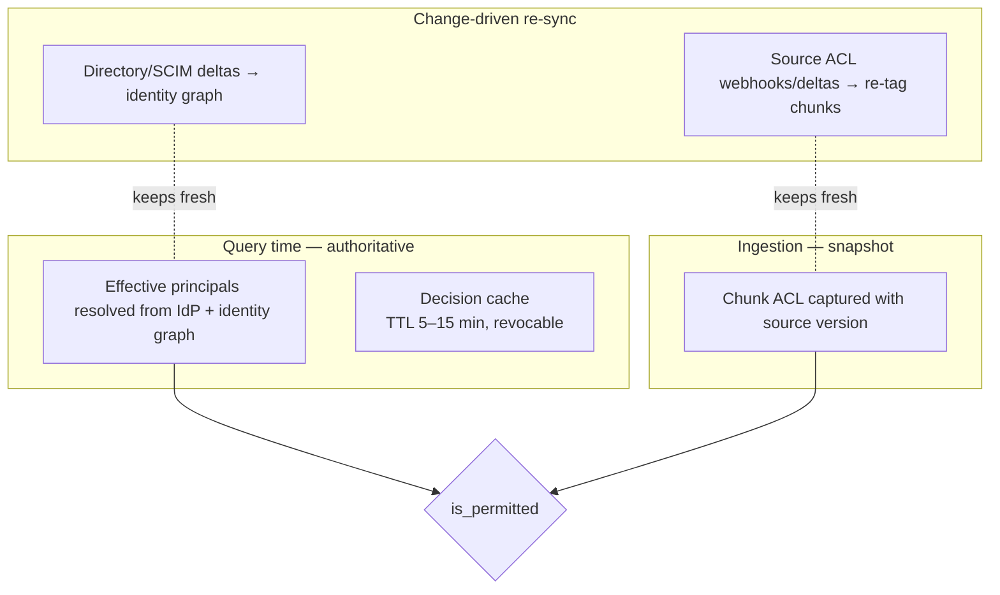

# Authorization Model — Canonical Permissions & Identity

> Status: **Foundational** · Owner: Security & Data Architecture · Cycle: 3
> Implements [ADR-0004](../architecture/adr/ADR-0004-permission-faithful-retrieval.md)
> and [ADR-0008](../architecture/adr/ADR-0008-canonical-principal-acl-model.md).

This is the platform's hardest correctness guarantee. Every regulated domain the
platform targets — Finance, HR, Legal, Audit — depends on one invariant: **a user may
only be answered from content they are authorized to see in the source system, at the
moment they ask.** This document defines the canonical model that makes that invariant
enforceable across heterogeneous sources, the query-time enforcement mechanics, the
freshness strategy, and the per-connector conformance test that gates any source from
serving production retrieval.

It is the anchor for risks **R1** (permission-model mismatch → leak), **R3** (stale
permissions), and **R4** (cross-tenant leakage) from
[NEXT_STEPS §4](../NEXT_STEPS.md).

---

## 1. Why a canonical model (and not per-source enforcement)

Enterprise sources each have a *different, rich, and subtly incompatible* access model:

- **SharePoint / M365** — Azure AD (Entra) principals, nested groups, item-level
  permission inheritance with breaks, sharing links, sensitivity labels.
- **SAP** — authorization objects, roles/profiles, org-level (company code, cost
  center) and field-level restrictions; not a document ACL at all.
- **Email / Exchange** — ownership by mailbox, delegate access, shared mailboxes,
  distribution-list membership.
- **File shares** — POSIX / NTFS ACLs, allow **and deny** ACEs, inheritance.

We have two options: enforce natively per source at query time (call each source's
authorization API for every candidate chunk), or **normalize every source's ACL into
one canonical model at ingestion and enforce against that model at query time.**

We choose normalization (**[ADR-0008](../architecture/adr/ADR-0008-canonical-principal-acl-model.md)**).
Native per-source enforcement at query time is correct but fatal to latency (N source
API calls on the hot path) and availability (source down → no answers), and it cannot
support **filter-during-retrieval** ([ADR-0004](../architecture/adr/ADR-0004-permission-faithful-retrieval.md))
because you cannot ask a vector store "return only rows this user may see" if the ACL
lives in another system. The canonical model is the price of both safety *and* speed.

The bet — and its risk — is that **every source ACL can be faithfully lowered into one
model.** Where it cannot (§9), that source is quarantined to a stricter isolation tier
rather than allowed to leak.

---

## 2. The canonical model: four nouns

Everything reduces to four entities. Keep this vocabulary stable across the platform,
storage schema, and connector contracts.

| Entity | Meaning | Example |
|--------|---------|---------|
| **Subject** | A human (or service) that asks. Resolved from the IdP token. | `user:alice@contoso.com` |
| **Principal** | An identity that a grant can name. A Subject *is* a principal; so is every group/role the Subject transitively belongs to. | `group:finance-emea`, `role:sap:FI_DISPLAY` |
| **Grant** | An `(principal, effect, scope)` triple attached to a Resource. `effect ∈ {allow, deny}`. | `allow group:legal to resource:doc/123` |
| **Resource** | A retrievable unit (a chunk) plus the ACL captured from its source item. | `chunk:987 → {tenant, acl:[grants], labels}` |

### 2.1 Canonical principal identifier (CPI)

Every principal from every source is normalized to a stable, namespaced string:

```
cpi := "<tenant>:<source>:<type>:<stable-id>"
# examples
acme:aad:user:8f3c-...-a91         # Entra object ID, not email (emails are reassignable)
acme:aad:group:finance-emea-guid
acme:sap:role:FI_AP_DISPLAY
acme:fileshare:sid:S-1-5-21-...-1013
acme:platform:everyone            # platform-synthesized well-known principal
```

Rules that make this safe:

- **Use the source's stable, non-reusable identifier** (Entra objectId, AD SID, SAP
  role name), **never a display name or email** — those get reused and reassigned,
  which silently transfers access. This is the single most common way normalization
  leaks.
- **Namespace by tenant and source.** A group GUID means nothing without knowing which
  tenant and which directory it came from. Cross-tenant collision is impossible by
  construction (reinforces R4).
- **Identity linking is explicit, never inferred.** If `alice@contoso.com` in Entra is
  the same human as an SAP user `ALICE01`, that link is a recorded, audited mapping in
  the identity graph (§4.2) — we do **not** guess by matching names/emails.

### 2.2 Resource ACL shape (stored per chunk)

```json
{
  "tenant_id": "acme",
  "resource_id": "sharepoint:site/legal:item/123#chunk/4",
  "source": "sharepoint",
  "source_item_version": "etag-or-mtime",
  "acl": {
    "allow": ["acme:aad:group:legal-all", "acme:aad:user:8f3c..."],
    "deny":  ["acme:aad:group:contractors"],
    "visibility": "restricted"        // restricted | internal | public-within-tenant
  },
  "labels": { "sensitivity": "confidential", "pii": true, "legal_hold": false },
  "acl_confidence": "exact",          // exact | approximate | unknown  (see §9)
  "captured_at": "2026-07-05T10:00:00Z"
}
```

`labels` (sensitivity/PII) are **orthogonal** to the ACL and are enforced *in addition*
to it — see §7. `acl_confidence` is what makes fail-closed decidable (§8).

---

## 3. The authorization decision (the one function)

All enforcement collapses to a single predicate, evaluated for a `(Subject, Resource)`
pair. It is intentionally trivial to reason about — complexity lives in *building the
inputs* (the effective-principal set in §4 and the ACL capture in §5), not in the
decision.

```
def is_permitted(subject_principals: set[CPI], resource) -> bool:
    if resource.tenant_id != subject.tenant_id:        # R4: tenant is absolute
        return False
    if resource.acl_confidence != "exact":             # R1: ambiguity → deny (§9)
        return False
    if subject_principals & resource.acl.deny:          # deny wins over allow (§3.1)
        return False
    if not (subject_principals & resource.acl.allow):   # need at least one allow
        return False
    return True                                         # labels checked separately (§7)
```

### 3.1 Precedence: deny always wins

If any of the Subject's principals appears in `deny`, access is refused **even if
another principal grants allow.** This matches NTFS and most enterprise semantics and
is the only safe default: an explicit deny is a stated intention to exclude. Modeling
"allow overrides deny" would let a broad group grant re-open a targeted exclusion.

### 3.2 Where this runs

The predicate is **not** run as a post-filter loop in application code (that would mean
retrieving restricted chunks first — the exact anti-pattern ADR-0004 forbids). Instead
its *allow/deny sets* are pushed **into the retrieval query** as a metadata filter, so
disallowed chunks are never ranked, scored, snippetted, or sent to the model (§6).

---

## 4. Resolving the Subject's effective principals (query time)

The hard half of authorization is not the decision — it is knowing the **complete** set
of principals a Subject holds *right now*, including transitive group nesting across
every source.

```mermaid
flowchart LR
  T[IdP token<br/>oid + group claims] --> R[Principal Resolver]
  IG[(Identity Graph<br/>group nesting, cross-source links)] --> R
  ENT[Source entitlement<br/>snapshots + deltas] --> R
  R --> EP[Effective principal set<br/>= &#123;subject&#125; ∪ groups* ∪ linked-source roles]
  EP --> C[(Decision cache<br/>short TTL, §8)]
  C --> RET[Retrieval filter]
```



### 4.1 Inputs

1. **IdP claims** — the OIDC/SAML token carries the Subject's object ID and (often
   overflow-limited) group claims. Group claims in tokens are frequently **truncated**
   (Entra caps at ~200); never trust the token as the complete group list.
2. **Identity Graph** — the authoritative, platform-maintained expansion of nested
   groups and the explicit cross-source identity links, kept fresh by SCIM + directory
   deltas (§8).
3. **Source entitlements** — for sources whose permissions are *roles not groups*
   (SAP), the Subject's current role assignments, captured as principals.

### 4.2 The identity graph

A per-tenant directed graph: nodes are principals (users, groups, roles); edges are
`member-of` and `same-human-as` (the explicit cross-source link). Effective principals
= the Subject node plus the transitive closure over `member-of`, unioned across every
linked identity. This is computed and cached, not recomputed per chunk.

- **Nested groups** are fully expanded — a Subject in `finance-emea` which is a member
  of `finance-all` holds both CPIs. Missing this is a silent over- or under-grant.
- **Cross-source links** let an Entra Subject inherit their SAP role principals, so a
  single query can safely span SharePoint *and* SAP content with one effective set.

### 4.3 Well-known synthetic principals

The platform materializes a few source-agnostic principals so common cases don't need
special code: `<tenant>:platform:everyone` (every authenticated Subject in the tenant),
`<tenant>:platform:authenticated`. A resource marked `visibility: internal` is
rewritten at ingestion to `allow: [<tenant>:platform:everyone]`, so §3's predicate
needs no special "public" branch.

---

## 5. Per-source ACL mapping (the connector's hardest job)

Each connector must **lower** its source's native model into `{allow[], deny[],
labels, acl_confidence}`. This is where correctness is won or lost. Mapping intent per
source:

### 5.1 SharePoint / OneDrive (M365)
- Resolve **item-level** permissions (respect broken inheritance — do not assume a doc
  inherits its library's ACL).
- Map Entra users/groups → CPIs by **objectId**. Expand M365-group → security-group
  where relevant.
- **Sharing links** (anyone / org-wide / specific-people) become explicit grants;
  "anyone" links on a restricted item are a policy flag, not a silent public grant.
- Sensitivity labels → `labels.sensitivity`.
- `acl_confidence = exact` only when item-level permissions were fully read.

### 5.2 SAP
- SAP has **no document ACL** — authorization is via authorization objects and org
  levels (company code, cost center, plant). The connector emits a chunk's requirement
  as **role/authorization principals** (`role:FI_AP_DISPLAY`, `orgunit:CC1000`), and the
  Subject's held SAP roles form the matching principals.
- Field/row-level restrictions that cannot be represented as principal set-membership
  ⇒ `acl_confidence = approximate` ⇒ **denied** under §3, quarantined to a stricter
  tier (§9). We do not fake SAP field-level security with document grants.

### 5.3 Email / Exchange
- A message is granted to its **mailbox owner** and explicit **delegates**; shared
  mailboxes grant their delegate set; distribution-list membership does **not** grant
  read to the archived copy unless the source says so.
- Threads: each message keeps its own ACL — a forwarded/quoted thread does not
  retroactively grant earlier recipients.

### 5.4 File shares (NTFS / POSIX)
- Map SIDs/UIDs/GIDs → CPIs. **Honor deny ACEs** (NTFS deny) — these map directly to
  `acl.deny` and must not be dropped.
- Expand inheritance; a chunk records the *effective* ACL of its file, not the raw ACE
  list.

### 5.5 The mapping contract

Every connector implements: `map_acl(source_item) -> CanonicalACL` and
`list_principal_changes(since) -> [principal-delta]`. The connector **declares** the
maximum `acl_confidence` it can achieve per item class; anything below `exact` is
denied on the shared retrieval path by construction.

---

## 6. Query-time enforcement: filter-during-retrieval



- The allow/deny predicate is compiled into the **vector store's metadata filter** and
  the keyword index filter, so both halves of hybrid search are constrained identically.
  A chunk the Subject can't see never enters ranking → cannot leak via score, snippet,
  or citation.
- **Tenant scope** is applied first and unconditionally; a missing tenant fails closed.
- If the permitted set is empty, the orchestrator answers *"no accessible information"* —
  it **never** falls back to unfiltered retrieval and never fabricates (per Overview §4).
- Every retrieval writes to the audit log **which principals were used and which chunk
  IDs were returned** — the non-repudiation backbone (Security §8).

Practical note on large principal sets: users in hundreds of groups produce large `IN`
filters. Mitigations: cap+bucket principals, use array-overlap operators
(pgvector/Elastic `terms`, Qdrant `should`), and pre-resolve the principal set once per
request (not per chunk). Chosen vector store must support efficient set-overlap
filtering — a hard requirement fed to the [Storage](../storage/) cycle (open question 1).

---

## 7. Sensitivity labels are enforced *in addition* to ACLs

ACL answers *"may this user open this item?"*. Labels answer *"may this content be used
this way, right now?"* — a second, independent gate:

- A `legal_hold` or `confidential` chunk may be ACL-permitted yet still **excluded from
  a lower-trust model tier**, or require redaction before entering a prompt (Security
  §6, Model Gateway policy).
- PII-tagged content can be permitted for retrieval but **masked** in the prompt.
- Labels never *widen* access; they can only *further restrict*. `permitted = ACL-allow
  AND label-policy-allow`.

This separation keeps the ACL model clean (identity-based) and lets compliance policy
(domain-specific, changes often) evolve in [Governance](../governance/) without touching
the authorization predicate.

---

## 8. Freshness: the stale-permission problem (R3)

Source ACLs change continuously (offboarding, role change, re-share). An index that
serves an ingestion-time snapshot will leak to a user who *just* lost access. Strategy:



Three layers, in precedence order:

1. **Query-time principal resolution wins** over the ingestion snapshot. The Subject's
   *current* effective principals are resolved live (cached with a **short TTL**, 5–15
   min, and **actively invalidated** on a SCIM `deactivate`/group-change event). If a
   user is offboarded, their principal set collapses and they match nothing — even
   before any chunk is re-tagged.
2. **Change-driven ACL re-sync.** Connectors subscribe to source change signals
   (Graph webhooks, SAP change docs, file-system audit) and re-tag affected chunks'
   `acl` + `source_item_version`. This closes the gap when the *resource's* ACL changes
   (item re-shared) rather than the *user's* groups.
3. **Freshness SLA (open question 7)** is the promised max staleness between a source
   ACL change and the index reflecting it. Proposed initial SLA: **principal changes
   ≤ 5 min** (identity graph is small, high-value), **resource ACL changes ≤ 15 min**
   for restricted classes, best-effort for public. This is a governance commitment, not
   just an implementation detail — recorded here, ratified in Governance.

**Why query-time precedence matters most:** offboarding and privilege revocation are the
highest-severity leak; anchoring on the *user's* live principal set means the most
dangerous change (person loses access) is closed fastest and cheapest.

---

## 9. When a source can't be faithfully normalized (R1 mitigation)

Some sources have semantics the canonical model cannot express *exactly* — SAP
field-level authorization, dynamic/attribute-based rules, computed row-level security.
Doctrine, in order of preference:

1. **Represent it exactly** as principals if at all possible (roles, org units).
2. **If not exact, mark `acl_confidence = approximate|unknown`** → the §3 predicate
   **denies** it on the shared retrieval path. It is invisible, not leaked.
3. **Quarantine to a stricter isolation tier** — that source/class serves only via a
   **per-user or dedicated-index** path (Security §5 Isolated tier), or via **native
   query-time delegation** (call the source's own authz for that narrow class) accepting
   the latency. This is the escape hatch that keeps the platform honest instead of
   pretending a bad mapping is safe.
4. **Never** promote an `approximate` mapping to `exact` to "make it work." That is the
   single change most likely to cause a leak; it is blocked by the conformance test.

---

## 10. Delegated / on-behalf-of access

Where a source supports it (Microsoft Graph OBO, SAP principal propagation), the
connector reads **as the user** at query time for the highest-risk classes, so the
source itself enforces. Trade-off: strongest correctness (source is the authority) but
adds a live source call on the hot path and requires per-user tokens. Used selectively —
as the §9 escape hatch and for the most sensitive domains — not as the default path,
because it reintroduces the latency/availability coupling normalization was chosen to
avoid.

---

## 11. The permission-conformance test (the production gate)

**No connector serves production retrieval until it passes this suite.** It is the
executable form of "faithfully normalized" and the primary control for R1. It is a
first-class deliverable of every connector, versioned with it.

Each connector ships a **fixture corpus** in its source with a known ground-truth
permission matrix, and the suite asserts the platform reproduces it exactly:

| Test | Asserts |
|------|---------|
| **Positive** | User with access retrieves the item. |
| **Negative** | User without access gets **zero** chunks (no snippet/citation leak). |
| **Deny-precedence** | Explicit deny beats an allow-granting group. |
| **Nested group** | Access via a group-of-groups resolves correctly. |
| **Broken inheritance** | Item with unique perms ignores parent ACL. |
| **Revocation freshness** | User removed from a group loses access within the SLA. |
| **Re-share freshness** | Newly restricted item stops being served within the SLA. |
| **Ambiguity → deny** | An item the connector marks `approximate` is never served on the shared path. |
| **Cross-tenant** | No chunk of tenant A is ever returned to tenant B (R4). |
| **Label gate** | A `confidential`-labeled, ACL-permitted item honors label policy (§7). |

The suite runs in CI and as a **periodic production canary** (synthetic users against a
synthetic corpus per source) to catch drift from source-API changes (R6). A connector's
declared max `acl_confidence` is verified, not trusted.

---

## 12. Trade-offs

- **Normalization risk vs. speed/availability.** We accept the burden of proving each
  mapping faithful (the conformance suite) to gain filter-during-retrieval and freedom
  from live source calls on the hot path. The alternative — native per-source authz per
  query — is simpler to trust but too slow and couples query availability to every
  source. (§1, §10.)
- **Freshness vs. cost.** Short TTLs and change-driven re-sync cost compute and
  connector complexity; the alternative (long snapshots) leaks on offboarding. We spend
  the most on the cheapest, highest-value layer — the user's live principal set. (§8.)
- **Deny-wins vs. flexibility.** Deny-overrides-allow can surprise admins ("why can't
  my group see it?") but is the only safe default. (§3.1.)
- **Quarantine vs. coverage.** Refusing to serve `approximate`-confidence content on the
  shared path reduces recall for hard sources, but a false answer from a leaked document
  is far costlier than a "no accessible information." (§9.)

## 13. Alternatives considered

| Alternative | Verdict |
|-------------|---------|
| Native per-source authz at query time (no normalization) | Rejected as default: N live source calls per query; can't filter-during-retrieval; query availability coupled to sources. Kept as the §9/§10 escape hatch. |
| Post-retrieval filtering | Rejected ([ADR-0004](../architecture/adr/ADR-0004-permission-faithful-retrieval.md)): restricted content enters ranking → snippet/score/citation leak. |
| Per-user indexes for everyone | Rejected as default: storage-explosive, slow to update; reserved for very-high-sensitivity classes (§9 tier-3). |
| Match identities by email/display name | Rejected: names/emails are reused and reassigned → silent access transfer. Identity links are explicit and audited (§2.1, §4.2). |
| Allow-overrides-deny precedence | Rejected: a broad allow would re-open a targeted exclusion. |
| Trust IdP token group claims as complete | Rejected: token group lists are truncated; identity graph is authoritative (§4.1). |

## 14. Future scalability

- **New source** = new connector implementing `map_acl` + `list_principal_changes` +
  passing the §11 conformance suite. No change to the decision predicate (§3) or storage
  schema. This is the core "new domain = pack, not redesign" bet applied to authz.
- **New identity provider** = new resolver feeding the identity graph; the CPI namespace
  and predicate are unchanged.
- **10× principals/groups** = identity graph and decision cache scale horizontally per
  tenant; the hot path resolves one principal set per request, not per chunk.
- **ABAC extension** — if a domain needs attribute-based rules (clearance ≥ X, region =
  Y), attributes become additional synthetic principals or a label-policy in §7, without
  changing the four-noun model.

## Related

- [ADR-0004 — Permission-faithful retrieval](../architecture/adr/ADR-0004-permission-faithful-retrieval.md) (the *what*)
- [ADR-0008 — Canonical principal/ACL model](../architecture/adr/ADR-0008-canonical-principal-acl-model.md) (the *how*, this doc's decision)
- [Security Architecture §3–§5, §10](../security/00-security-architecture.md) — identity, isolation, fail-closed
- [Platform Overview §4–§5](../architecture/01-platform-overview.md) — request/ingestion lifecycles
- Downstream deep dives: [RAG](../rag/) (consumes the retrieval filter),
  [Storage](../storage/) (must support set-overlap filtering + isolation tiers),
  [Metadata](../metadata/) (labels, lineage), [Workers](../workers/) (change-driven
  re-sync), [Governance](../governance/) (freshness SLA, label policy)
