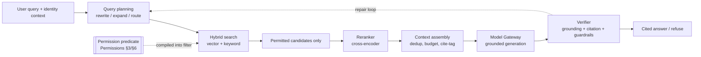

# RAG Retrieval Pipeline

> Status: **Foundational** · Owner: RAG / Query-Plane Architecture · Cycle: 4
> Implements [ADR-0009](../architecture/adr/ADR-0009-hybrid-retrieval-and-chunking.md).
> Consumes the permission filter from
> [Permissions §3, §6](../permissions/00-authorization-model.md) — this document does
> **not** re-specify authorization; it plugs the existing predicate into retrieval.

This is the **query-plane payoff**. The permission model ([Cycle 3](../permissions/00-authorization-model.md))
exists so retrieval can be safe; this document specifies the pipeline that turns a user
question plus the permitted corpus into a **grounded, cited, verified** answer. It owns
the ingestion-side representation (chunking, embedding) and the query-side path
(hybrid search → permission filter → rerank → grounding → verify), and it is the anchor
for risk **R2** (prompt injection via retrieved content) from [NEXT_STEPS §4](../NEXT_STEPS.md).

It answers open question **#4** (chunking & embedding strategy) and takes a **provisional**
position on open question **#1** (vector store) — enough to unblock the pipeline, with
final selection deferred to [Storage](../storage/) (Cycle 5).

---

## 1. Why RAG, and why this pipeline shape

The platform's knowledge must be **fresh, auditable, and permission-checkable per user**
([Vision §5](../architecture/00-vision-and-principles.md), [ADR-0001](../architecture/adr/ADR-0001-platform-shape-private-rag.md)).
Fine-tuning fails all three; classic keyword search fails on natural-language questions;
pure vector search fails on exact tokens (invoice numbers, statute IDs, SAP doc numbers,
person names) and cannot be trusted to honor an ACL by itself. The pipeline is therefore
**hybrid retrieval with a permission filter pushed into the query, a reranking stage, and
a verifier that refuses ungrounded answers.**

The non-negotiable ordering constraint, inherited from
[ADR-0004](../architecture/adr/ADR-0004-permission-faithful-retrieval.md): **the
permission filter runs *inside* retrieval, before ranking, snippeting, or reranking.**
Every stage below operates only on the already-permitted candidate set. A chunk the
Subject may not see never exists as far as the rest of the pipeline is concerned.



---

## 2. Ingestion-side: chunking strategy (open question #4, part 1)

Chunking is an **ingestion-plane** concern ([Workers](../workers/)) but is specified here
because retrieval quality is decided by it. A chunk is the atomic **retrievable unit**
and — critically — the atomic **ACL-bearing unit** ([Permissions §2.2](../permissions/00-authorization-model.md)):
every chunk carries the canonical ACL of its source item. This couples chunking to
authorization and to citation granularity.

### 2.1 Principle: structure-aware, not fixed-size

We reject naive fixed-token windows as the default. Chunks are cut on **semantic and
structural boundaries** first, with a token budget as a bound, not the primary cut:

| Content class | Cut on | Why |
|---------------|--------|-----|
| Prose (policy, contract, wiki) | Headings → paragraphs; ~512–1024 tok target, ~15% overlap | Preserves clause/section integrity for Legal/HR |
| Tables (Finance, SAP exports) | Whole table or row-group; keep header row with each chunk | A row is meaningless without its header; never split mid-row |
| Email threads | Per **message**, not per thread | Each message has its **own ACL** ([Permissions §5.3](../permissions/00-authorization-model.md)); mixing them would mix ACLs |
| Code / config | Function / logical block | Keep definitions whole |
| Scanned / OCR (Doc Intelligence) | Layout blocks from OCR, then prose rules | Respect columns, figures, form fields |

### 2.2 Hard rules (correctness, not tuning)

1. **A chunk never spans two source items with different ACLs.** If a boundary would
   merge content from two items, split. This is a permission-safety invariant, not a
   quality preference — a mixed-ACL chunk is unfilterable and is treated as a defect.
2. **Every chunk retains a stable `resource_id`** (`source:item:...#chunk/N`) and the
   `source_item_version`, so re-ingestion is idempotent and citations are addressable.
3. **Parent/section context is attached as metadata**, not merged into the body: a chunk
   stores its document title + heading path so the reranker and the prompt can show
   provenance without diluting the embedding.
4. **Overlap is bounded and recorded** so the same sentence retrieved via two chunks is
   de-duplicated at context assembly (§6).

### 2.3 Trade-off

Structure-aware chunking costs a per-content-type parser (more connector/worker work,
[Workers](../workers/)) versus a trivial universal splitter. We pay it because the
dominant domains (Finance tables, Legal clauses, email threads) are exactly the ones a
fixed window corrupts — and because the mixed-ACL invariant is not optional.

---

## 3. Ingestion-side: embedding strategy (open question #4, part 2)

### 3.1 One embedding space per tenant, per model version

- Embeddings are produced by an **in-boundary embedding model** served through the
  [Model Gateway](../architecture/adr/ADR-0003-model-gateway-indirection.md) (Principle 1:
  private by default — embeddings are derived customer data and must not egress).
- The **embedding model + version is recorded on every vector** (`embed_model`,
  `embed_dim`). A query is only ever compared against vectors from the **same** model
  version; mixing spaces silently degrades recall. Model upgrades are a **versioned
  re-embed migration** ([Storage](../storage/) / [Workers](../workers/)), never an
  in-place swap — this satisfies Principle 8 (immutable, versioned knowledge).

### 3.2 Universal core, per-domain adapters (not per-domain models)

Open question #4 asked per-domain vs. universal embeddings. Decision: a **single
strong general-purpose embedding model as the default**, with **domain handling in
pre-embed normalization**, not in a fork of the model:

- Tables/numeric (Finance/SAP): serialize rows to a canonical `header: value` text form
  before embedding; also index the raw values for keyword/exact search (§4).
- Long contracts (Legal): embed at the clause chunk with the heading path prepended, so
  a clause is findable by its section.
- Email: embed the message body with a normalized `subject + from + body` preface.

This keeps **one vector space** (so hybrid search and cross-domain queries work) while
handling domain shape at the text-normalization layer. A genuinely divergent domain can
later get its own **named embedding space** without changing the pipeline — see §10.

### 3.3 Trade-off

A universal space slightly underperforms a perfectly domain-tuned model on that domain,
but avoids N incompatible spaces, N migration pipelines, and the impossibility of a
cross-domain query (Finance + Legal in one answer). We buy simplicity and cross-domain
recall at a small per-domain quality cost, recoverable later via §10 without a redesign.

---

## 4. Query-side: hybrid search (vector + keyword)

Neither retrieval mode is sufficient alone, so we run **both and fuse**:

- **Dense / vector** — semantic similarity (embed the query in the same space as §3),
  catches paraphrase and concept match. Weak on exact tokens and rare identifiers.
- **Sparse / keyword** (BM25 / full-text) — exact match on invoice numbers, statute IDs,
  SAP document numbers, names, code identifiers. Weak on synonyms and paraphrase.

### 4.1 Fusion

Results are merged with **Reciprocal Rank Fusion (RRF)** as the default — it needs no
score calibration between the two engines and is robust. Weighted score fusion is
available per-domain where one modality is known dominant (e.g. keyword-heavy for SAP
document-number lookups). Fusion produces a single candidate list handed to the reranker.

### 4.2 The permission filter is applied to *both* halves (consumed, not redefined)

Both the vector filter and the keyword filter carry the **same** compiled predicate from
[Permissions §6](../permissions/00-authorization-model.md):

```
WHERE tenant_id = :tenant
  AND acl_confidence = 'exact'
  AND acl.allow  &&  :subject_principals     -- array overlap: at least one allow
  AND NOT (acl.deny && :subject_principals)  -- deny wins
  -- label policy (Permissions §7) applied as an additional AND
```

- **This document does not define authorization** — it declares the *integration
  contract*: retrieval MUST compile the effective-principal set (resolved once per
  request by the Principal Resolver) into the metadata filter of **each** search engine,
  so a chunk excluded by one is excluded by both. Applying it to only the vector side
  would leak via the keyword side, and vice-versa.
- **Tenant scope is unconditional and first.** A missing/empty principal set → empty
  result → the orchestrator answers *"no accessible information"*; retrieval **never**
  falls back to an unfiltered query ([Overview §4](../architecture/01-platform-overview.md)).
- Requirement fed to [Storage](../storage/): both the vector store and the keyword index
  must support **efficient array set-overlap filtering** on principal arrays — a hard
  selection criterion, already flagged in [Permissions §6](../permissions/00-authorization-model.md).

### 4.3 Query planning (before search)

A light planning step improves recall without harming the ACL guarantee (it only shapes
the *query text*, never the filter):

- **Query rewrite / expansion** — resolve pronouns, expand acronyms from a per-tenant
  glossary, optionally multi-query (generate 2–3 paraphrases, union candidates).
- **Routing hints** — domain/source hints (e.g. "in the contract with X") become
  *additional* metadata filters that further **restrict**, never widen, the candidate set.
- **Structured-data escape** — a question that is really a structured query
  (aggregations over SAP/warehouse) is routed toward a text-to-query path
  ([Reporting](../architecture/00-vision-and-principles.md) domain, future) rather than
  vector search; RAG retrieves the *narrative/context*, not the aggregate.

---

## 5. Query-side: reranking

Hybrid fusion is high-recall but coarsely ordered. A **cross-encoder reranker** (served
in-boundary via the Model Gateway) re-scores the top-K candidates (e.g. K≈50 → top-8) by
reading query and chunk **together**, which a bi-encoder embedding cannot. This is the
single biggest precision lever in the pipeline.

- Runs **only on already-permitted candidates** (§4.2) — reranking never sees a chunk the
  Subject may not read, so it cannot leak via reorder or score.
- **Diversity / MMR** is applied after reranking to avoid returning eight near-duplicate
  chunks of the same paragraph; the goal is coverage within the token budget.
- Reranker output carries a **relevance score** used both to trim context (§6) and by the
  verifier and grounding step (§7) to decide "is there enough signal to answer at all?".

Trade-off: the cross-encoder adds latency and a model call. Mitigated by reranking only
the fused top-K (not the whole candidate set) and by caching per (query, candidate-set)
where safe. If a tenant tier is latency-critical, reranking degrades gracefully to
fusion-only ranking — an explicit, logged quality/latency dial, not a silent skip.

---

## 6. Context assembly

Between reranking and generation, candidates become a **prompt-ready, cited context**:

1. **De-duplicate** overlapping chunks (§2.4) so the model isn't shown the same sentence
   twice and the token budget isn't wasted.
2. **Budget** — pack the highest-reranked chunks up to the model's context budget minus
   headroom for the answer; prefer breadth (distinct sources) over depth when scores tie.
3. **Cite-tag** — each included chunk is wrapped with a stable citation handle
   (`[S1] resource_id + title + heading path + version`) so the model can attribute
   claims and the verifier (§7) can check them. Provenance metadata travels *around* the
   content, never inside the embedded body.
4. **Label-driven redaction** — chunks permitted by ACL but carrying sensitivity/PII
   labels are masked/redacted here per [Permissions §7](../permissions/00-authorization-model.md)
   and Model-Gateway policy **before** the text enters the prompt. Labels can only further
   restrict, never widen.

### 6.1 Prompt-injection defense (R2) — retrieved text is data, never instructions

Retrieved content is **untrusted data** and is treated as such at assembly time:

- Context is delivered inside an explicit **data boundary** (delimited, role-separated),
  with a system instruction that content between the delimiters is reference material and
  **must not be executed as instructions**.
- Chunks are **not** allowed to alter tool-call policy, model routing, or the citation
  contract; those are fixed by the orchestrator/gateway, outside the retrieved text.
- The **verifier** (§7) is the backstop: an answer that obeyed an injected instruction
  (e.g. exfiltration, "ignore your sources") fails grounding/guardrail checks and is
  repaired or refused. This is the defense-in-depth pairing named in
  [Security](../security/00-security-architecture.md) and [NEXT_STEPS R2](../NEXT_STEPS.md).

---

## 7. Grounding, citation & the verifier contract

Generation happens via the [Model Gateway](../architecture/adr/ADR-0003-model-gateway-indirection.md)
(policy-checked, redacted, routed). The pipeline's promise is **no ungrounded claims**.

### 7.1 The verifier's contract (query-plane guardrail)

The Verifier ([Overview §3.1, §4](../architecture/01-platform-overview.md)) sits between
the model completion and the user. Its contract:

| Check | Pass condition | On fail |
|-------|----------------|---------|
| **Grounding** | Every factual claim maps to ≥1 cited chunk in the assembled context | Repair (re-prompt with stricter grounding) → else refuse |
| **Citation validity** | Each citation handle resolves to a chunk actually in this request's permitted context | Strip/repair; never invent a source |
| **No-context honesty** | If context was empty/low-signal, the answer states "no accessible information" and does not fabricate | Force the honest refusal |
| **Guardrails** | No policy-violating, injected, or exfiltrating output (R2) | Refuse; log as a security event |
| **Label compliance** | Redaction from §6.4 survived into the answer (no leaked PII/confidential span) | Redact/refuse |

- **Refuse-over-guess** is the default: a wrong grounded-looking answer in Finance/Legal/
  HR/Audit is more costly than a refusal (mirrors the fail-closed doctrine, Principle 7).
- The verifier may trigger **one bounded repair loop** (back to query planning §4.3 with a
  tightened instruction or expanded retrieval); loops are capped to protect latency/cost.

### 7.2 Citations are first-class

Every answer returns **structured citations** (resource_id, title, source, version) — not
just footnote text — so the UI can deep-link to the source item and an auditor can verify
"this claim came from that document version." Citation identity is the same `resource_id`
used by the ACL and the audit log, so the three views reconcile exactly.

### 7.3 Auditability

Per [Overview §4](../architecture/01-platform-overview.md) and
[Permissions §6](../permissions/00-authorization-model.md), each request appends to the
append-only audit log: **the effective principals used**, the **chunk IDs retrieved**, the
**model + policy** applied, the reranker scores, and the verifier verdict. This makes the
whole pipeline explainable by construction (Principle 5) and is the evidence trail the
[Governance](../governance/) cycle consumes.

---

## 8. End-to-end latency budget (indicative)

The permission-aware, reranked path is heavier than naive vector search. Indicative
budget for the synchronous query plane (tuned per tenant tier in [Deployment](../deployment/)):

| Stage | Indicative share | Primary lever |
|-------|------------------|---------------|
| Principal resolution | cached (near-0) hot; slow on cache miss | Decision cache TTL ([Permissions §8](../permissions/00-authorization-model.md)) |
| Query planning / embed | small | Skip multi-query on latency tier |
| Hybrid search + filter | moderate | Set-overlap index efficiency (Storage) |
| Reranking | **largest single cost** | Rerank top-K only; degrade to fusion-only |
| Generation | model-bound | Model tiering at the gateway |
| Verify (+ optional repair) | moderate; repair doubles worst case | Cap repair loops at 1 |

The dominant, *non-optional* cost is reranking + generation; permission filtering is
designed to be a **filter predicate, not extra round-trips** precisely so safety is cheap.

---

## 9. Provisional position on the vector store (open question #1)

Final selection belongs to [Storage](../storage/) (Cycle 5). The RAG pipeline imposes
these as **hard requirements**, which pre-constrain the choice:

1. **Efficient array set-overlap filtering** on principal arrays (allow/deny), applied
   *pre-ranking* — the ACL predicate must be a first-class filter, not a post-filter.
2. **Hybrid search**: native or cleanly-integrable dense + sparse (BM25/full-text) with
   fusion, both honoring the same metadata filter.
3. **Per-tenant isolation** by namespace/collection/cluster (Principle 4), not by a shared
   `tenant_id` column alone.
4. **Metadata-rich payloads** (ACL arrays, labels, version, resource_id) with indexed
   filtering, and **in-boundary self-hosting** (Principle 1).
5. **Versioned upsert/delete** to support re-embed migrations (§3.1) and immutable
   knowledge (Principle 8).

**Provisional lean:** **pgvector** (Postgres) for early/small tenants — it co-locates
vectors, ACL arrays (`&&` overlap on `text[]`/GIN), full-text (`tsvector`), and metadata
in one transactional store, minimizing moving parts and satisfying set-overlap natively;
graduating to a **dedicated vector engine (Qdrant / Elasticsearch)** for large/high-QPS
tenants that need `should`/`terms` overlap filters and horizontal scale. This mirrors the
tenant-tier model already anticipated in [Overview §7](../architecture/01-platform-overview.md).
Recorded as provisional in [ADR-0009](../architecture/adr/ADR-0009-hybrid-retrieval-and-chunking.md);
**Storage owns the final call.**

---

## 10. Trade-offs

- **Hybrid + rerank vs. simple vector search.** More engines, more latency, one extra
  model call — bought for exact-token recall (identifiers) *and* semantic recall, plus
  the precision the cross-encoder gives. A demo can skip it; a Finance/Legal platform
  cannot. (§4, §5.)
- **Universal embedding space vs. per-domain models.** Small per-domain quality loss in
  exchange for one filterable, cross-domain-queryable space and one migration pipeline.
  Recoverable per §10-future without a redesign. (§3.)
- **Structure-aware chunking vs. fixed windows.** Per-content-type parser cost for
  clause/table/thread integrity and the mixed-ACL invariant. (§2.)
- **Refuse-over-guess.** Lower apparent answer rate, far lower rate of confident wrong
  answers in regulated domains — the correct trade for this platform. (§7.)
- **Safety is a filter, not a round-trip.** The whole design keeps the permission
  guarantee as an index predicate so it costs a `WHERE`, not N source calls — the reason
  normalization ([ADR-0008](../architecture/adr/ADR-0008-canonical-principal-acl-model.md))
  was chosen upstream. (§4.2.)

## 11. Alternatives considered

| Alternative | Verdict |
|-------------|---------|
| Pure vector search (no keyword) | Rejected: misses exact identifiers (invoice/statute/SAP numbers, names) that regulated domains query by. |
| Pure keyword search (no vector) | Rejected: fails natural-language/paraphrase questions — the core value of the platform. |
| No reranker (fusion order is final) | Rejected as default: coarse precision; cross-encoder is the biggest precision lever. Kept as a per-tier latency degrade (§5). |
| Fixed-size token chunks everywhere | Rejected: corrupts tables, clauses, and mixes email-message ACLs; breaks the mixed-ACL invariant (§2.2). |
| Per-domain embedding models by default | Rejected as default: N incompatible spaces, N migrations, no cross-domain query. Deferred as an opt-in named space (§10-future). |
| Post-retrieval permission filtering | Rejected ([ADR-0004](../architecture/adr/ADR-0004-permission-faithful-retrieval.md)): restricted content would enter ranking/rerank/snippets → leak. Filter is pushed into search (§4.2). |
| Trust the model to cite honestly (no verifier) | Rejected: ungrounded/injected answers would reach users; the verifier is the R2 backstop and the grounding guarantee (§7). |

## 12. Future scalability

- **New domain** = new connector + chunk parser + text-normalization rule; the vector
  space, filter predicate, rerank, and verifier are unchanged (the "new domain = pack"
  bet applied to retrieval).
- **Divergent domain** that truly needs its own vector space = a **named embedding
  space** selected by routing metadata; hybrid search and the ACL filter operate
  per-space unchanged (§3.2).
- **Embedding-model upgrade** = versioned re-embed migration into a new space, blue/green
  cut-over; old space stays queryable until cut (§3.1, Principle 8).
- **10× data / QPS** = graduate the tenant from co-located pgvector to a dedicated vector
  engine + read replicas + reranker autoscaling; the pipeline contract is identical (§9).
- **New reranker / generator** = registered at the [Model Gateway](../architecture/adr/ADR-0003-model-gateway-indirection.md);
  the pipeline calls the gateway, not a specific model.

## Related

- [Permissions §3, §6, §7 — the retrieval filter, consumed here](../permissions/00-authorization-model.md)
- [ADR-0004 — permission-faithful retrieval (filter during retrieval)](../architecture/adr/ADR-0004-permission-faithful-retrieval.md)
- [ADR-0009 — hybrid retrieval + structure-aware chunking (this doc's decision)](../architecture/adr/ADR-0009-hybrid-retrieval-and-chunking.md)
- [ADR-0003 — Model Gateway (embeddings, reranker, generation all mediated)](../architecture/adr/ADR-0003-model-gateway-indirection.md)
- [Platform Overview §3–§4 — planes and request lifecycle](../architecture/01-platform-overview.md)
- Downstream: [Storage](../storage/) (vector store selection — open Q#1),
  [Workers](../workers/) (chunk parsers + embedding jobs + re-embed migration),
  [Governance](../governance/) (audit-trail consumption), [Metadata](../metadata/) (labels)
