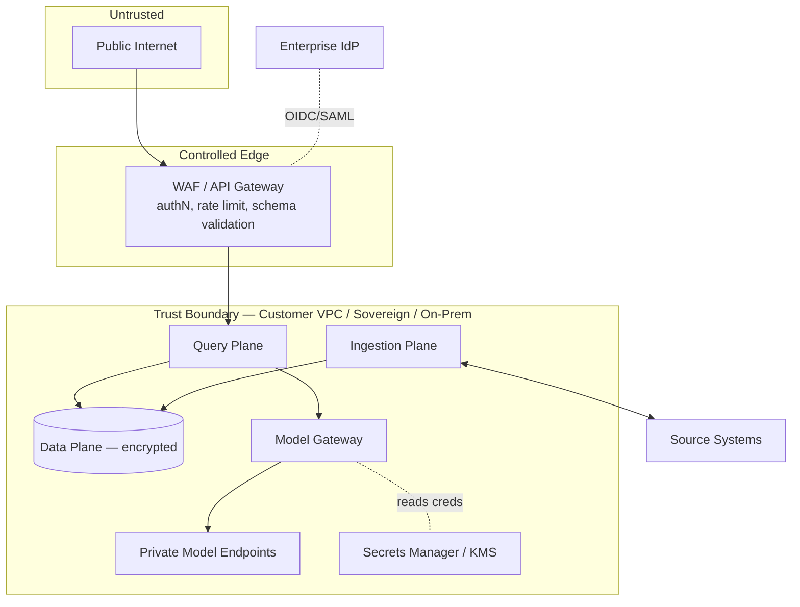

# Security Architecture

> Status: **Foundational** · Owner: Security Architecture · Cycle: 1

Security is a cross-cutting plane, not a feature. This document defines the trust
boundary, identity model, isolation strategy, data protection, threat model, and the
AI-specific risks the platform must defend against. It is the anchor for the
[Permissions](../permissions/) and [Governance](../governance/) deep dives.

## 1. Why security leads

The platform serves Finance, HR, Legal, and Audit — data whose exposure is a
regulatory and commercial incident. "Private by default" and "permission-faithful
retrieval" (Vision Principles 1 & 2) are the platform's reason to exist. If those fail,
nothing else matters. Therefore security constraints are decided **before** feature
convenience.

## 2. Trust boundary

**Rules of the boundary:**
- Nothing inside the boundary is reachable from the public internet except through the
  authenticated, validated edge.
- Model inference happens **inside** the boundary (self-hosted) or via a
  **contractually-private** endpoint with no training-on-data and no retention.
- Source systems are read by connectors; connectors never expose an inbound surface.
- Secrets never leave the Secrets Manager/KMS except into the process that needs them.

## 3. Identity & authentication

- **Users** authenticate via the enterprise IdP (OIDC/SAML); the platform is a relying
  party and issues short-lived, audience-scoped tokens. Group/role claims flow through
  for authorization. SCIM keeps user/group state in sync.
- **Services** authenticate to each other with workload identity (mTLS + signed
  service tokens). No shared static API keys between services.
- **Connectors** use least-privilege service principals per source; where the source
  supports it, prefer **on-behalf-of / delegated** access so the *user's* permissions
  are used at query time (see ADR-0004 and [Permissions](../permissions/)).

## 4. Authorization model

Two layers, both enforced:

1. **Platform authorization** — what a principal may do in the platform (RBAC: admin,
   domain-engineer, end-user; scoped per tenant).
2. **Content authorization** — which knowledge a user may retrieve, derived from source
   ACLs captured at ingestion and re-checked at query time
   ([ADR-0004](../architecture/adr/ADR-0004-permission-faithful-retrieval.md)).

Content authorization is the harder and more important layer; it gets its own deep dive
in [Permissions](../permissions/).

## 5. Multi-tenant isolation

Isolation is by construction, tiered by sensitivity (detailed in [Storage](../storage/)):

| Tier | Vector store | Object/metadata | Model routing | For |
|------|--------------|-----------------|---------------|-----|
| Shared | Per-tenant **namespace** | Per-tenant schema/prefix + row-level security | Shared gateway, tenant policy | Standard tenants |
| Isolated | Dedicated index/cluster | Dedicated schema/bucket | Dedicated model pool option | Regulated / large tenants |

Every stored record (vector, object, row, audit entry) carries a `tenant_id`. Queries
are tenant-scoped at the gateway; a missing/mismatched `tenant_id` fails closed. Cross-
tenant access is impossible without an explicit, audited, admin-level operation.

## 6. Data protection

- **In transit:** TLS 1.2+ everywhere, mTLS between services.
- **At rest:** encryption for object, vector, relational, cache, and audit stores;
  keys in KMS, per-tenant key separation for isolated tiers; support customer-managed
  keys (BYOK) for regulated tenants.
- **In use:** minimize sensitive data in prompts; the Model Gateway applies redaction
  policies (e.g. strip/mask PII fields) before inference where the domain requires it.
- **Classification-driven handling:** the ingestion Classifier tags sensitivity/PII;
  handling rules (retention, redaction, model-tier restrictions) key off those tags.
  See [Metadata](../metadata/).
- **Retention & deletion:** documents, embeddings, and derived artifacts are versioned;
  a source deletion propagates to vectors/caches (right-to-erasure support). No silent
  orphans — deletion is tracked in lineage.

## 7. Secrets management

- All credentials (source principals, model provider keys, DB creds) live in a secrets
  manager / KMS; never in source, config files, or images.
- Short-lived, rotated credentials; automatic rotation where the provider allows.
- Required secrets validated at service startup — **fail fast** if missing.
- This mirrors the repository's global security rule: *no hardcoded secrets, validate
  at startup, rotate on exposure.*

## 8. Audit & non-repudiation

An **append-only** audit log records, per event: who (user + tenant), when, what query,
what was retrieved (chunk IDs, not necessarily content), which model/role, what policy
applied, and what was returned. The log is tamper-evident (hash-chained) and retained
per compliance requirements. It is the backbone of Governance and incident response.

## 9. Threat model (STRIDE-lite) & AI-specific risks

### Classic threats

| Threat | Vector | Mitigation |
|--------|--------|-----------|
| Spoofing | Stolen token, service impersonation | Short-lived tokens, mTLS workload identity |
| Tampering | Poisoned document, altered vector | Signed ingestion lineage, integrity checks |
| Repudiation | "I never asked that" | Append-only hash-chained audit |
| Info disclosure | Cross-tenant / over-permissive retrieval | Isolation by construction + permission-faithful retrieval (fail closed) |
| Denial of service | Query/ingestion flooding | Rate limits, quotas, queue backpressure, cost budgets |
| Elevation of privilege | Connector over-scoped, ACL bypass | Least-privilege principals, delegated access, deny-on-ambiguity |

### AI-specific threats (OWASP LLM-aligned)

| Risk | Description | Mitigation |
|------|-------------|-----------|
| **Prompt injection** | Malicious instructions embedded in retrieved documents hijack the model | Treat retrieved content as **data, not instructions**; system-prompt hardening; output verifier; never let retrieved text trigger tool calls without policy checks |
| **Sensitive data leakage** | Model reveals restricted content in an answer | Permission-faithful retrieval (content never enters the prompt if unauthorized) + response redaction + grounding verifier |
| **Insecure output handling** | Model output used unsafely downstream (e.g. rendered HTML, executed SQL) | Output treated as untrusted; sanitize/validate before any downstream use |
| **Training-data exfiltration / retention** | Provider trains on or retains prompts | Private endpoints with contractual no-train/no-retain; in-boundary hosting preferred |
| **Excessive agency** | Agent takes destructive action autonomously | Governance policy engine + approval gates (inherited from template's fail-closed rule) |
| **Model DoS / cost abuse** | Expensive prompts drain budget | Token/cost budgets and quotas enforced at the Model Gateway |
| **Data poisoning** | Adversarial content corrupts the index | Source trust levels, ingestion validation, lineage to trace/rollback |

**Prompt injection is treated as a first-class, unsolved-in-general risk.** The
defense-in-depth stance: retrieved content is never trusted as instruction, tool
invocation requires policy approval, and the verifier inspects outputs before release.

## 10. Fail-closed doctrine

Every security-relevant ambiguity resolves to **deny + audit + escalate**:
unresolved permissions, unknown classification, missing tenant scope, verifier
uncertainty, expired token. Availability is never traded for confidentiality on the
query path.

## 11. Trade-offs

- Strict isolation and per-user permission checks raise cost and latency — accepted;
  they are the platform's core value.
- Redaction and verification can reduce answer richness — accepted; correctness and
  confidentiality outrank completeness.
- Private/in-boundary model hosting is more operationally demanding than a public API —
  accepted; it is a hard requirement for the target domains.

## 12. Alternatives considered

| Alternative | Verdict |
|-------------|---------|
| Perimeter-only security (trust the internal network) | Rejected: no defense against lateral movement or a compromised service; we use zero-trust between services. |
| Filter permissions after retrieval | Rejected (ADR-0004): restricted content still enters the pipeline. |
| Single shared index for all tenants with `tenant_id` filter only | Rejected as default: one filtering bug = cross-tenant leak; we isolate by namespace/cluster. |
| Rely on the model to keep secrets | Rejected: models are not an access-control boundary. |

## 13. Future scalability

- New tenant/tier: provision keys, namespace, and policy — no core change.
- New source: connector must pass a **permission-conformance test** before it can
  serve production retrieval.
- New model vendor: onboarded only if it meets the no-train/no-retain and
  private-endpoint bar.
- The threat model is revisited every cycle as new attack classes (esp. against
  agents and RAG) emerge.

## Related

- [Vision & Principles](../architecture/00-vision-and-principles.md)
- [ADR-0004 — Permission-faithful retrieval](../architecture/adr/ADR-0004-permission-faithful-retrieval.md)
- [ADR-0003 — Model Gateway](../architecture/adr/ADR-0003-model-gateway-indirection.md)
- Deep dives (planned): [Permissions](../permissions/), [Governance](../governance/),
  [Storage](../storage/)
