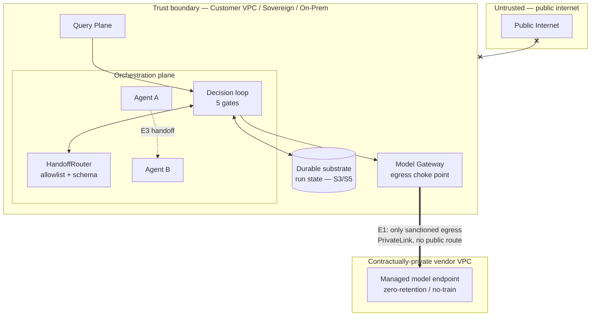

# Trust-edge hardening — the three edges earlier cycles handed to Security

> Status: **Seeded** (Cycle 28) · Owner: Security Architecture / Platform Engineering
> Extends [00-security-architecture.md](00-security-architecture.md) §2 (trust boundary),
> §5 (isolation) and §9 (threat model) with the concrete controls for three named trust edges.
> Discharges the Security hand-offs from [ADR-0018 / Models §"what this hands to Security"](../models/00-model-hosting-and-serving.md),
> [the substrate constraints S3/S5](../orchestration/01-execution-backend-substrate.md), and
> [Orchestration §"what this hands to Security"](../orchestration/00-agent-orchestration.md#10-what-this-hands-to-other-documents).
> **No new ADR** — this is the *security projection* of decisions already ratified (ADR-0018 dual-track
> serving, ADR-0019 orchestration posture, ADR-0004 permission-faithful retrieval). It introduces no new
> cross-component choice, only the concrete edge controls and the verification that makes them auditable.
> Net horizontal change = none, all additive.

---

## 0. Why this document exists (the gap it closes)

The [foundational security doc](00-security-architecture.md) (Cycle 1) drew the *trust boundary* as a single
line: inside = the customer VPC / sovereign / on-prem estate; outside = everything else. That line was correct
and load-bearing, but three later cycles each pierced or subdivided it and **explicitly deferred the concrete
hardening to Security**:

| Edge | Who opened it | What was deferred to Security |
|------|---------------|-------------------------------|
| **E1 — Track-B managed-endpoint egress** | [ADR-0018](../architecture/adr/ADR-0018-model-hosting-and-serving-posture.md) (Cycle 22) admitted a *contractually-private managed* serving track — the **one sanctioned outbound path** through the boundary. | "Track B private-networking (PrivateLink/VPC-peering) + zero-egress verification" ([Models §"hands to Security"](../models/00-model-hosting-and-serving.md)). |
| **E2 — substrate run-state residency & isolation** | [ADR-0019](../architecture/adr/ADR-0019-agent-orchestration-posture.md) (Cycle 23) + the [substrate doc](../orchestration/01-execution-backend-substrate.md) (Cycle 27) added durable *orchestration state* that encodes the question asked and the items retrieved — a **new class of sensitive data at rest**, with a residency rule (S5) and a tenant-isolation rule (S3). | Make S3 (per-tenant namespace, no cross-tenant workflow) and S5 (Isolated run-state never egresses) **verifiable, not merely asserted**. |
| **E3 — agent→agent handoff** | [ADR-0019](../architecture/adr/ADR-0019-agent-orchestration-posture.md) introduced multi-agent handoffs — an **intra-boundary lateral trust edge** inside the estate the Cycle-1 boundary treated as uniformly trusted. | "the handoff allowlist + schema validation + carried end-user context are the controls that keep a handoff from becoming a privilege-escalation path" ([Orchestration §10](../orchestration/00-agent-orchestration.md#10-what-this-hands-to-other-documents)). |

None of the three is a *new decision*. Each is a **known edge whose controls were named upstream and whose
concrete, testable form belongs here.** This document draws each edge, states its control set, and — the part
that makes it security rather than aspiration — specifies the **verification** that turns "we don't egress
Isolated run state" from a promise into a monitored, fail-closed, audited fact.

The unifying doctrine is the platform's existing one ([§10 fail-closed](00-security-architecture.md#10-fail-closed-doctrine)):
**every edge fails closed, and every "by construction" claim is paired with a runtime verifier that alarms on
violation.** A control you cannot observe failing is a control you do not have.

---

## 1. What these edges must satisfy (inputs, not choices)

Inherited constraints. The hardening does not get to relax any of them.

| # | Constraint | Source |
|---|-----------|--------|
| H1 | **Private by default — no un-approved egress.** No customer data (prompt, retrieved content, embedding, run state) leaves the trust boundary except through an explicit, logged, policy-approved egress. | [M1](../models/00-model-hosting-and-serving.md); [Principle 1](../architecture/00-vision-and-principles.md); [Security §2](00-security-architecture.md) |
| H2 | **Isolated tier is in-boundary, period.** For an Isolated / sovereign tenant, *nothing* sensitive egresses — not inference (Track A only), not run state (S5). The Track-B egress edge does **not** exist for Isolated. | [ADR-0018 routing](../models/00-model-hosting-and-serving.md); [S5](../orchestration/01-execution-backend-substrate.md); [Storage §5](../storage/00-storage-architecture.md) |
| H3 | **The end-user identity + tenant ride every hop.** No hop — model call, substrate activity, agent handoff — may widen scope by acting as a service account. | [O2](../orchestration/00-agent-orchestration.md); [ADR-0004](../architecture/adr/ADR-0004-permission-faithful-retrieval.md) |
| H4 | **Fail closed on ambiguity.** An unverifiable egress path, an unresolved residency, an unlisted handoff target, a missing tenant scope → deny + audit + escalate. | [Security §10](00-security-architecture.md#10-fail-closed-doctrine); [ADR-0006](../architecture/adr/ADR-0006-fail-closed-autonomy-default.md) |
| H5 | **Two independent controls at a confidentiality edge.** No single misconfiguration is a leak: construction (network/namespace) **and** an unconditional predicate/verifier. | [R4 mitigation](../storage/00-storage-architecture.md#52-isolation-by-construction); [Security §5](00-security-architecture.md#5-multi-tenant-isolation) |
| H6 | **Every claim is auditable evidence.** Egress-approval, residency, and handoff decisions are recorded in the append-only [hash-chained audit log](00-security-architecture.md#8-audit--non-repudiation) as first-class events. | [ADR-0012](../architecture/adr/ADR-0012-governance-audit-and-cost.md); [Security §8](00-security-architecture.md#8-audit--non-repudiation) |

---

## 2. The map — three edges on one boundary

- **E1** is the *only* line that crosses the boundary outward, and only for non-Isolated tenants at or below
  the data-class floor (§3). Everything else terminates inside.
- **E2** (the substrate store) never crosses the boundary at all for Isolated tenants (S5); for Shared it
  stays within the residency region and is tenant-namespaced (S3).
- **E3** is an *internal* edge — agent A to agent B — inside the estate the Cycle-1 boundary drew as one
  trusted zone. (Zero-trust between services — [Security §12](00-security-architecture.md#12-alternatives-considered))
  already says "don't trust the internal network"; E3 makes that concrete for the agent-to-agent case.

---

## 3. Edge E1 — the Track-B managed-endpoint egress edge

**The edge.** [ADR-0018](../architecture/adr/ADR-0018-model-hosting-and-serving-posture.md) resolved that a
Standard tenant's `public`/`internal` and capability-critical traffic may be served by a **contractually-private
managed endpoint** (`managed_private` / `managed_private_dedicated`) reached over private networking. That is,
by design, an outbound path through the boundary carrying a prompt (and, for a RAG answer, retrieved content).
It is the single sanctioned exception to "inference happens inside the boundary" — and therefore the edge that
most needs hardening.

### 3.1 Controls (two independent, H5)

1. **Network construction — no public route exists.** The managed endpoint is reached **only** over
   PrivateLink / VPC-peering / a private service-connect equivalent. Egress is governed by a default-deny
   egress firewall / NAT policy: the *only* allowed outbound destination from the model-serving subnet is the
   allowlisted private endpoint. There is **no route to the public internet** from that subnet — a
   mis-addressed request fails to connect rather than leaking. TLS 1.2+ / mTLS to the endpoint
   ([Security §6](00-security-architecture.md#6-data-protection)).
2. **The Model Gateway egress gate — policy predicate.** Independently of the network, every outbound call is
   gated at the [Model Gateway](../architecture/adr/ADR-0003-model-gateway-indirection.md) (the one inference
   choke point, ADR-0003) by the `(tenant tier × data class)` routing rule
   ([Models §4](../models/00-model-hosting-and-serving.md)): the gate **refuses** to emit a request to a
   `managed_private*` posture when the tenant is Isolated (H2) or the request's data class is above the floor
   (`confidential`/`pii` → highest-trust track). The refusal is fail-closed — a request whose track cannot be
   resolved does **not** default to the cheaper managed track; it waits or fails (H4). This is the
   [Models §"fail-closed routing"](../models/00-model-hosting-and-serving.md) rule, enforced as an egress
   control, not just a cost/quality one.

Either control alone would prevent a leak; requiring both means no single misconfiguration (an over-broad
firewall rule *or* a routing-policy bug) is sufficient.

### 3.2 Verification — making "zero-retention / no-train" observable

The contract (DPA, zero-retention, no-train — [M4](../models/00-model-hosting-and-serving.md), recorded in the
`hosting_posture` registry entry) is a *legal* control; Security adds the *technical* controls that make it
falsifiable rather than trusted:

- **Egress-conformance canary.** A scheduled, synthetic probe sends a **uniquely-fingerprinted, non-sensitive
  sentinel** through each `managed_private*` endpoint and asserts the network path is the private one
  (source/destination match the PrivateLink IDs, no public hop in the trace). A drift — a new resolved IP, a
  public-route reachability — **auto-quarantines** the posture (the endpoint is marked unusable and traffic
  fails closed to the highest-trust track or a hard refusal), exactly as the
  [connector conformance canary auto-quarantines a source on semantic drift](../workers/01-connector-framework.md).
  This is the model-serving analogue of R6's production canary.
- **No-retention attestation + audit binding.** Each `managed_private*` registry entry carries the vendor's
  retention/training terms *and* a required **attestation review cadence**; the review outcome is an audit
  event. The registry is the enforcement point already ([Governance §8](../governance/00-governance-and-audit.md#8-g6--model-governance));
  Security requires the attestation be current or the posture is disabled (H4/H6).
- **Egress ledger.** Every actual egress (which endpoint, which tenant, which data class, which idempotency
  key) is an append-only audit event (H6). "No customer data egressed the boundary for tenant X" becomes a
  **provable query over the egress ledger**, not an assertion — the same move Metadata made for erasure
  completeness.

### 3.3 Falsifiability check (E1)

*Can a `pii`/`confidential` request, or any Isolated-tenant request, reach a `managed_private` endpoint; or can
any request reach a public-internet model API?* — **No, on two independent grounds:** the egress firewall has
no public route and only the allowlisted private endpoint as a destination (construction), **and** the Gateway
egress gate refuses the managed track above the data-class floor and for Isolated tenants (policy), failing
closed when the track is unresolved. A single bug in either is caught by the other; a silent drift is caught by
the canary. The "no" is the proof E1 is safe.

---

## 4. Edge E2 — substrate run-state residency & tenant isolation

**The edge.** The [distributed substrate](../orchestration/01-execution-backend-substrate.md) persists *run
state* — the plan DAG, step inputs/outputs, retrieved-item identifiers, the user's question. That is sensitive
data at rest that **did not exist before Cycle 27** (a single-process loop held it only in memory). It inherits
two hard rules: **S3** (tenant isolation by construction — no activity, timer, signal, or queue crosses a
tenant boundary) and **S5** (in-boundary for Isolated — run state follows the same residency rule as content).
Security's job is to make both *verifiable*.

### 4.1 Controls (two independent, H5)

1. **Isolation by construction.** A run is keyed `(tenant_id, request_id)` in the
   [`RunSpec`](../../core/execution.py); the substrate adapter routes on `tenant_id` to a **per-tenant task
   queue + namespace**, and workflow IDs are prefixed `tenant_id:` so a cross-tenant workflow reference is
   *unrepresentable* (the [substrate §5 sizing table](../orchestration/01-execution-backend-substrate.md#5-per-tier-substrate-sizing-the-deployment-input-d2d3d9)).
   The Isolated tier goes further — a **dedicated engine/DB per tenant** at the top of the tier — the same
   two-control R4 posture Storage uses for the vector store.
2. **The unconditional tenant predicate.** Independently of namespacing, every substrate read/write carries an
   unconditional `tenant_id` predicate (the orchestration-plane mirror of Storage's `WHERE tenant_id = ?`); a
   missing or mismatched scope fails closed (H4). Namespace **and** predicate — a filtering bug in one is not a
   cross-tenant blast radius.

### 4.2 Residency verification — S5 made observable

S5 ("Isolated run state never egresses the boundary") is the substrate analogue of E1's egress rule, and gets
the same treatment: a construction control plus a verifier.

- **Placement pin, not preference.** The tenant→substrate **placement map** (the same map that drives
  [graduation §3.3](../deployment/00-deployment-topology.md#33-graduation-shared--isolated-without-redesign)
  and [region/residency routing §7.2](../deployment/00-deployment-topology.md#72-region--residency-routing))
  pins an Isolated tenant's substrate to an **in-boundary, in-region** engine. A managed third-party
  durable-workflow SaaS is **disqualified for Isolated by policy** — the [substrate §8 alternative](../orchestration/01-execution-backend-substrate.md#8-alternatives-considered)
  ("its run state would egress the boundary — an S5 violation") is enforced here as a placement-map validator:
  an Isolated tenant whose substrate resolves to a non-in-boundary posture **fails placement** (H4), it does
  not silently downgrade.
- **Residency canary.** A scheduled probe asserts each Isolated tenant's substrate endpoints resolve to the
  in-boundary/in-region address block and that run-state storage carries the tenant's DEK
  ([per-tenant key separation, Security §6](00-security-architecture.md#6-data-protection)). Drift
  auto-quarantines the tenant's distributed backend, failing runs **closed onto the in-process/in-boundary
  adapter** rather than proceeding on an unverified substrate.
- **Run-state is DEK-encrypted at rest** with the tenant's key (BYOK for regulated tenants), so even a
  storage-layer mistake is ciphertext without the tenant's key — the third, defense-in-depth layer.

### 4.3 Falsifiability check (E2)

*Can one tenant's run read or resume another tenant's run; or can an Isolated tenant's run state come to rest
outside the trust boundary?* — **No:** cross-tenant is blocked by the `tenant_id:`-prefixed workflow key
(unrepresentable) **and** the unconditional predicate; egress is blocked by the placement-map validator
(Isolated → in-boundary posture only, fails placement otherwise) **and** caught by the residency canary, with
DEK encryption as the backstop. A crash-resume replays *within* the tenant namespace (the substrate carries no
decision authority — [S1](../orchestration/01-execution-backend-substrate.md#4-exactly-once-observable-execution-the-safety-relevant-core--s2)),
so recovery cannot cross the edge either.

---

## 5. Edge E3 — the agent→agent handoff privilege-escalation edge

**The edge.** A multi-agent run hands control from agent A to agent B
([`HandoffRouter`](../../core/handoff.py)). Inside the Cycle-1 boundary this is a *lateral* trust edge: two
components inside the "trusted" estate, one passing work — and *context* — to the other. The escalation hazard
is specific and three-fold: (a) B running with **more tool scope** than A's step warranted; (b) the end-user
identity being **dropped or widened** across the hop (B acting as a service account, violating H3/O2); (c) a
**poisoned handoff payload** (retrieved content that smuggled instructions, [R2](../rag/00-retrieval-pipeline.md))
steering B to an unintended target or tool.

### 5.1 Controls — the handoff is a gate, not a wire

The controls were named in [Orchestration §6](../orchestration/00-agent-orchestration.md) and the handoff row
of its capability table; Security states them as an escalation-defense set:

1. **Target allowlist (bounded, not emergent).** A handoff is permitted **only** to a target on the acting
   agent's pack-declared allowlist ([pack §6 agent graph](../packs/README.md)). An unlisted/unresolvable
   target is a **refused** handoff (`handoff_refused`), not an improvised one — the run is a *bounded DAG over
   an allowlisted graph*, so the reachable-agent set is a static, reviewable, per-tenant fact
   ([Orchestration §4.3](../orchestration/00-agent-orchestration.md#43-multi-agent-is-bounded-never-emergent)).
   B cannot be a peer A "discovered."
2. **Schema-validated, size-bounded payload.** The handoff payload is schema-validated and payload-size
   bounded before transfer; a malformed/oversized payload is refused. Retrieved content in the payload rides
   as **data, not instruction** ([R2](00-security-architecture.md#9-threat-model-stride-lite--ai-specific-risks))
   — it cannot rewrite the target, the tool scope, or the allowlist.
3. **Context rides, scope does not widen (H3/O2).** The end-user identity + tenant + budget are carried into
   B's queued step; B's retrieval still filters on the **end user's** principals (ADR-0004) and B's tool set
   is **B's own `WorkerRegistry` scope** — least privilege by construction ([O3/O5](../orchestration/00-agent-orchestration.md)).
   The handoff **cannot grant B a capability A lacked *and* B lacks**: B's scope is B's, floored by the
   carried user's permissions. A handoff is **capability-preserving-or-narrowing**, never widening — the
   orchestration analogue of the pack contract's tighten-only rule and the
   [derived-label "only subtracts capability" rule](../packs/document-intelligence/00-document-intelligence-pack.md).
4. **Governance + audit sit inside the loop (O3).** The handoff is a step like any other: it passes the
   governance gate and is recorded (who handed off to whom, with what payload schema, carrying which principal)
   in the audit log (H6). A handoff is never a black-box jump the choke points sit *beside*.

### 5.2 Why this is not a new trust zone

The key security property: **an agent is not a privilege boundary; the end-user principal is.** Every agent in
the graph, whatever its position, executes retrieval and tools under the *carried end-user permissions* floored
by *its own least-privilege tool scope*. So a handoff cannot escalate, because there is no ambient authority to
escalate *to* — the ceiling is fixed by the user who started the run, and each hop can only stay at or below
it. This is why E3 needs controls (allowlist, schema, carried context) but **not** a new isolation mechanism:
it rides the identity model ([Security §3–§4](00-security-architecture.md#3-identity--authentication)) already
in place. The controls prevent *lateral reach* (unlisted target, poisoned steer); the identity model prevents
*vertical reach* (privilege gain).

### 5.3 Falsifiability check (E3)

*Can a handoff cause agent B to (a) run a tool outside B's `WorkerRegistry` scope, (b) act with wider
permissions than the end user who started the run, or (c) transfer to an agent outside the pack-declared
allowlist?* — **No to all three:** (a) B's scope is B's own, enforced at B's tool-call gate; (b) the carried
end-user principal is the retrieval/permission ceiling on every hop (H3/O2), and a handoff carries context, not
authority; (c) the allowlist refuses unlisted targets structurally (`handoff_refused`). A poisoned payload is
data behind the schema boundary and cannot rewrite (a)–(c). This mirrors the
[Orchestration §8 unit-test check](../orchestration/00-agent-orchestration.md) ("can a sub-agent answer without
the verifier, or call a tool outside its scope? — no, structurally unreachable") — E3 is that check applied to
the *handoff* specifically.

---

## 6. The three edges, one table

| | E1 — Track-B egress | E2 — substrate residency/isolation | E3 — agent handoff |
|---|---|---|---|
| **Boundary crossed** | Outward, to a private vendor VPC | None (Isolated) / within region (Shared) | Internal, lateral |
| **Construction control** | Default-deny egress firewall, only PrivateLink destination | `tenant_id:`-prefixed namespace/queue; Isolated = dedicated engine | Pack-declared target allowlist |
| **Predicate/policy control** | Gateway `(tier × class)` egress gate, fail-closed | Unconditional `tenant_id` predicate | Carried end-user principal = permission ceiling |
| **Verifier (observable)** | Egress-conformance canary + egress ledger | Placement-map validator + residency canary | Governance gate + audit record, in-loop |
| **Backstop** | No-retention attestation cadence | Per-tenant DEK encryption at rest | Schema+size bound (poisoned-payload = data) |
| **Fails closed to** | Highest-trust track / hard refuse | In-process in-boundary adapter | `handoff_refused` |
| **Falsifiability** | §3.3 | §4.3 | §5.3 |

The shared shape — **construction + independent predicate + runtime verifier + fail-closed default + audit
evidence** — is the platform's fail-closed doctrine ([Security §10](00-security-architecture.md#10-fail-closed-doctrine))
applied edge by edge. No edge relies on a single control, and no "by construction" claim is left un-monitored.

---

## 7. Trade-offs (stated honestly)

- **Two controls per edge cost latency and ops.** An egress gate + firewall, a namespace + predicate, an
  allowlist + carried-context check each add a hop and a config surface. Accepted — it is the R4/H5 bet the
  platform already makes at the storage edge: no single misconfiguration may be a leak.
- **Canaries add standing cost and can false-positive.** A residency/egress canary that auto-quarantines on
  drift will, occasionally, quarantine on a benign endpoint IP rotation. Accepted deliberately: a
  false-quarantine costs *availability* (traffic fails closed to the safer path) and pages an operator; the
  inverse — trusting an unverified egress/residency claim — costs *confidentiality*. The asymmetry is the
  whole point.
- **Track B exists at all.** Every managed-endpoint egress is a contract-and-network trust rather than physical
  possession. Accepted only for non-Isolated tenants at/below the data-class floor, and only with the §3
  controls; an operator who declines the residual risk sets the tenant to Isolated (Track A only, E1 closed) —
  a policy value, not a redesign ([Models §5 trade-offs](../models/00-model-hosting-and-serving.md)).
- **Handoff rigidity vs. emergent autonomy.** A pack-declared allowlist forbids agents discovering peers at
  runtime. Accepted (the [Orchestration §8 emergent-multi-agent rejection](../orchestration/00-agent-orchestration.md#8-alternatives-considered)):
  an unauditable, un-fail-closable agent swarm is exactly what a Finance/HR/Legal estate cannot run. A new
  legal handoff is a reviewable pack edit.

---

## 8. Alternatives considered

| Alternative | Verdict |
|-------------|---------|
| **Trust the contract for Track B; skip network + canary controls** | **Rejected (H1/H5).** A legal term is not a technical boundary; a retention breach would be undetectable. Private networking + egress canary make the term *observable*. |
| **Allow a managed-workflow SaaS to hold Isolated run state** (cheaper than in-boundary engine) | **Rejected (H2/S5).** Run state encodes the question + retrieved items; egressing it for an Isolated tenant is the orchestration analogue of routing `pii` to a managed model track — the same rejection as [substrate §8](../orchestration/01-execution-backend-substrate.md#8-alternatives-considered). |
| **Treat the intra-boundary estate as one trusted zone (no handoff controls)** | **Rejected (Security §12 zero-trust).** Lateral movement between agents is exactly the elevation-of-privilege vector the STRIDE model names; the boundary being "internal" is not a reason to drop controls. |
| **Give a "coordinator" agent ambient authority to widen sub-agent scope** | **Rejected (H3/O2).** That re-introduces an ambient privilege to escalate to. The end-user principal is the only ceiling; agents are not privilege boundaries. |
| **One firewall rule per endpoint, no egress gate** (network-only) | **Rejected (H5).** A single over-broad rule would be a silent leak. The Gateway policy gate is the independent second control. |

---

## 9. Future scalability

- **A new managed vendor (Track B)** onboards as a `hosting_posture` registry entry with its DPA/terms, its
  PrivateLink IDs added to the egress allowlist, and an egress canary — no boundary redesign
  ([Models §"future scalability"](../models/00-model-hosting-and-serving.md)).
- **A new substrate** (an on-prem sovereign engine, a managed durable-workflow service for Shared
  `public`/`internal`) declares its residency + isolation properties in the placement map
  ([substrate §6](../orchestration/01-execution-backend-substrate.md#6-the-adapter-swap-contract-s7-made-concrete));
  the placement-map validator and residency canary extend to it automatically — the controls are per-posture,
  not per-vendor.
- **A future *action-taking* platform** (write-back, today out of the
  [read-plane-mirror scope](../packs/audit/00-audit-pack.md)) turns the handoff edge into a *write*-capable
  edge; E3's identity-ceiling + allowlist controls carry over unchanged, and the governance gate gains
  write-risk policies — the execution and handoff planes do not change, exactly as
  [substrate §9](../orchestration/01-execution-backend-substrate.md#9-future-scalability) foresaw.
- **New egress classes** (a sanctioned analytics export, a DSAR bundle leaving the boundary) reuse E1's shape:
  a single sanctioned path, an egress gate keyed on data class, an egress ledger, fail-closed default. The
  edge doctrine generalizes; each new egress is an allowlist entry + a canary, not a new boundary.
- **The threat model is revisited each cycle** ([Security §13](00-security-architecture.md#13-future-scalability));
  these three edges are now named entries in it (§10 below), so a new attack class against any of them has a
  home to be tracked against.

---

## 10. Threat-model additions (extends [Security §9](00-security-architecture.md#9-threat-model-stride-lite--ai-specific-risks))

| Threat | Vector | Mitigation (this doc) |
|--------|--------|-----------------------|
| **Egress exfiltration** | Prompt/retrieved content routed to a public or over-retentive endpoint | E1: default-deny egress firewall (only PrivateLink) + Gateway `(tier×class)` egress gate + egress canary + no-retention attestation (§3) |
| **Residency violation** | Isolated run state comes to rest outside the boundary | E2: placement-map validator (Isolated → in-boundary only, fails placement) + residency canary + per-tenant DEK (§4) |
| **Cross-tenant orchestration leak** | A run reads/resumes another tenant's run state | E2: `tenant_id:`-prefixed namespace (unrepresentable) + unconditional predicate + dedicated engine (Isolated) (§4) |
| **Handoff privilege escalation** | Agent B gains tool scope or permissions beyond the end user / A's step | E3: pack-declared allowlist + carried end-user principal as ceiling + B's own least-privilege scope + in-loop governance/audit (§5) |
| **Poisoned handoff steer** | Retrieved content in a handoff payload redirects B's target/tool | E3: schema+size-bounded payload, content as data-not-instruction, allowlist refuses unlisted targets (§5) |

---

## Related

- [00-security-architecture.md](00-security-architecture.md) — the foundational boundary, identity, isolation,
  threat model, and fail-closed doctrine this document makes edge-concrete.
- [Models §2–§5](../models/00-model-hosting-and-serving.md) / [ADR-0018](../architecture/adr/ADR-0018-model-hosting-and-serving-posture.md)
  — the dual-track serving posture that opened E1 and handed its network hardening here.
- [Orchestration substrate §1, §4, §5](../orchestration/01-execution-backend-substrate.md) — S3/S5, the
  run-state residency + isolation constraints that opened E2.
- [Orchestration §4–§6, §10](../orchestration/00-agent-orchestration.md) / [ADR-0019](../architecture/adr/ADR-0019-agent-orchestration-posture.md)
  — the `HandoffRouter` allowlist/schema/carried-context model that opened E3.
- [ADR-0004](../architecture/adr/ADR-0004-permission-faithful-retrieval.md) — the query-time permission gate
  that is the fixed permission ceiling every hop rides under (H3).
- [Governance §8](../governance/00-governance-and-audit.md#8-g6--model-governance) — the `hosting_posture`
  registry + attestation cadence that E1's egress gate enforces against.
- [Deployment §3.3, §7.2](../deployment/00-deployment-topology.md) — the graduation + region/residency routing
  map that E2's placement-map validator extends.
