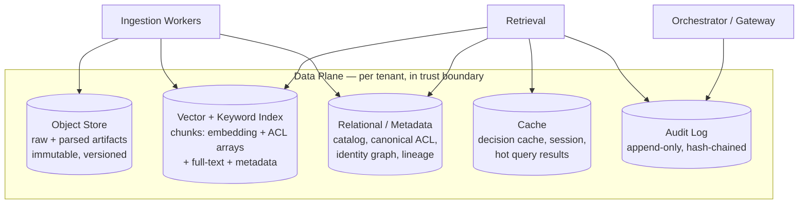

# Storage & Tenancy Architecture

> Status: **Foundational** · Owner: Data / Platform Architecture · Cycle: 5
> Implements [ADR-0010](../architecture/adr/ADR-0010-storage-topology-and-tenancy.md).
> Consumes the hard selection criteria handed down by
> [Permissions §6](../permissions/00-authorization-model.md) and
> [RAG §9](../rag/00-retrieval-pipeline.md) — this document does **not** re-open the
> authorization or retrieval design; it selects the stores that make them enforceable
> and fast, and fixes the tenancy model they run inside.

This is the **data plane** ([Overview §3.3](../architecture/01-platform-overview.md)).
Every guarantee the platform makes above it — permission-faithful retrieval, hybrid
search, immutable versioned knowledge, per-tenant isolation, auditability — is only as
true as the stores that hold the data. Cycle 3 (Permissions) and Cycle 4 (RAG) have both
handed Storage **concrete, non-negotiable requirements**; this document turns them into a
selected, sized, isolated storage topology and closes the two open questions Storage owns:
**#1 (vector store — final)** and **#5 (tenancy granularity)**.

It is the anchor for risks **R4** (cross-tenant leakage), **R5** (cost blow-up), and
**R7** (vendor lock-in at the vector layer) from [NEXT_STEPS §4](../NEXT_STEPS.md).

---

## 1. What Storage must satisfy (inputs, not choices)

These arrived as **hard requirements** from upstream cycles. They are selection criteria,
not preferences — a store that cannot meet them is disqualified regardless of other merits.

| # | Requirement | Source | Why it is non-negotiable |
|---|-------------|--------|--------------------------|
| S1 | **Efficient principal set-overlap filtering** on `allow[]`/`deny[]` arrays, applied *pre-ranking* | [Permissions §6](../permissions/00-authorization-model.md), [RAG §4.2](../rag/00-retrieval-pipeline.md) | The ACL predicate must be an index filter, not a post-filter — else restricted chunks enter ranking and leak (R1/R4). |
| S2 | **Hybrid (vector + keyword) search under ONE shared metadata filter** | [RAG §4](../rag/00-retrieval-pipeline.md) | Both engines must honor the *same* ACL predicate; filtering one but not the other leaks via the unfiltered half. |
| S3 | **Versioned upsert / delete** keyed on `resource_id` + `source_item_version` | [RAG §2.2, §3.1](../rag/00-retrieval-pipeline.md), Principle 8 | Idempotent re-ingestion, re-embed migrations, and right-to-erasure require addressable, versionable records. |
| S4 | **Per-tenant isolation by construction** (namespace/cluster), not a shared `tenant_id` column alone | [Security §5](../security/00-security-architecture.md), Principle 4 | One filtering bug must not be a cross-tenant breach (R4). |
| S5 | **In-boundary, self-hostable** with encryption at rest + BYOK for regulated tenants | [Security §6](../security/00-security-architecture.md), Principle 1 | Customer data (raw, parsed, embeddings) is private by default; no uncontrolled egress. |
| S6 | **Rich, indexed metadata payloads** (ACL arrays, labels, version, resource_id, embed model) | [Permissions §2.2](../permissions/00-authorization-model.md), [RAG §3.1](../rag/00-retrieval-pipeline.md) | The filter, the citation, the re-embed migration, and the audit trail all key off stored metadata. |
| S7 | **Append-only, tamper-evident audit store** | [Security §8](../security/00-security-architecture.md) | Non-repudiation backbone; must not share a mutable table with operational data. |

If a single store satisfied all seven for all tenant sizes, this cycle would be trivial.
None does — the design below **assigns each concern to the store that fits it** and picks a
graduation path so small tenants stay simple and large tenants scale.

---

## 2. The five stores (and why they are separate)

The data plane is **five stores with distinct consistency, access, and lifecycle needs.**
Collapsing them into one is the tempting simplification we reject (§11) — each has a
different scaling axis and a different blast radius.



| Store | Holds | Scaling axis | Consistency | Blast radius if breached |
|-------|-------|--------------|-------------|--------------------------|
| **Object** | Raw source bytes + parsed/normalized artifacts | Data volume (TB→PB) | Immutable, write-once + version | Source content of one tenant |
| **Vector + keyword** | Chunks: embedding, ACL arrays, full-text, metadata | Chunk count × QPS | Eventually consistent w/ source; versioned upsert | **Retrievable knowledge** — highest |
| **Relational / metadata** | Catalog, canonical ACL of record, identity graph, lineage, job state | Rows + write rate | Strong (transactional) | The ACL source-of-truth — critical |
| **Cache** | Permission decisions, sessions, hot results | RAM, TTL-bounded | Ephemeral, revocable | Short-lived permitted data |
| **Audit** | Append-only event trail | Append rate, retention | Immutable, hash-chained | Confidentiality of *who asked what* |

The **relational store is the source of truth for the canonical ACL and the identity
graph**; the **vector index carries a denormalized copy of the ACL** on each chunk so the
filter is a single-store predicate ([RAG §4.2](../rag/00-retrieval-pipeline.md)). §7
governs how those two are kept coherent — the one place where denormalization must not
drift.

---

## 3. Vector + keyword store — resolving open question #1 (FINAL)

[RAG §9](../rag/00-retrieval-pipeline.md) and
[ADR-0009 §6](../architecture/adr/ADR-0009-hybrid-retrieval-and-chunking.md) left a
**provisional** lean: pgvector for small tenants, graduating to a dedicated engine at
scale. Storage now **confirms and makes it the standard**, with the graduation criteria
and the abstraction that keeps it from becoming lock-in (R7).

### 3.1 Candidates scored against the hard criteria

| Candidate | S1 set-overlap | S2 hybrid (one filter) | S3 versioned upsert | S4 isolation | S5 in-boundary | Verdict |
|-----------|:--------------:|:----------------------:|:-------------------:|:------------:|:--------------:|---------|
| **pgvector (Postgres)** | ✅ `text[]` + GIN `&&` | ✅ vector + `tsvector` in one `WHERE` | ✅ transactional upsert on PK | schema/RLS + DB-per-tenant | ✅ self-host | **Default (small/mid)** |
| **Qdrant** | ✅ `should`/`match-any` on keyword payload | ⚠️ vector native; sparse via named vectors / BM42 | ✅ point upsert + payload | collection/cluster per tenant | ✅ self-host | **Graduation (scale)** |
| **Elasticsearch / OpenSearch** | ✅ `terms` filter | ✅ dense + BM25, one query | ✅ versioned doc | index/cluster per tenant | ✅ self-host | **Graduation (keyword-heavy)** |
| Milvus / Weaviate | ✅ | ⚠️ hybrid maturing | ✅ | collection/cluster | ✅ self-host | Viable alt; not default |
| Managed public vector DB | ✅ | ✅ | ✅ | tenant | ❌ egress | **Rejected** (violates S5/Principle 1) |

### 3.2 Decision

**Standard: pgvector-in-Postgres as the default vector + keyword store; graduate a tenant
to a dedicated engine (Qdrant, or Elasticsearch/OpenSearch when keyword/aggregation is
dominant) at defined thresholds.** Rationale:

- **pgvector co-locates everything the filter needs in one transactional store:** the
  embedding (`vector`), the ACL arrays (`text[]` with a GIN index for native `&&`
  set-overlap — satisfies **S1** directly), full-text (`tsvector`/`ts_rank` — the sparse
  half of **S2** in the *same* `WHERE` clause, so both halves share one filter by
  construction), and all metadata (**S6**). One store means the ACL denormalization (§2)
  is a same-transaction write with the catalog — **S7 coherence is trivial at this tier.**
- It **minimizes moving parts** for the 80% of tenants that never reach the scale where a
  dedicated ANN engine pays for itself — fewer stores to isolate, encrypt, back up, and
  keep coherent (directly serves R4/R5).
- **S3** (versioned upsert/delete) is a primary-key upsert + a `source_item_version` column;
  re-embed migrations (§8) and right-to-erasure (§9) are ordinary transactional DML.

### 3.3 Graduation criteria (when a tenant leaves pgvector)

Graduation is **per tenant**, driven by measured pressure, not by tenant class alone:

| Trigger | Threshold (indicative, tuned in [Deployment](../deployment/)) | Graduate to |
|---------|-------------------------------------------------------------|-------------|
| Chunk count | ANN recall/latency degrades vs. flat/IVF at scale (≈ 10s of millions of chunks/tenant) | Qdrant (HNSW, quantization) |
| Query QPS | p95 hybrid-search latency breaches the tenant tier's SLA under load | Dedicated engine + read replicas |
| Keyword/aggregation dominance (Finance/SAP) | BM25 + faceted filtering is the hot path | Elasticsearch/OpenSearch |
| Isolation mandate (regulated) | Tenant requires dedicated cluster, not a schema | Dedicated engine cluster (Isolated tier, §5) |

Below all thresholds, **stay on pgvector** — graduation adds a store to isolate, secure,
and keep coherent; do not pay that cost speculatively (R5).

### 3.4 The abstraction that prevents lock-in (R7)

The pipeline never talks to a specific engine. A narrow **`VectorIndex` port** exposes
exactly the operations the platform needs, and each engine has an adapter:

```
VectorIndex (port):
  upsert(tenant, [chunk{resource_id, version, embedding, allow[], deny[],
                        labels, tsv, payload}])          # S3, S6
  hybrid_search(tenant, query_vec, query_text,
                filter=CompiledPredicate, top_k) -> [hit] # S1, S2 — filter is mandatory
  delete(tenant, resource_id | source_item_version)      # S3, §9
  # NO method accepts a query without a tenant + filter — unfiltered search is unrepresentable
```

- The **`CompiledPredicate` is produced by Permissions** ([§6](../permissions/00-authorization-model.md))
  and passed opaque; the adapter translates it to pgvector `&&`, Qdrant `should`, or
  Elastic `terms`. The *pipeline* never re-expresses the ACL — **S2's "one shared filter"
  is enforced at the port**, not left to two call sites.
- **There is deliberately no "search without a filter" method.** The unsafe path is
  *unrepresentable* in the API — the strongest possible enforcement of
  filter-during-retrieval ([ADR-0004](../architecture/adr/ADR-0004-permission-faithful-retrieval.md)):
  you cannot forget the filter because there is no method that omits it.
- Lock-in is bounded to **one adapter** per engine; a tenant migration is a re-index
  through the port (§8), not a pipeline rewrite. This is the vector-layer analogue of the
  [Model Gateway](../architecture/adr/ADR-0003-model-gateway-indirection.md)'s
  vendor-independence bet — R7 mitigated by the same indirection pattern.

---

## 4. The other four stores

### 4.1 Object store (raw + parsed artifacts)
- **What:** the immutable byte record — raw source fetch (PDF, email, SAP export) **and**
  the parsed/normalized artifact the chunker consumed. Keeping both makes re-chunking and
  re-embedding possible **without re-hitting the source** (essential for §8 migrations and
  for source-outage resilience).
- **Choice:** S3-compatible object storage (MinIO in-boundary, or the sovereign cloud's
  native object store), **versioning on**, encryption at rest (§6). Access is by
  `resource_id` + version; objects are **write-once** (Principle 8) — an update is a new
  version, never an overwrite.
- **Isolation:** per-tenant bucket (Isolated) or per-tenant prefix + IAM policy (Shared).
- **Lifecycle:** tiered — hot artifacts on standard storage, cold raw originals to archival
  class by age/access (a primary **R5** cost lever; raw originals are rarely re-read once
  parsed).

### 4.2 Relational / metadata store (source of truth)
- **What:** the **catalog** (documents, items, chunk index), the **canonical ACL of
  record** and **identity graph** ([Permissions §2, §4](../permissions/00-authorization-model.md)),
  **lineage** (source→artifact→chunk→vector), classification/labels, and **job/worker
  state** ([Workers](../workers/)). This is the **strongly-consistent, transactional**
  heart — the vector index's ACL is a *denormalized copy* of what lives here.
- **Choice:** **Postgres** — and for small/mid tenants it is the *same* Postgres instance
  that hosts pgvector, so a chunk's ACL and its vector are written in **one transaction**
  (§7 coherence for free at this tier). At scale (dedicated vector engine) the metadata
  store stays Postgres and the vector engine holds a denormalized ACL kept coherent by §7's
  transactional-outbox pattern.
- **Isolation:** schema-per-tenant + row-level security (Shared), or database/instance-per-
  tenant (Isolated).

### 4.3 Cache
- **What:** the **permission decision cache** ([Permissions §8](../permissions/00-authorization-model.md),
  short revocable TTL 5–15 min), session state, and optionally hot query-result caches.
- **Choice:** Redis/Valkey in-boundary, per-tenant keyspace/prefix, encryption in transit.
- **Hard rule — the cache is not an ACL bypass:** cached results are keyed by
  `(tenant, effective-principal-set-hash, query)` so a user with different principals can
  **never** be served another user's cached answer. On a SCIM `deactivate`/group-change
  event the decision cache is **actively invalidated** ([Permissions §8](../permissions/00-authorization-model.md))
  — the cache honors query-time precedence, it does not undermine it (R3).

### 4.4 Audit store
- **What:** the append-only, hash-chained event trail ([Security §8](../security/00-security-architecture.md)):
  per request the **effective principals used**, **chunk IDs retrieved**, model + policy,
  reranker scores, and verifier verdict ([RAG §7.3](../rag/00-retrieval-pipeline.md)).
- **Choice:** **physically separate from operational data** — append-only table with no
  UPDATE/DELETE grant + periodic hash-chain checkpoint, or an append-only log store
  (e.g. object-store WORM). It **must not** share a mutable table with the catalog, or
  "append-only" is unenforceable. Retention per compliance; this is a
  [Governance](../governance/) (Cycle 7) input.
- **Isolation:** per-tenant partition/stream; cross-tenant audit access is an explicit,
  itself-audited admin operation.

---

## 5. Tenancy — resolving open question #5 (FINAL)

Open question #5: *is a "tenant" a customer, a department, or a domain?* The answer shapes
isolation tiers, cost, and the identity namespace, so it must be fixed here.

### 5.1 Definition

> **A tenant is an isolation and governance boundary — normally one customer
> organization — that owns its data, its identity namespace, its policies, and its cost
> envelope. Departments and domains are *not* tenants; they are `visibility`/ACL scopes
> and domain packs *within* a tenant.**

Rationale:
- **Identity is per-organization.** The CPI namespace is `tenant:source:type:id`
  ([Permissions §2.1](../permissions/00-authorization-model.md)); "tenant" must equal the
  scope in which a group GUID / SAP role is globally meaningful — that is the **customer
  org / directory**, not a department. Making a department a tenant would fracture one
  Entra directory across tenants and break nested-group resolution.
- **Departments are already modeled** as principals and `visibility` scopes inside the ACL
  ([Permissions §2.2, §4.3](../permissions/00-authorization-model.md)) — they need no
  storage-level boundary; the permission predicate already separates them.
- **Domains are packs** ([Vision §3–4](../architecture/00-vision-and-principles.md)), a
  content/config concern, not an isolation boundary. Finance and Legal content coexist in
  one tenant's stores and are separated by ACL + label, which is exactly what the
  permission model was built to do.

**Consequence for storage:** isolation primitives (namespace, schema, bucket, cluster) are
provisioned **per customer org**. Sub-org separation (department, domain, sensitivity
class) is handled **inside** a tenant by the ACL/label predicate and, for the highest
sensitivity, by the §5.3 Isolated-class escape hatch — never by minting a new tenant.

### 5.2 Isolation tiers (concretizing [Security §5](../security/00-security-architecture.md))

Isolation is **by construction and tiered by sensitivity** — the same two tiers Security
named, now made concrete per store:

| Concern | **Shared tier** (standard tenants) | **Isolated tier** (regulated / large / high-sensitivity) |
|---------|-----------------------------------|----------------------------------------------------------|
| Vector + keyword | Per-tenant **namespace/collection** in a shared engine; every row carries `tenant_id` **and** lives in the tenant's namespace | **Dedicated index/cluster** per tenant |
| Object | Shared bucket, **per-tenant prefix + IAM** | **Dedicated bucket** per tenant |
| Relational/metadata | **Schema-per-tenant + row-level security** | **Database/instance-per-tenant** |
| Cache | Shared cluster, per-tenant keyspace | Dedicated cache |
| Keys (§6) | Per-tenant data keys under a shared KMS | **BYOK / dedicated key hierarchy** |
| Model routing | Shared gateway, tenant policy | Dedicated model pool option ([ADR-0003](../architecture/adr/ADR-0003-model-gateway-indirection.md)) |

**Defense in depth against R4:** the Shared tier applies **both** a namespace boundary
**and** an unconditional `tenant_id` predicate. Neither is trusted alone — a namespace
mis-route *and* a filter bug would both have to occur to cross tenants. Cross-tenant access
requires an explicit, audited, admin-level operation ([Security §5](../security/00-security-architecture.md));
it is **not** expressible on the query path (the §3.4 port takes a `tenant` on every call).

### 5.3 The Isolated escape hatch is where Permissions §9 quarantine lands

When a source cannot be faithfully normalized ([Permissions §9](../permissions/00-authorization-model.md)),
its content is quarantined to a **stricter isolation tier** — concretely, in Storage terms:
a **dedicated per-user or per-class index** in the Isolated tier, physically separate from
the shared retrieval path. This document is where that doctrine gets a home: quarantine =
Isolated-tier dedicated index, provisioned like any regulated tenant but scoped to the
unmappable class.

---

## 6. Encryption, keys & BYOK

Concretizes [Security §6](../security/00-security-architecture.md) for each store.

- **At rest:** every store — object, vector, relational, cache, audit — is encrypted with
  a **per-tenant data-encryption key (DEK)** wrapped by a **key-encryption key (KEK)** in
  KMS (envelope encryption). Per-tenant DEKs mean a key compromise is tenant-scoped, and
  **crypto-erasure** (destroying a tenant's DEK) is a fast, provable deletion primitive
  (§9).
- **BYOK (Isolated tier):** regulated tenants supply/control the KEK in their own KMS/HSM;
  the platform holds only wrapped DEKs and cannot decrypt without the customer key. This is
  the strongest private-by-default posture (Principle 1) and a common Finance/HR/Legal
  procurement requirement.
- **In transit:** TLS 1.2+ / mTLS between every service and store ([Security §6](../security/00-security-architecture.md)).
- **In use:** label-driven redaction happens in context assembly / the Model Gateway
  ([RAG §6.4](../rag/00-retrieval-pipeline.md), [Permissions §7](../permissions/00-authorization-model.md))
  — not a storage concern, but storage must carry the `labels` that drive it (S6).
- **Key rotation:** KEK rotation re-wraps DEKs without re-encrypting data (cheap, routine);
  DEK rotation is a background re-encrypt, scheduled like a migration (§8).

---

## 7. Consistency & the ACL-denormalization coherence problem

The one genuine hazard the five-store split creates: the **canonical ACL lives in the
relational store (source of truth) but is denormalized onto every chunk in the vector
index** so the filter is single-store ([RAG §4.2](../rag/00-retrieval-pipeline.md)). If the
two drift, retrieval filters on a **stale ACL** — a correctness and security defect
(R3/R4), not a mere cache-miss.

**Rules that keep them coherent:**

1. **Same-transaction at the pgvector tier.** When vector + metadata share one Postgres
   instance (small/mid tenants), the chunk's vector, its ACL arrays, and the catalog row
   are written in **one transaction** — no drift window exists. This is a decisive reason
   pgvector is the *default*, not merely the cheap option.
2. **Transactional outbox at the dedicated-engine tier.** When the vector engine is
   separate (Isolated/scale), the metadata write and a vector-upsert intent are committed
   atomically to Postgres + an **outbox**; a relay applies the upsert to the vector engine
   with **at-least-once** delivery and idempotent, version-keyed upsert (S3). The vector
   index is *eventually* coherent, bounded by the freshness SLA
   ([Permissions §8](../permissions/00-authorization-model.md), open Q#7).
3. **Query-time principal precedence covers the residual gap.** Even under (2)'s small
   drift window, the *user's* live effective-principal set is resolved at query time
   ([Permissions §8](../permissions/00-authorization-model.md)) — so the highest-severity
   change (offboarding/revocation) is closed by the principal side regardless of chunk-ACL
   lag. Chunk-ACL re-tag (resource re-share) is the slower, lower-severity path, which the
   change-driven re-sync + SLA bounds.
4. **Version is the coherence key.** Every chunk carries `source_item_version`; a re-tag or
   re-embed writes a new version and the delete of the old is version-scoped (S3), so a
   partially-applied migration never leaves a chunk filterable under two ACLs.

---

## 8. Versioning & re-embed migrations (Principle 8)

Knowledge is **immutable and versioned** — updates and deletes are tracked, never silent.
Two migration classes, both blue/green:

- **Content/ACL re-ingestion.** A changed source item is re-fetched, re-parsed, re-chunked,
  and upserted under a new `source_item_version`; old chunks for that item are deleted
  version-scoped. Idempotent by `resource_id` (S3) — safe to retry (Workers backpressure,
  R8).
- **Embedding-model upgrade** ([RAG §3.1](../rag/00-retrieval-pipeline.md)). A new
  `embed_model`/`embed_dim` means a **new embedding space**. Migration re-embeds from the
  **parsed artifact in the object store** (§4.1 — no source re-hit) into a new
  space/collection; the old space stays queryable until cut-over; routing flips
  blue→green; old space is dropped after a soak. A query is **only ever** compared against
  its own model version (the `embed_model` filter is part of every search), so mixed spaces
  never silently degrade recall during the migration.

This is why the object store keeps the **parsed** artifact, not only the raw bytes:
re-embedding is the common migration and must not depend on source availability or
re-parsing cost.

---

## 9. Deletion & right-to-erasure

A source deletion (or a GDPR erasure request) must propagate to **every** derived artifact —
"no silent orphans" ([Security §6](../security/00-security-architecture.md)):

```
delete(resource_id | subject) ⇒
  object store:  delete raw + parsed versions (or tombstone if legal_hold)
  vector index:  delete all chunks (version-scoped) via the §3.4 port
  relational:    delete/anonymize catalog + lineage rows (keep lineage tombstone)
  cache:         evict by tenant + resource key
  audit:         RETAINED (append-only) — records the deletion event, not the content
```

- **Lineage tracks the erasure** so an auditor can prove *what* was deleted and *when*
  without retaining the deleted content itself.
- **`legal_hold`-labeled content is exempt** and tombstoned, not deleted, until the hold
  clears ([Permissions §2.2](../permissions/00-authorization-model.md)) — a compliance
  override, surfaced to [Governance](../governance/).
- **Crypto-erasure** (§6) is the fast path for whole-tenant offboarding: destroy the
  tenant's DEK and all five stores' ciphertext is unrecoverable, provably, at once.
- **The audit log is never erased** — it records the deletion as an event; erasure applies
  to *content*, not to the non-repudiation trail (a standard, defensible GDPR balance,
  ratified in Governance).

---

## 10. Cost model & scaling (R5)

Storage is a top cost driver at 10× data/tenants; the levers, by store:

| Store | Dominant cost | Primary lever |
|-------|---------------|---------------|
| Vector + keyword | RAM/compute for ANN index | **Quantization** (Qdrant scalar/PQ), IVF/HNSW tuning, stay on pgvector below graduation (§3.3) |
| Object | Raw + parsed bytes | **Tiering** raw originals to archival class (§4.1); parsed artifacts hot |
| Relational | Rows + write IOPS | Partition by tenant/time; archive cold lineage |
| Cache | RAM | Short TTLs (already required for freshness); bounded working set |
| Audit | Append volume × retention | Compress + tier to WORM object storage by age |

- **Isolation ↔ cost is the central tension** (Principle 4 trade-off): dedicated
  clusters/buckets/keys (Isolated) cost more than namespaces/prefixes (Shared). The tier
  model (§5.2) makes this a **per-tenant, priced decision** — regulated tenants pay for
  their blast-radius reduction; standard tenants share and stay cheap. This is the concrete
  answer to [Overview §7](../architecture/01-platform-overview.md)'s deferred cost trade-off.
- Per-tenant cost attribution (which tenant drives which storage spend) is an audit/metering
  concern handed to [Governance](../governance/) (Cycle 7, R5 budget model).

---

## 11. Trade-offs

- **Five stores vs. one.** More surfaces to isolate, encrypt, back up, and keep coherent
  (§7) — bought because each has a different scaling axis, consistency need, and blast
  radius; one store for all would scale to the weakest and breach to the widest. (§2.)
- **pgvector default vs. dedicated-engine-first.** We start simple and graduate on measured
  pressure (§3.3), accepting a future migration for the 80% of tenants that never need one —
  rather than paying dedicated-engine operational cost for everyone up front. The §3.4 port
  makes the graduation a re-index, not a rewrite. (§3.)
- **ACL denormalization vs. join-at-query.** Copying the ACL onto every chunk creates the
  coherence hazard (§7) but is the *only* way the filter is a single-store index predicate
  ([RAG §4.2](../rag/00-retrieval-pipeline.md)); a query-time join to the relational ACL
  would reintroduce the per-candidate lookup normalization was chosen to avoid. We pay §7's
  coherence discipline to keep safety a `WHERE`. (§2, §7.)
- **Isolation by construction vs. cost.** Dedicated per-tenant infrastructure (Isolated)
  shrinks the R4 blast radius at real cost; namespaces (Shared) are cheap but rely on two
  independent controls. The tier lets each tenant buy the isolation it needs. (§5.2, §10.)
- **BYOK vs. operability.** Customer-held keys are the strongest privacy posture but add
  key-availability as a dependency (customer KMS down → tenant unreadable). Offered to
  Isolated-tier tenants who require it, not defaulted. (§6.)

## 12. Alternatives considered

| Alternative | Verdict |
|-------------|---------|
| **One store for everything** (e.g. Postgres for vectors + objects + audit + cache) | Rejected: forces the weakest scaling axis on all data; append-only audit can't share a mutable table; object bytes bloat the relational store. pgvector *does* co-locate vector+relational+keyword at small scale (§3.2) — but object, cache, and audit stay separate. |
| **Dedicated vector engine for all tenants from day one** | Rejected as default: operational + cost overhead for the majority that never reach graduation thresholds (R5); reserved for scale/regulated tenants (§3.3). |
| **Managed public vector DB / object store** | Rejected: violates S5/Principle 1 (data egress) for Finance/HR/Legal/Audit. |
| **Query-time join to the relational ACL (no denormalization)** | Rejected: reintroduces per-candidate ACL lookup on the hot path; the whole point of normalization ([ADR-0008](../architecture/adr/ADR-0008-canonical-principal-acl-model.md)) is that the filter is a single index predicate. |
| **`tenant_id` column as the only tenant boundary** | Rejected ([Security §5](../security/00-security-architecture.md)): one filter bug = cross-tenant leak; we add a namespace/cluster boundary as a second, independent control (§5.2, R4). |
| **Tenant = department/domain** | Rejected (§5.1): fractures the identity namespace and nested-group resolution; departments/domains are ACL scopes and packs *within* a tenant. |
| **Shared KMS key for all tenants** | Rejected: a key compromise would be platform-wide; per-tenant DEKs scope the blast radius and enable crypto-erasure (§6, §9). |

## 13. Future scalability

- **New tenant** = provision a namespace (Shared) or a cluster + bucket + key hierarchy
  (Isolated) from a template; no code change ([Overview §9](../architecture/01-platform-overview.md)).
- **10× data / QPS for one tenant** = graduate that tenant across the §3.4 port
  (pgvector → Qdrant/Elastic) + object tiering + relational partitioning + read replicas;
  the pipeline contract is unchanged ([RAG §12](../rag/00-retrieval-pipeline.md)).
- **New vector engine on the market** = one new `VectorIndex` adapter; tenants migrate by
  re-index, never by pipeline change (R7 — §3.4).
- **New embedding model** = versioned re-embed migration from the parsed artifact, blue/green
  (§8); old space queryable until cut.
- **New compliance regime** (data residency, stricter erasure) = per-tenant key + region +
  retention policy, expressed as tenant config consumed by [Governance](../governance/) —
  not a storage redesign.
- **Divergent domain needing its own vector space** ([RAG §3.2](../rag/00-retrieval-pipeline.md))
  = a named collection/namespace within the tenant, selected by routing metadata; isolation
  and the filter operate per-space unchanged.

## Related

- [Permissions §2.2, §6, §8, §9 — the ACL shape, the retrieval filter, freshness, quarantine](../permissions/00-authorization-model.md)
- [RAG §3.1, §4.2, §9 — embedding versioning, the shared filter, the vector-store requirements](../rag/00-retrieval-pipeline.md)
- [Security §5, §6, §8 — isolation tiers, encryption/BYOK, audit](../security/00-security-architecture.md)
- [ADR-0010 — Storage topology & tenancy (this doc's decision)](../architecture/adr/ADR-0010-storage-topology-and-tenancy.md)
- [ADR-0009 — hybrid retrieval (whose provisional vector-store lean this confirms)](../architecture/adr/ADR-0009-hybrid-retrieval-and-chunking.md)
- [ADR-0004 — permission-faithful retrieval (enforced at the §3.4 port by construction)](../architecture/adr/ADR-0004-permission-faithful-retrieval.md)
- Downstream: [Workers](../workers/) (re-sync + re-embed jobs, outbox relay),
  [Governance](../governance/) (retention, cost/metering, erasure ratification),
  [Deployment](../deployment/) (per-tier topology, graduation thresholds, DR/backup),
  [Metadata](../metadata/) (catalog + lineage schema this store holds)
