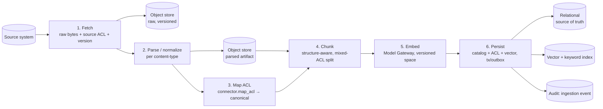
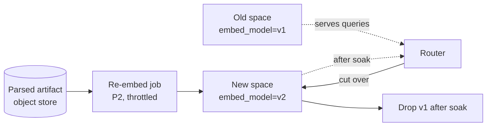

# Ingestion Workers & Job Orchestration

> Status: **Foundational** · Owner: Platform / Data Engineering · Cycle: 6
> Implements [ADR-0011](../architecture/adr/ADR-0011-ingestion-workers-and-connector-framework.md).
> Consumes the write-side contract fixed by [Storage §7–§9](../storage/00-storage-architecture.md)
> (versioned upsert, ACL-denormalization coherence, re-embed migration, erasure), the
> chunking/embedding rules from [RAG §2–§3](../rag/00-retrieval-pipeline.md), and the
> connector obligations from [Permissions §5, §8, §11](../permissions/00-authorization-model.md).
> This document does **not** re-open storage topology, retrieval, or the authorization
> model — it specifies the **moving machinery** that keeps the data plane fresh, coherent,
> and permission-faithful over time.

This is the **ingestion plane** ([Overview §3.2](../architecture/01-platform-overview.md)) —
the last major un-designed subsystem before the platform's write path is fully specified.
Everything the query plane guarantees (permission-faithful, hybrid, versioned, fresh
retrieval) is only as true as the workers that *populate and maintain* the stores behind
it. Cycles 3–5 fixed **what must be true of the data at rest**; this cycle fixes **how the
data gets and stays that way** — under source-API failure, permission churn, embedding-model
upgrades, and 10× load.

It is the anchor for risk **R8** (ingestion backlog starves freshness) and co-owns
**R3** (stale permissions — the *re-sync* half), **R6** (connector fragility), and the
**coherence bound** handed down by [Storage §7](../storage/00-storage-architecture.md).
The **connector-facing** contract — `map_acl`, `list_principal_changes`, the conformance
suite, per-source change detection — lives in its companion,
[01-connector-framework.md](01-connector-framework.md).

---

## 1. What the ingestion plane must satisfy (inputs, not choices)

These arrived as **hard requirements** from upstream cycles. A worker design that cannot
meet them is disqualified regardless of throughput.

| # | Requirement | Source | Why it is non-negotiable |
|---|-------------|--------|--------------------------|
| W1 | **Idempotent, version-keyed writes** — re-processing an item must not duplicate or corrupt chunks | [Storage §3, §8](../storage/00-storage-architecture.md) (S3), Principle 8 | Retries, replays, and at-least-once delivery are unavoidable; the write must converge to one state. |
| W2 | **ACL-denormalization coherence within the freshness bound** — the chunk ACL in the vector index must track the canonical ACL in the relational store | [Storage §7](../storage/00-storage-architecture.md) | Drift = retrieval filters on a stale ACL = leak (R3/R4). Workers own the relay that closes this at the dedicated-engine tier. |
| W3 | **Change-driven re-sync of content *and* permissions** within the freshness SLA | [Permissions §8](../permissions/00-authorization-model.md) (R3), open Q#7 | An index that serves an ingestion-time snapshot leaks to a user who just lost access. |
| W4 | **Re-embed migration from the parsed object artifact — no source re-hit** | [Storage §8](../storage/00-storage-architecture.md), [RAG §3.1](../rag/00-retrieval-pipeline.md) | Embedding-model upgrades must be routine and source-independent. |
| W5 | **The mixed-ACL chunk invariant is enforced at write time** | [RAG §2.2](../rag/00-retrieval-pipeline.md) | A chunk spanning two ACLs is unfilterable — a defect the pipeline must make impossible, not merely rare. |
| W6 | **Least-privilege, per-tenant, in-boundary execution** | [Security §5](../security/00-security-architecture.md), Principle 1, `core/workers.py` | A worker holds source credentials and writes the ACL of record; a compromised worker must not cross tenants or exceed its scoped tools. |
| W7 | **Backpressure & prioritization** — a backlog must degrade gracefully, not silently starve freshness | R8 | Bulk backfill must never block a high-value permission-revocation re-sync. |

The rest of this document turns these into a pipeline shape (§2), a queue and scaling
model (§3–§4), the coherence relay (§5), the migration and re-sync jobs (§6–§7), the
failure/DLQ model (§8), the security posture (§9), and the observability that proves the
SLA is met (§10).

---

## 2. The ingestion pipeline as a staged DAG

Ingestion is **not one job** — it is a directed pipeline of small, independently
retryable, independently scalable stages. Each stage reads a durable artifact and writes a
durable artifact, so a failure resumes from the last completed stage, never from the
source.



| Stage | Reads | Produces | Owner / rules |
|-------|-------|----------|---------------|
| **1. Fetch** | Source API | Raw bytes → object store (versioned); the item's **source ACL** + `source_item_version` | Connector ([framework §2](01-connector-framework.md)); least-privilege source creds (§9). Never overwrites — a change is a new version (Principle 8). |
| **2. Parse / normalize** | Raw artifact | Parsed/normalized artifact → object store ([Storage §4.1](../storage/00-storage-architecture.md)) | Per-content-type parser (PDF/OCR layout, SAP table serialization, email MIME). The artifact re-embed reads (W4). |
| **3. Map ACL** | Source item metadata | Canonical `{allow[], deny[], labels, acl_confidence}` ([Permissions §2.2](../permissions/00-authorization-model.md)) | `connector.map_acl`. Below-`exact` confidence ⇒ quarantine routing (§7.3, [Permissions §9](../permissions/00-authorization-model.md)). |
| **4. Chunk** | Parsed artifact + canonical ACL | Chunks, each carrying `resource_id`, `source_item_version`, ACL, labels ([RAG §2](../rag/00-retrieval-pipeline.md)) | **Enforces W5**: a chunk never spans two ACLs — the boundary splits first. |
| **5. Embed** | Chunk text (domain-normalized) | Vector + `embed_model`/`embed_dim` ([RAG §3](../rag/00-retrieval-pipeline.md)) | Via the [Model Gateway](../architecture/adr/ADR-0003-model-gateway-indirection.md) (in-boundary; embeddings never egress). Batched (§4.3). |
| **6. Persist** | Chunk + vector + ACL + catalog row | Committed write to relational + vector index; **ingestion audit event** | **W1 idempotent, version-keyed**; coherence via §5 (same-tx at pgvector tier / outbox at dedicated tier). |

### 2.1 Why a DAG of durable stages, not one procedure

- **Resumability without re-hitting the source.** Parse/chunk/embed all read a stored
  artifact, so a crash in stage 5 replays from the parsed object — the expensive, rude, and
  sometimes rate-limited source fetch (stage 1) happens **once** per version. This is the
  same reason [Storage §8](../storage/00-storage-architecture.md) keeps the *parsed*
  artifact, not only raw bytes.
- **Independent scaling.** Embedding is GPU-bound; parsing OCR is CPU-bound; fetch is
  IO/rate-limit-bound. Separate stages get separate worker pools and separate concurrency
  caps (§4), so the slow stage does not pin the fast one.
- **Independent retry semantics.** A transient source 429 retries stage 1 with backoff; a
  malformed PDF dead-letters stage 2 without failing the whole item's already-fetched bytes.

### 2.2 Two triggers into the same pipeline

The DAG is entered by two paths, and **both converge on the same idempotent stages 4–6**:

1. **Bulk / scheduled backfill** — initial onboarding of a source, or a periodic full
   reconciliation crawl. High volume, **low priority** (§4.2).
2. **Change-driven delta** — a source webhook / change-feed event ([framework §4](01-connector-framework.md))
   enqueues only the changed item. Low volume, **high priority** — this is the path that
   meets the freshness SLA (W3).

There is deliberately **one** write path (stages 4–6); a delta and a backfill of the same
item converge to the same version-keyed state (W1), so a race between them cannot corrupt a
chunk — the higher `source_item_version` wins, the lower is a no-op.

---

## 3. Queue & work-unit design

### 3.1 The work unit

The atomic unit is an **`IngestionTask`**, not a document — one task = one item at one
stage for one tenant:

```
IngestionTask:
  tenant_id            # W6 — every task is tenant-scoped; a worker never spans tenants
  source               # sharepoint | sap | exchange | fileshare | ...
  resource_id          # source:item:...  (stable, addressable)
  source_item_version  # the version this task processes (idempotency key, W1)
  stage                # fetch | parse | map_acl | chunk | embed | persist
  priority             # revoke > delta > backfill   (§4.2)
  attempt              # retry counter → backoff + DLQ threshold (§8)
  trace_id             # correlates all stages of one item across the audit log (§10)
```

Keying on `(tenant, resource_id, source_item_version, stage)` makes a task **naturally
idempotent**: enqueuing the same task twice is a no-op if the target version is already
persisted. This is the queue-level expression of W1.

### 3.2 Queue choice and the ordering it must (and must not) provide

- **Choice:** a durable, at-least-once broker with per-key ordering and a dead-letter
  facility — e.g. Redis Streams / Postgres-backed queue for small tenants (reuse the
  existing store; fewer surfaces per [Storage §11](../storage/00-storage-architecture.md)),
  graduating to Kafka/NATS/SQS at scale. The broker sits behind a narrow **`TaskQueue`
  port** (`enqueue`, `lease`, `ack`, `nack→retry|dlq`, `list_dlq`) — the same
  lock-in-bounding indirection [Storage §3.4](../storage/00-storage-architecture.md) uses
  for the vector layer.
- **At-least-once, never exactly-once.** We assume duplicate delivery and make the *write*
  idempotent (W1) rather than paying for exactly-once semantics the broker cannot honestly
  guarantee. This is the load-bearing reason stages 4–6 are version-keyed.
- **Per-`resource_id` ordering only.** Two versions of the *same* item must apply in order
  (else an older ACL could overwrite a newer one — a leak). Ordering *across* items is
  unnecessary and would kill parallelism. The broker partitions by `resource_id` hash:
  same item → same partition → ordered; different items → parallel.

### 3.3 Isolation of the queue itself (W6)

The queue is tenant-partitioned (namespace/stream per tenant, [Storage §5.2](../storage/00-storage-architecture.md)
Shared tier; dedicated broker for Isolated tenants). A task carries its `tenant_id` and a
worker leases only tasks for tenants it is provisioned for — a poisoned or mis-routed task
cannot cause a worker to fetch or write another tenant's data.

---

## 4. Worker pools, scaling & prioritization (R8)

### 4.1 Per-stage worker pools

Each stage runs as an autoscaling pool of stateless workers built on the existing
least-privilege **`WorkerRegistry`** (`core/workers.py`, [ADR-0005](../architecture/adr/ADR-0005-template-consolidation-council.md)):
each worker declares the minimum tool/credential scope for its stage (fetch workers hold
source read creds; embed workers hold only a Model Gateway token; persist workers hold
store write creds — **no worker holds all three**, §9). Stateless workers scale
horizontally on queue depth and lag; state lives in the durable stores, never in the
worker.

### 4.2 Priority: freshness beats bulk, always (R8 core)

A single FIFO queue lets a million-item backfill starve a one-item permission revocation —
the exact R8 failure. We use **strict priority classes with fairness guards**:

| Class | Examples | SLA target ([Permissions §8](../permissions/00-authorization-model.md), open Q#7) |
|-------|----------|-----------------------------------------------------------------------------------|
| **P0 — Revocation / security** | Principal offboarded, item newly restricted, deny added, quarantine | Principal changes **≤ 5 min**; restricted-resource ACL **≤ 15 min** |
| **P1 — Content delta** | Item created/edited/re-shared (widening or neutral) | Restricted content ≤ 15 min; public best-effort |
| **P2 — Backfill / re-embed / reconciliation** | Initial crawl, model-upgrade re-embed, periodic full sync | Best-effort, throttled |

- **P0 preempts.** Revocation is the highest-severity leak vector ([Permissions §8](../permissions/00-authorization-model.md)),
  so its tasks jump the queue and get reserved capacity. Note the **defense-in-depth**: even
  if a P0 chunk-ACL re-tag is delayed, query-time principal precedence
  ([Storage §7 rule 3](../storage/00-storage-architecture.md)) already closes the
  offboarding case — the P0 re-tag is the belt to that suspenders.
- **Fairness guard.** A minimum share of worker capacity is reserved for P1 so a pathological
  P0 storm cannot indefinitely stall content freshness; backfill (P2) yields to both but is
  guaranteed forward progress via a small floor (no starvation *of* backfill either).
- **Per-tenant fairness.** Within a class, a weighted-fair scheduler prevents one tenant's
  bulk onboarding from starving another tenant's deltas (noisy-neighbor control, complements
  [Storage §5.2](../storage/00-storage-architecture.md) isolation).

### 4.3 Batching the expensive stage

Embedding (stage 5) dominates cost and has high per-call fixed overhead. Workers **batch**
chunks (respecting per-tenant space + `embed_model`) into one Model Gateway call, trading a
little latency for large throughput/cost gains (an R5 lever, coordinated with the
[Governance](../governance/) budget model). Batching never crosses tenants or embedding
spaces — a batch is `(tenant, embed_model)`-homogeneous.

### 4.4 Backpressure

When a downstream stage saturates (embedding GPU pool at capacity, vector store write
throttled), the broker's bounded in-flight lease count applies **natural backpressure** —
upstream stages slow because their output queue is full rather than overrunning memory.
Fetch workers additionally honor each source's rate limit (§8.2), so the platform never
becomes the reason a customer's SharePoint throttles. Sustained backpressure raises a
**lag alarm** (§10) long before it becomes a silent SLA breach — R8 is made *observable*,
not just survivable.

---

## 5. The ACL-denormalization coherence relay (W2, from Storage §7)

[Storage §7](../storage/00-storage-architecture.md) fixed the coherence *contract*; Workers
**owns the mechanism**. The hazard: the canonical ACL lives in the relational store, but a
denormalized copy rides on every chunk in the vector index so the filter is single-store.
If they drift, retrieval filters on a stale ACL.

**At the pgvector tier (default, small/mid tenants):** there is *no relay* — the catalog
row, the ACL arrays, and the vector are written in **one Postgres transaction** (stage 6).
Coherence is free; this is a decisive reason pgvector is the default
([Storage §3.2](../storage/00-storage-architecture.md)).

**At the dedicated-engine tier (Isolated / scale):** the vector engine is a separate system
that cannot join the relational transaction. We use the **transactional outbox**:

```mermaid
sequenceDiagram
  participant W as Persist worker
  participant PG as Postgres (relational, tx)
  participant OB as Outbox table (same tx)
  participant RL as Outbox relay
  participant VE as Vector engine (Qdrant/Elastic)
  W->>PG: BEGIN; upsert catalog + canonical ACL
  W->>OB: insert vector-upsert intent (same tx)
  W->>PG: COMMIT
  Note over PG,OB: relational write + intent are atomic — no lost intent
  RL->>OB: poll unrelayed intents (ordered per resource_id)
  RL->>VE: idempotent, version-keyed upsert (W1)
  VE-->>RL: ack
  RL->>OB: mark relayed
```

Rules the relay must honor (these are the §5 acceptance criteria):

1. **Atomic capture.** The intent is committed in the *same* transaction as the relational
   write. If the transaction rolls back, no intent exists → no phantom vector write.
2. **At-least-once, idempotent apply.** The relay may deliver twice; the version-keyed
   upsert (W1) makes the second a no-op. It **never** claims exactly-once.
3. **Per-`resource_id` order preserved** (§3.2), so a newer ACL never loses to a replayed
   older one.
4. **Bounded lag = the freshness SLA.** Relay lag is a first-class metric (§10); breaching
   the P0/P1 bound (§4.2) is an alarm, because a slow relay *is* a stale-permission window
   (R3). This is the concrete answer to [Storage §7 rule 2](../storage/00-storage-architecture.md)'s
   "bounded by the freshness SLA."
5. **Residual gap covered by query-time precedence.** Within the (small) relay window, the
   *user's* live principal set already closes revocation ([Storage §7 rule 3](../storage/00-storage-architecture.md));
   the relay closes the slower resource-re-tag case.

---

## 6. Re-embed migrations (W4, from Storage §8)

An embedding-model upgrade means a **new embedding space** ([RAG §3.1](../rag/00-retrieval-pipeline.md)).
The migration is a **blue/green, P2 background job that reads the parsed artifact from the
object store — never the source**:



- **Source-independent** (W4): re-embedding reads stage-2's parsed artifact, so a model
  upgrade does not re-crawl (no source load, no rate-limit exposure, works even if the source
  is offline or decommissioned).
- **Blue/green, never in-place.** The old space stays queryable; every search carries an
  `embed_model` filter ([Storage §8](../storage/00-storage-architecture.md)), so a query is
  only ever compared within one space — mixed spaces never silently degrade recall
  mid-migration.
- **ACL is re-carried, not re-derived.** The re-embed copies the *current* canonical ACL
  onto the new-space chunk (a relational read), so the migration cannot resurrect a stale
  ACL. It is version-keyed and idempotent (W1) — safe to pause/resume/retry under
  backpressure.
- **Throttled (P2)** so a fleet-wide re-embed never starves P0/P1 freshness (§4.2).

The same job shape serves **re-chunking** (chunking-rule change) — also from the parsed
artifact, also blue/green — since both are "re-derive chunks/vectors from the stored
artifact under a new rule, version-keyed."

---

## 7. Change detection & re-sync jobs (W3 — the R3 write half)

Freshness ([Permissions §8](../permissions/00-authorization-model.md)) has two write-side
jobs, both connector-fed ([framework §4](01-connector-framework.md)):

### 7.1 Content & resource-ACL re-sync (P0/P1)

A source change signal (Graph webhook, SAP change-doc, file-system audit) enqueues a
**delta task** for the changed item. It runs the ordinary DAG (stages 1–6) but for one
item, at P0 (if the change *restricts*: deny added, item newly restricted, sharing revoked)
or P1 (widening/neutral edit). Version-keyed upsert replaces the item's chunks; the old
version is deleted version-scoped ([Storage §8](../storage/00-storage-architecture.md)) —
no orphan, no double-ACL chunk.

### 7.2 Principal-change re-sync (P0)

`connector.list_principal_changes(since)` ([Permissions §5.5](../permissions/00-authorization-model.md))
and SCIM/directory deltas feed the **identity graph** in the relational store, *not* the
chunks — a group-membership change updates one graph, not a million chunk ACLs. This is why
[Permissions §8](../permissions/00-authorization-model.md) anchors freshness on the *user's*
live principal set: the cheap, high-value P0 path is a small graph update + active decision-
cache invalidation ([Storage §4.3](../storage/00-storage-architecture.md)), not a re-tag
storm.

### 7.3 Quarantine routing (R1 write-side)

When stage 3 yields `acl_confidence < exact` ([Permissions §9](../permissions/00-authorization-model.md)),
the persist stage routes those chunks to the **Isolated-tier quarantine index**
([Storage §5.3](../storage/00-storage-architecture.md)), never the shared retrieval path. A
worker **may not** promote confidence to make an item ingestible — that is the single change
most likely to leak, and it is blocked by the conformance gate ([framework §5](01-connector-framework.md)).

### 7.4 Reconciliation crawl (P2 safety net)

Webhooks are lossy (missed events, replays, source outages). A periodic **full reconciliation
crawl** compares source `version`/`etag` against the catalog and enqueues deltas for any
divergence — the backstop that guarantees eventual convergence even when the change feed
drops events (R6). Low priority, throttled, idempotent (W1).

---

## 8. Failure model, retries & the dead-letter queue

Ingestion touches flaky sources, large binaries, and rate limits — failure is the normal
case, not the exception. The design makes failure **contained, observable, and recoverable**.

### 8.1 Retry with backoff, then dead-letter

- **Transient** (source 5xx/429, network, store timeout): retry with exponential backoff +
  jitter, capped attempts. Because every stage resumes from a durable artifact, a retry
  re-runs one stage, not the whole item.
- **Permanent** (malformed artifact, parser crash, `map_acl` schema violation): after the
  attempt cap, the task moves to a **per-tenant Dead-Letter Queue** with full context
  (`resource_id`, version, stage, last error, trace_id). The item's *other* versions and the
  rest of the tenant's ingestion are unaffected — one poison item never stalls the pipeline.

### 8.2 Source rate-limit citizenship

Fetch workers hold a per-source token-bucket honoring the source's published limits and its
`Retry-After`. The platform is a **polite client** — it never becomes the reason a customer's
SharePoint/SAP throttles production users. This bounds fetch concurrency independently of how
many workers are scaled up.

### 8.3 The safety-critical asymmetry

A failure to **ingest** an item degrades *recall* (an answer is missing) — recoverable, and
never a leak. A failure to **re-sync a revocation** degrades *safety* (a leak). Therefore
**P0 re-sync failures alarm louder and retry more aggressively than content-ingest
failures**, and the DLQ for P0 tasks is a paged, not a batched, alert. When forced to choose
under load, the platform **drops recall before it drops a revocation** — the same
fail-closed doctrine as [ADR-0006](../architecture/adr/ADR-0006-fail-closed-autonomy-default.md)
and [ADR-0004](../architecture/adr/ADR-0004-permission-faithful-retrieval.md), applied to
the write path.

### 8.4 Poison-pill isolation

A single item that reliably crashes a parser (stage 2) is dead-lettered after N attempts and
never re-blocks its partition. The partition (per `resource_id` hash, §3.2) means one poison
item stalls at most its own key's ordering, not the tenant's whole feed.

---

## 9. Security posture of the ingestion plane (W6)

Workers are the platform's **most privileged** component: they hold source credentials and
they write the **ACL of record**. Their compromise is the worst case, so:

- **Least privilege per stage** ([ADR-0005](../architecture/adr/ADR-0005-template-consolidation-council.md)
  `WorkerRegistry`): the credential to *read a source* and the credential to *write the
  vector store* live in **different worker pools**. No single worker identity can both
  exfiltrate a source and rewrite an ACL.
- **Per-tenant credential scoping** ([Security §5](../security/00-security-architecture.md)):
  a worker leases tasks only for tenants it is provisioned for; source tokens are per-tenant,
  fetched from the secret manager at task time, never baked into an image
  ([Security §7](../security/00-security-architecture.md) secrets management, Principle 1).
- **In-boundary embedding**: chunk text and vectors are derived customer data and go only to
  the in-boundary [Model Gateway](../architecture/adr/ADR-0003-model-gateway-indirection.md) —
  never to an external embedding API (Principle 1).
- **Every write is audited**: stage 6 emits an append-only ingestion event (item, version,
  ACL confidence, worker identity, trace_id) to the [audit store](../storage/00-storage-architecture.md)
  — the write-side complement to RAG's read-side audit ([RAG §7.3](../rag/00-retrieval-pipeline.md)).
  Who ingested what, with what ACL, when, is non-repudiable.
- **The worker cannot widen access.** A worker persists the ACL `map_acl` produced; it has
  no path to mark an item `public` or promote `acl_confidence`. Access-widening is a source
  decision faithfully mirrored, never a worker decision.

---

## 10. Observability & SLA enforcement (makes R8 & R3 measurable)

The freshness SLA (open Q#7) is a **promise**; these metrics are how it is kept and proven:

| Metric | Meaning | Alarms when |
|--------|---------|-------------|
| **Queue lag per class** | Oldest un-leased P0/P1/P2 task age | P0 > 5 min or P1 > 15 min → SLA-breach alarm (R8) |
| **Outbox relay lag** (§5) | Time from relational commit to vector-engine apply | Exceeds the freshness bound → stale-ACL risk (R3) |
| **Re-sync latency** | Source-change signal → index reflects it | Exceeds SLA per class (the ratified Q#7 number) |
| **DLQ depth per tenant/source** | Items failing permanently | Non-zero P0 DLQ pages immediately (§8.3) |
| **Reconciliation drift** (§7.4) | Items where source version ≠ catalog | Rising drift ⇒ webhook loss (R6) |
| **Conformance-canary status** | Periodic permission-conformance run per source ([framework §5](01-connector-framework.md)) | Any failure quarantines the source (R1/R6) |

Every task carries a `trace_id` correlating all six stages plus the persist audit event, so
one item's journey — and where it stalled — is reconstructable end to end. **The SLA is not
asserted; it is continuously measured, and a breach is an alarm, not a surprise.**

---

## 11. Trade-offs

- **Staged DAG vs. one procedure.** More moving parts (six stages, per-stage pools, a queue)
  bought for resumability without source re-hit, independent scaling of the GPU-bound stage,
  and contained failure. A monolithic ingest job is simpler but re-crawls on any failure and
  scales to its slowest stage. (§2.)
- **At-least-once + idempotent write vs. exactly-once.** We refuse to depend on
  exactly-once delivery (which brokers rarely honestly provide) and instead make the write
  version-keyed (W1). Cost: every write path must be idempotent; benefit: replays and outbox
  double-delivery are harmless. (§3.2, §5.)
- **Strict priority vs. FIFO simplicity.** Priority classes + fairness guards are more
  complex than one queue, but a FIFO backlog starving a revocation is the R8 failure we
  exist to prevent. (§4.2.)
- **Outbox coherence discipline vs. pgvector simplicity.** The dedicated-engine tier pays
  the outbox-relay tax; the pgvector tier pays nothing (same-tx). This is the operational
  cost of the [Storage §3.3](../storage/00-storage-architecture.md) graduation, made
  explicit here. (§5.)
- **Reconciliation crawl cost vs. missed-event risk.** A periodic full crawl costs source
  load and compute but is the only guarantee of eventual convergence when webhooks drop
  events. Throttled P2 keeps the cost bounded. (§7.4.)
- **Recall-vs-safety asymmetry.** Under load we drop recall before a revocation (§8.3) —
  correct, but it means a saturated ingestion plane can leave content *un-searchable* longer
  than it leaves it *stale-permissioned*. That is the intended, fail-closed bias.

## 12. Alternatives considered

| Alternative | Verdict |
|-------------|---------|
| **Monolithic ingest job** (fetch→…→persist in one unit, retry whole item) | Rejected: any failure re-hits the source; scales to the slowest stage; poison item stalls everything. (§2.1) |
| **Exactly-once queue semantics** | Rejected: brokers can't honestly guarantee it across a heterogeneous write (relational + vector + object); idempotent version-keyed writes achieve the same *effect* cheaper. (§3.2) |
| **Single FIFO queue** | Rejected: a bulk backfill starves a revocation re-sync — the R8 failure. Priority classes + fairness guards instead. (§4.2) |
| **Dual-write to relational + vector (no outbox)** at the dedicated tier | Rejected: a crash between the two writes leaves a permanent stale-ACL chunk (R3/R4); the outbox makes the intent atomic with the relational commit. (§5) |
| **Re-embed by re-crawling the source** | Rejected: needless source load + rate-limit exposure + fails if source is offline; the parsed artifact exists precisely to avoid this. (§6, [Storage §8](../storage/00-storage-architecture.md)) |
| **Poll-only change detection (no webhooks)** | Rejected as the *primary* path: polling can't meet a 5-min P0 SLA at scale; webhooks primary, reconciliation crawl as the lossy-feed backstop. (§7.1, §7.4) |
| **One worker identity with all credentials** | Rejected: a compromised worker could both exfiltrate a source and rewrite ACLs; per-stage least privilege splits the two. (§9) |

## 13. Future scalability

- **New source** = a new connector ([framework §2](01-connector-framework.md)); the DAG,
  queue, priority, and coherence machinery are unchanged. "New domain = pack, not redesign"
  applied to ingestion.
- **10× ingest volume** = scale per-stage worker pools independently on queue lag; the
  bottleneck stage (usually embedding) gets more GPU workers without touching the others.
- **New embedding model** = a P2 re-embed migration (§6) from the parsed artifact,
  blue/green; no source involvement, no pipeline change.
- **Tenant graduates to a dedicated vector engine** ([Storage §3.3](../storage/00-storage-architecture.md))
  = the persist stage switches from same-tx to the outbox relay (§5) for that tenant; the
  `VectorIndex` port ([Storage §3.4](../storage/00-storage-architecture.md)) means the write
  shape is otherwise unchanged.
- **Tighter freshness SLA** = raise P0 reserved capacity and relay poll frequency (a
  Deployment/cost tuning), not a redesign — the priority + outbox model already expresses it.
- **New content type** (e.g. audio transcripts, CAD) = a new stage-2 parser + stage-4
  chunking rule; stages 5–6 and everything downstream are unchanged.

## Related

- [Connector Framework §2–§5](01-connector-framework.md) — the per-source contract, change
  detection, versioning, and the conformance gate this plane runs.
- [Storage §7 — coherence](../storage/00-storage-architecture.md), [§8 — re-embed migration](../storage/00-storage-architecture.md),
  [§9 — erasure propagation](../storage/00-storage-architecture.md) (the write-side contract Workers implements).
- [Permissions §5 — map_acl / list_principal_changes](../permissions/00-authorization-model.md),
  [§8 — freshness/SLA](../permissions/00-authorization-model.md),
  [§9 — quarantine](../permissions/00-authorization-model.md),
  [§11 — conformance suite](../permissions/00-authorization-model.md).
- [RAG §2 — chunking](../rag/00-retrieval-pipeline.md), [§3 — embedding versioning](../rag/00-retrieval-pipeline.md)
  (the ingestion-side rules this plane executes).
- [Security §5 — isolation](../security/00-security-architecture.md), [§8 — audit](../security/00-security-architecture.md).
- [ADR-0011 — Ingestion workers & connector framework](../architecture/adr/ADR-0011-ingestion-workers-and-connector-framework.md) (this cycle's decision).
- Downstream: [Governance](../governance/) (freshness-SLA ratification, per-tenant ingest
  cost, DLQ policy), [Deployment](../deployment/) (worker topology, autoscaling, broker
  choice per tier), [Metadata](../metadata/) (lineage emitted by stage 6).
